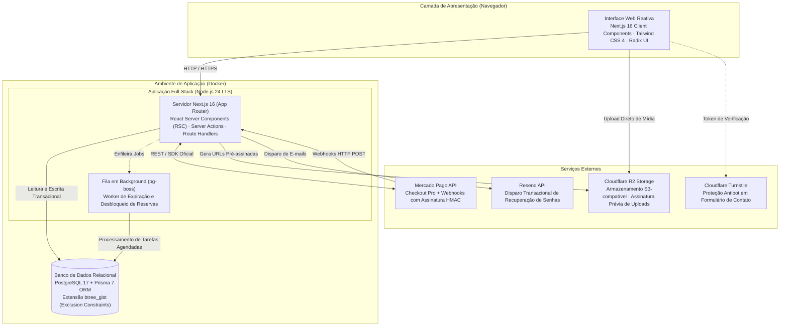
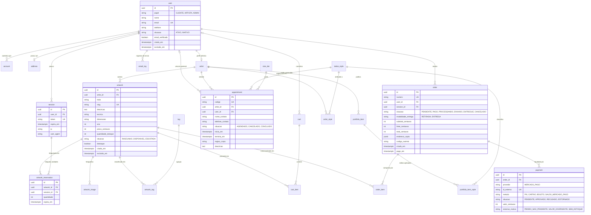

# CAPÍTULO 4 — DESENVOLVIMENTO DO SISTEMA

## 4.1 Levantamento e Especificação de Requisitos

O desenvolvimento do sistema Kolô fundamentou-se nas necessidades operacionais diagnosticadas no ateliê e estúdio de tatuagem em Pinheiros, unificando a vitrine de obras de arte, o módulo de comércio eletrônico assíncrono e o assistente determinístico de triagem de tatuagens.

Conforme preconizado por Pressman e Maxim (2021), a engenharia de requisitos estabelece as bases de comunicação, restrições e critérios de aceitação essenciais à estabilidade do ciclo de vida do software. Para o escopo final da aplicação (versão 2.2), os requisitos foram categorizados em funcionais (RF), não funcionais (RNF) e regras de negócio (RN), priorizados em P0 (indispensável à defesa e operação central) e P1 (incrementos integrados).

### 4.1.1 Requisitos Funcionais

Os requisitos funcionais determinam as operações, serviços e transformações de estado que a aplicação fornece aos seus respectivos atores: Visitante, Cliente, Artista e Administrador. A Tabela 4.1 detalha a especificação de RF01 a RF31, distribuídos por módulos de domínio.

**Tabela 4.1 — Requisitos Funcionais do Sistema Kolô.**
*Fonte: Elaborado pelos autores (2026).*

| ID | Módulo de Domínio | Descrição do Requisito Funcional | Prioridade |
| :--- | :--- | :--- | :---: |
| **RF01** | Autenticação | Permitir o cadastro autônomo de clientes mediante fornecimento de nome completo, e-mail único, telefone e senha de acesso. | P0 |
| **RF02** | Autenticação | Realizar autenticação de usuários por credenciais (e-mail e senha), mantendo a sessão persistida no banco de dados com capacidade de revogação explícita. | P0 |
| **RF03** | Autenticação | Disponibilizar recuperação de senha de acesso via correio eletrônico, gerando token criptográfico com uso único e prazo de expiração determinado. | P0 |
| **RF04** | Perfil do Usuário | Permitir a atualização dos dados cadastrais do cliente, incluindo alteração de nome, telefone de contato e redefinição de senha autenticada. | P0 |
| **RF05** | Perfil do Usuário | Permitir o cadastro e edição de um endereço de entrega padronizado por cliente, utilizado para conferência e despacho de pedidos no checkout. | P0 |
| **RF06** | Controle de Acesso | Implementar controle de acesso baseado em papéis (RBAC), segregando autorizações entre os perfis `CLIENTE`, `ARTISTA` e `ADMIN`. | P0 |
| **RF07** | Vitrine | Apresentar página inicial (Home) responsiva destacando obras em evidência, manifesto do ateliê e chamada para o assistente de agendamento. | P0 |
| **RF08** | Institucional | Exibir páginas institucionais contendo políticas de privacidade de dados, termos de uso da plataforma e normas de cancelamento e reembolso. | P0 |
| **RF09** | Catálogo | Exibir catálogo de obras de arte em grade bidimensional responsiva, com paginação de registros e filtros de ordenação por data, preço e destaque. | P0 |
| **RF10** | Catálogo | Disponibilizar ficha detalhada da obra, apresentando galeria de imagens otimizadas, ficha técnica (dimensões, técnica, ano) e estado de disponibilidade. | P0 |
| **RF11** | E-commerce | Manter carrinho de compras persistente, armazenando itens em cookie seguro para visitantes anônimos e sincronizando com o banco após autenticação. | P0 |
| **RF12** | E-commerce | Estruturar processo de checkout com conferência de itens e seleção entre retirada presencial no ateliê em Pinheiros ou entrega postal com cálculo de frete no servidor. | P0 |
| **RF13** | E-commerce | Processar transações financeiras integradas ao gateway Mercado Pago (Checkout Pro), abrangendo pagamentos via Pix, cartão e boleto sem trafegar dados de cartão pelo servidor. | P0 |
| **RF14** | E-commerce | Confirmar automaticamente o status do pedido para "Pago" e realizar a baixa definitiva de estoque mediante recebimento de webhook assinado e idempotente. | P0 |
| **RF15** | E-commerce | Efetuar reserva temporária das unidades de obras durante o checkout por período determinístico de 10 minutos, liberando-as em caso de desistência ou expiração. | P0 |
| **RF16** | E-commerce | Disponibilizar ao cliente painel de acompanhamento de pedidos realizados, histórico de transações, linha do tempo de status e código de rastreamento postal. | P0 |
| **RF17** | Portfólio Tattoo | Apresentar galeria de trabalhos de tatuagem realizados pelos artistas residentes, categorizados por profissional, estilo artístico e região anatômica. | P0 |
| **RF18** | Portfólio Tattoo | Disponibilizar mecanismo de busca textual no portfólio de tatuagens por palavras-chave e estilo artístico. | P0 |
| **RF19** | Portfólio Tattoo | Disponibilizar módulo de gestão de portfólio para administradores e artistas, permitindo inclusão, edição, reordenação e exclusão de fotos de seus trabalhos. | P0 |
| **RF20** | Agendamento | Disponibilizar assistente público em etapas (wizard determinístico): coleta de nome, seleção de artista, estilo, região anatômica, porte e janela de preferência. | P0 |
| **RF21** | Agendamento | Gerar link de direcionamento para o WhatsApp (`wa.me`) ao término do wizard, com mensagem estruturada contendo dados e aceites declarados. | P0 |
| **RF22** | Agendamento | Permitir o cadastro manual de sessões na agenda interna pelo artista ou administrador, definindo cliente, profissional, horário de início e fim. | P0 |
| **RF23** | Conformidade | Exigir confirmação explícita de alerta informando que a ficha de anamnese clínica deve ser respondida presencialmente antes do procedimento de tatuagem. | P0 |
| **RF24** | Conformidade | Exigir confirmação obrigatória de termo de consentimento livre e esclarecido a ser assinado fisicamente na data da sessão no ateliê. | P0 |
| **RF25** | Conformidade | Exigir declaração obrigatória de maioridade civil (idade igual ou superior a 18 anos) para liberação do redirecionamento ao canal de agendamento. | P0 |
| **RF26** | Back-office | Disponibilizar CRUD completo de obras de arte com suporte a múltiplas fotografias, dados catalográficos, preço em centavos, estoque e publicação. | P0 |
| **RF27** | Back-office | Fornecer upload de imagens com validação de tipo MIME e extensão, além de geração automatizada de miniaturas. | P0 |
| **RF28** | Back-office | Disponibilizar gerenciamento de artistas residentes, estilos de tatuagem vinculados e tags temáticas de obras. | P0 |
| **RF29** | Back-office | Prover painel administrativo de pedidos com filtros de status, vinculação de código de rastreio postal e gestão de estornos financeiros manuais. | P0 |
| **RF30** | Back-office | Disponibilizar visualização consolidada de clientes cadastrados, com histórico de compras realizadas e sinalização de contas com anonimização solicitada. | P1 |
| **RF31** | Back-office | Permitir a parametrização de configurações do estabelecimento, incluindo canais de contato, horários de atendimento e textos institucionais. | P1 |

### 4.1.2 Requisitos Não Funcionais

Os requisitos não funcionais definem os critérios de qualidade técnica, segurança, desempenho e manutenibilidade observados na concepção do software. A Tabela 4.2 sintetiza os requisitos não funcionais, distinguindo o que está implementado na aplicação e o que está projetado para a infraestrutura de produção (PBI-46).

**Tabela 4.2 — Requisitos Não Funcionais do Sistema Kolô.**
*Fonte: Elaborado pelos autores (2026).*

| Categoria | ID | Especificação do Requisito Não Funcional | Situação / Mecanismo de Verificação |
| :--- | :--- | :--- | :--- |
| **Segurança** | RNF01 | Todo o tráfego deve trafegar sob protocolo criptográfico HTTPS com certificados válidos. | Projetado para produção com Caddy (PBI-46). |
| **Segurança** | RNF02 | Runtimes, frameworks e dependências devem manter versões ativas e isentas de vulnerabilidades conhecidas. | Implementado; `npm audit` zerado em nível alto/crítico. |
| **Segurança** | RNF03 | Senhas de usuários armazenadas sob funções de hash lento scrypt com salt individual (Better Auth). | Implementado; verificação de modelo e banco. |
| **Segurança** | RNF04 | Prevenção contra Injeção de SQL (SQLi) mediante parametrização integral de consultas via Prisma ORM. | Implementado; consultas parametrizadas na aplicação. |
| **Segurança** | RNF05 | Prevenção contra Cross-Site Scripting (XSS) via escape automático de templates e Content-Security-Policy (CSP). | Implementado na aplicação via `src/proxy.ts`. |
| **Segurança** | RNF06 | Proteção contra CSRF em todas as ações mutativas (Server Actions) associada a cookies `HttpOnly`, `Secure` e `SameSite=Lax`. | Implementado na camada de aplicação. |
| **Segurança** | RNF07 | Emissão de cabeçalhos de segurança HTTP: HSTS, X-Content-Type-Options e Referrer-Policy. | Projetado para Caddy/produção (PBI-46). |
| **Segurança** | RNF08 | Mitigação de abusos via rate limiting em login, recuperação de senha e formulários públicos. | Implementado na aplicação via tabela `rate_limit`. |
| **Segurança** | RNF09 | Validação de toda entrada no servidor por esquemas declarativos com tipagem estrita (Zod). | Implementado em todos os módulos. |
| **Segurança** | RNF10 | Nenhum dado de cartão de crédito trafega ou é persistido no servidor da aplicação. | Implementado via Checkout Pro hospedado. |
| **Segurança** | RNF11 | Webhooks de confirmação de pagamento com validação de assinatura e processamento idempotente. | Implementado via `WebhookSignatureValidator`. |
| **Segurança** | RNF12 | Chaves de API e segredos exclusivamente em variáveis de ambiente, nunca commitados. | Implementado; verificação no repositório. |
| **Desempenho** | RNF13 | Páginas públicas de catálogo e exibição de obras com LCP abaixo de 2,5 segundos em rede móvel 4G simulada. | Implementado; 2,43 s no catálogo e 2,25 s na obra. |
| **Desempenho** | RNF14 | Imagens servidas em formato moderno e comprimido (WebP), com renderização responsiva e carregamento diferido. | Implementado via Next.js Image e Sharp. |
| **Disponibilidade**| RNF15 | Ambiente conteinerizado com política de reinicialização automática (`restart: unless-stopped`). | Projetado no `docker-compose` de produção (PBI-46). |
| **Disponibilidade**| RNF16 | Rotina automatizada de backup diário do banco de dados relacional com retenção mínima de 7 dias. | Projetado na rotina de produção (PBI-46). |
| **Privacidade** | RNF17 | Princípio de minimização de coleta de dados pessoais (LGPD), coletando apenas dados necessários à compra e entrega. | Implementado nos esquemas cadastrais. |
| **Privacidade** | RNF18 | O banco de dados não persiste histórico clínico, prontuários de anamnese ou dados sensíveis de saúde de tatuagem. | Implementado no fluxo do assistente. |
| **Privacidade** | RNF19 | Atendimento ao direito de exclusão do titular com anonimização cadastral preservando registros contábeis. | Implementado na ação `excluirContaUsuario`. |
| **Usabilidade** | RNF20 | Responsividade adaptável de 320 px a 1920 px sem rolagem horizontal indesejada e alvos de toque de 48 px. | Implementado e validado em testes E2E. |
| **Usabilidade** | RNF21 | Acessibilidade digital segundo WCAG 2.1 nível AA: navegação por teclado, foco visível e atributos `alt`. | Implementado; varredura axe-core sem violações. |
| **Manutenção** | RNF22 | Tipagem estática estrita em TypeScript, linting obrigatório e formatação automática validados em CI. | Implementado no GitHub Actions. |
| **Manutenção** | RNF23 | Ambiente de desenvolvimento local reprodutível por arquivos declarativos de contêineres Docker. | Implementado via `docker-compose.yml`. |
| **Manutenção** | RNF24 | Registro de logs e captura de exceções em ambiente produtivo. | Projetado para integração Sentry/Pino (PBI-46). |

### 4.1.3 Regras de Negócio do Domínio

As regras de negócio do Kolô expressam os requisitos determinísticos de integridade, contabilidade e segurança:

- **RN01 — Acesso Público versus Autenticado:** A exploração da vitrine, catálogo de obras, visualização da ficha técnica, galeria do portfólio de tatuagens e o preenchimento do assistente de agendamento são abertos ao público. A finalização do checkout de compras e a gestão de dados cadastrais exigem autenticação de usuário. O assistente de agendamento não efetua gravação de registro na tabela de agendamentos;
- **RN02 — Unicidade e Estoque de Obras de Arte:** As obras de arte produzidas no ateliê possuem estoque inicial padrão unitário ($1$), podendo ser expandido pelo administrador no caso de tiragens numeradas. O sistema não autoriza a comercialização de quantidade que ultrapasse o estoque disponível;
- **RN03 — Reserva Temporária no Checkout:** Ao iniciar a fase de pagamento no checkout, as unidades selecionadas são bloqueadas em favor da sessão do comprador por uma janela de exatamente dez minutos. Expirado esse período sem quitação, as unidades retornam automaticamente ao acervo disponível;
- **RN04 — Concorrência Transacional de Estoque:** O processo de reserva e baixa de estoque é protegido por transações ACID com bloqueio pessimista (`SELECT ... FOR UPDATE`), assegurando que requisições paralelas para uma mesma obra com estoque unitário não gerem venda duplicada (*overselling*);
- **RN05 — Quitação Vinculada à Confirmação do Gateway:** Um pedido de compras só adquire o status "Pago" (`PAID`) e consolida a baixa definitiva de seu estoque quando o webhook oficial do Mercado Pago notifica a aprovação definitiva do pagamento;
- **RN06 — Manutenção de Reserva para Meios Assíncronos:** Pagamentos iniciados via Pix ou boleto bancário resultam em pedidos com status pendente; caso o pagamento seja gerado dentro dos dez minutos de reserva, a expiração das unidades é prorrogada no webhook até a data-limite de vencimento do meio;
- **RN07 — Aritmética Monetária Inteira:** Todos os valores financeiros são manipulados e persistidos em centavos (números inteiros), prevenindo imprecisões decorrentes de arredondamentos de ponto flutuante;
- **RN08 — Impossibilidade de Sobreposição de Agendas:** Um mesmo tatuador residente não pode ter dois agendamentos confirmados com sobreposição temporal no mesmo intervalo de horas, restrição imposta no banco de dados através de exclusão relacional via tipos de alcance temporal (`btree_gist`);
- **RN09 — Normalização Temporal em UTC:** Todos os carimbos de data e hora são armazenados no banco de dados em UTC (`timestamptz`), com exibição e cálculos de interface convertidos para o fuso horário oficial `America/Sao_Paulo`;
- **RN10 — Segregação de Escopo por Artista:** Usuários com o perfil `ARTISTA` possuem permissão restrita para manipular o seu respectivo portfólio, sua disponibilidade de agenda e os agendamentos dos quais são responsáveis;
- **RN11 — Transição Automática de Status de Obra:** Quando o estoque de uma obra ativa atinge o total de zero unidades, seu estado de publicação é transicionado automaticamente de "Disponível" para "Esgotada", mantendo a peça no acervo histórico, porém desabilitando adições ao carrinho;
- **RN12 — Anonimização de Dados em Exclusão de Conta:** Quando um cliente solicita o encerramento de sua conta de acesso, em observância ao Artigo 18 da LGPD, suas credenciais de acesso, sessões e dados de qualificação pessoal são anonimizados, porém seus registros fiscais e pedidos pagos são preservados para fins contábeis e de prestação de contas.

---

## 4.2 Arquitetura de Software e Tecnologias Adotadas

A plataforma Kolô foi estruturada segundo o padrão arquitetural de **Monólito Modular Cliente-Servidor**, orquestrado sobre a plataforma Docker.

A escolha do monólito modular fundamenta-se nas lições de Sommerville (2019) e Richards e Ford (2020), que ressaltam que sistemas integrados de médio porte obtêm coesão, menor custo operacional e menor complexidade de infraestrutura ao manter módulos de negócio delimitados dentro de um mesmo processo executável, evitando os custos de serialização de rede e orquestração inerentes aos microsserviços distribuídos.

### 4.2.1 Diagrama Estrutural da Arquitetura

A Figura 4.1 ilustra a disposição dos componentes que compõem o ecossistema da aplicação, distinguindo as camadas de apresentação, núcleo de aplicação, persistência e integrações externas.



**Figura 4.1 — Diagrama de Arquitetura da Aplicação Kolô.**
*Fonte: Elaborado pelos autores (2026).*

### 4.2.2 Justificativa da Stack Tecnológica

Cada tecnologia do sistema foi selecionada com base em critérios técnicos mensuráveis:

1. **TypeScript (Linguagem):** Adotado tanto no back-end quanto no front-end em modo estrito (`strict: true`). Garante integridade de tipos de ponta a ponta, permitindo que alterações nos modelos de dados ou esquemas de validação reflitam imediatamente em avisos de compilação;
2. **Next.js 16 e Node.js 24 LTS (Framework Full-stack e Runtime):** A adoção do Next.js App Router consolida a arquitetura monolítica modular. Por meio dos *React Server Components* (RSC), o servidor renderiza a vitrine de obras e portfólios diretamente em HTML, reduzindo o volume de JavaScript enviado ao navegador. As alterações de estado ocorrem via *Server Actions*, que encapsulam validações com proteção CSRF embutida;
3. **Tailwind CSS 4 e shadcn/ui (Estilização e Componentes):** A interface utiliza componentes desacoplados baseados nas primitivas acessíveis do Radix UI estilizadas pelo Tailwind CSS, assegurando conformidade com os tokens de identidade visual do ateliê e semântica de acessibilidade (ARIA) nativa;
4. **PostgreSQL 17 e Prisma 7 (Persistência e ORM):** O PostgreSQL foi selecionado devido ao seu suporte nativo a índices GiST para verificação de sobreposição temporal de intervalos, isolamento serializável de transações e campos do tipo `JSONB` para armazenamento de snapshots de endereços e payloads de webhooks. O Prisma 7 atua como camada de mapeamento objeto-relacional (ORM), oferecendo migrações declarativas e consultas parametrizadas;
5. **Better Auth (Autenticação e Sessões):** Adotado para emissão de sessões registradas e verificadas no banco de dados relacional com senhas derivadas em scrypt. Permite a revogação de sessões ativas (logout forçado, encerramento de acesso pós-exclusão LGPD);
6. **Mercado Pago Checkout Pro (Gateway de Pagamento):** A solução de Checkout Pro transfere a responsabilidade da coleta de números de cartões para o ambiente seguro do provedor, enquadrando o Kolô no nível simplificado de conformidade PCI DSS (SAQ-A) e oferecendo suporte simultâneo a Pix, cartão de crédito e boleto bancário;
7. **Cloudflare R2 (Armazenamento de Objetos):** Solução de armazenamento compatível com a API S3 da AWS, sem tarifas de tráfego de saída (*egress fees*), viabilizando o armazenamento de imagens do acervo;
8. **pg-boss (Fila em Background):** Gerenciador de filas executado no próprio PostgreSQL, empregado para o agendamento de tarefas de liberação de reservas expiradas.

### 4.2.3 Organização Modular do Código-Fonte

A arquitetura do projeto organiza-se por módulos de domínio no diretório `src/modules/`, conforme detalhado na Tabela 4.3. Cada módulo expõe suas operações públicas através de um arquivo `index.ts`, evitando acoplamento indevido com suas funções internas.

**Tabela 4.3 — Estrutura de Módulos de Domínio da Aplicação (`src/modules/`).**
*Fonte: Elaborado pelos autores (2026).*

| Módulo | Responsabilidade Central | Dependências Principais |
| :--- | :--- | :--- |
| **`artists`** | Gerenciamento de artistas residentes, perfis e vínculos com estilos. | Prisma |
| **`catalog`** | Vitrine de obras, catálogo paginado, filtros de ordenação e ficha detalhada. | Prisma, `media` |
| **`contact`** | Formulário público de contato institucional com proteção Turnstile. | Prisma, Cloudflare Turnstile |
| **`customers`** | Consulta administrativa de clientes, histórico de compras e perfil consolidado. | Prisma, `orders` |
| **`endereco`** | Validação de CEP, formatação de endereço de entrega e cálculo de frete. | Prisma |
| **`identity`** | Autenticação, controle de papéis (RBAC), sessões e recuperação de senha. | Better Auth, Prisma, Resend |
| **`media`** | Validação de uploads, geração de assinaturas prévias para o R2 e thumbnails. | AWS S3 SDK, Sharp |
| **`orders`** | Checkout, reserva transacional de estoque, despacho postal e ciclo de pedidos. | Prisma, `payments`, `pg-boss` |
| **`payments`** | Integração com Mercado Pago, cálculo de assinatura HMAC e webhooks. | Prisma, Mercado Pago SDK |
| **`portfolio`** | Gestão de trabalhos de tatuagem realizados, ordenação e vinculação de estilos. | Prisma, `media` |
| **`scheduling`** | Agenda de horários dos artistas residentes com bloqueio de sobreposição GiST. | Prisma |
| **`settings`** | Parametrização institucional do ateliê, canais de contato e horários. | Prisma |

---

## 4.3 Modelagem de Dados

O modelo de dados do Kolô foi normalizado na 3ª Forma Normal (3FN), garantindo integridade referencial, atomicidade nas operações e preservação histórica de transações comerciais.

### 4.3.1 Diagrama Entidade-Relacionamento (DER)

A Figura 4.2 apresenta o Diagrama Entidade-Relacionamento detalhando as principais tabelas, chaves primárias, relacionamentos de cardinalidade e chaves estrangeiras.



**Figura 4.2 — Modelo Entidade-Relacionamento do Banco de Dados Relacional.**
*Fonte: Elaborado pelos autores (2026).*

### 4.3.2 Dicionário de Dados e Modelo Físico

O modelo físico implementado no PostgreSQL incorpora decisões voltadas à integridade histórica de dados:

1. **Snapshots Imutáveis de Pedidos (`order.endereco_copia` e `order_item`):** Para evitar inconsistências decorrentes de alterações cadastrais posteriores à compra, `order` armazena um snapshot no campo `endereco_copia` (estrutura `JSONB`) no momento do fechamento, e `order_item` congela o título da obra e o valor unitário (`preco_centavos_copia`);
2. **Separação de Chaves de Mídia:** O banco armazena a chave relativa do objeto dentro do bucket R2 (por exemplo, `obras/artistId/uuid.webp`), em vez de URLs absolutas. A resolução da URL pública e a localização da miniatura associada são derivadas pelo módulo `media`, facilitando eventuais migrações de provedor de mídia;
3. **Restrição Física de Exclusão Temporal na Agenda:** Em atendimento à regra **RN08**, a tabela `appointment` possui uma restrição de exclusão DDL no PostgreSQL via extensão `btree_gist`:
   $$\text{EXCLUDE USING GIST } (\text{artist\_id WITH } =, \text{ tstzrange(inicia\_em, termina\_em) WITH } \&\&)$$
   Essa restrição assegura que duas transações simultâneas não consigam inserir intervalos concorrentes para o mesmo profissional.

---

## 4.4 Decisões de Implementação e Algoritmos do Sistema

Esta seção aprofunda as principais decisões técnicas e os algoritmos desenvolvidos para garantir a solidez operacional da plataforma.

### 4.4.1 Controle de Concorrência e Reserva Temporária de Estoque (PBI-25)

Em virtude de o ateliê comercializar peças exclusivas de estoque unitário ($Q = 1$), a concorrência por compras no checkout exige proteção contra *overselling*.

O algoritmo de reserva temporária de dez minutos, implementado na função `reservarItens` do módulo `orders`, opera segundo os seguintes passos:

1. **Abertura de Transação:** O processo é encapsulado em um bloco `prisma.$transaction`;
2. **Bloqueio Ordenado de Linhas:** Para prevenir impasses mútuos (*deadlocks*) entre requisições concorrentes, os identificadores das obras são ordenados alfabeticamente antes da consulta com trava pessimista:
   $$\text{SELECT id, stock\_quantity FROM artwork WHERE id IN (...ids) ORDER BY id ASC FOR UPDATE;}$$
3. **Cálculo de Unidades Livres:** A quantidade disponível é expressa pela Equação 4.1:
   $$E_{\text{livre}} = Q_{\text{estoque}} - \sum R_{\text{ativas}}$$
   Onde $R_{\text{ativas}}$ corresponde a todas as reservas ativas ($\text{expira\_em} > \text{agora}$) de outras sessões ($\text{session\_id} \neq S_{\text{atual}}$);
4. **Reserva Atômica ("Tudo ou Nada"):** Se qualquer item solicitado apresentar $E_{\text{livre}} < Q_{\text{solicitada}}$, a transação rejeita a solicitação e informa os itens indisponíveis;
5. **Gravação e Expiração:** Se todas as unidades estiverem disponíveis, as linhas de reserva são gravadas com $\text{expira\_em} = \text{agora} + 10\text{ minutos}$. O worker em segundo plano gerenciado pelo `pg-boss` monitora a tabela periodicamente a cada 60 segundos (`* * * * *`) executando a limpeza assíncrona de registros expirados.

### 4.4.2 Processamento Idempotente de Webhooks com Assinatura HMAC (PBI-28)

A confirmação de quitação de pedidos depende do processamento assíncrono de notificações enviadas pelo gateway Mercado Pago, exigindo autenticação da mensagem e tratamento contra retransmissões de rede (*at-least-once delivery*).

O endpoint `/api/webhooks/mercadopago` opera em três etapas:

1. **Validação da Assinatura HMAC:** A autenticidade é verificada por meio do `WebhookSignatureValidator` oficial do SDK do Mercado Pago. O validador extrai o cabeçalho `x-signature` (que transporta o timestamp `ts` e o hash `v1`), o identificador da requisição `x-request-id`, o `data.id` e a chave secreta compartilhada, comparando o hash calculado em tempo constante. Requisições inválidas ou defasadas temporalmente são rejeitadas com código HTTP 401;
2. **Barreira de Idempotência:** A tabela `webhook_event` armazena os identificadores únicos de eventos recebidos (`id_evento`). Caso o identificador já exista no banco (violação de unicidade), o sistema reconhece a requisição como notificação repetida e retorna código HTTP 200 imediatamente, sem duplicar ações no pedido;
3. **Baixa de Estoque Transacional:** Confirmada a autenticidade e unicidade, uma transação única atualiza o status do pedido para `PAGO`, registra a transação na tabela `payment` e aciona `baixarEstoque`. Esta função decrementa o estoque físico e consome a respectiva reserva. Se o estoque resultante for zero, o status da obra transiciona para `ESGOTADA`. Se o evento reportar uma aprovação tardia de um pedido cuja reserva já expirou e a peça foi adquirida por outro cliente, o sistema transiciona o pagamento para `ESTORNO_PENDENTE` (PBI-43), permitindo ao administrador efetuar o estorno manual sem gerar inconsistência contábil.

### 4.4.3 Upload de Imagens com URLs Pré-Assinadas (PBI-17)

Para evitar que o tráfego de arquivos pesados de imagem onere o servidor da aplicação, adotou-se o padrão de upload com URLs pré-assinadas:

1. O cliente administrativo solicita autorização de envio via Server Action;
2. O servidor valida a extensão do arquivo, tamanho máximo permitido (até 10 MB) e tipo MIME declarado (`image/jpeg`, `image/png`, `image/webp`);
3. O servidor aciona o cliente S3 configurado com o Cloudflare R2 e gera uma URL assinada temporária com método `PUT` e validade de 5 minutos, gerando uma chave aleatória no formato `<modulo>/<artistaId>/<uuid>.<extensão>`;
4. O navegador envia o binário diretamente do dispositivo do usuário ao Cloudflare R2 via requisição HTTP `PUT`;
5. Concluída a transferência, o servidor processa a imagem em segundo plano através da biblioteca Sharp, gerando a versão miniatura otimizada (*thumbnail* de 400 px) e registrando a chave no banco de dados.

### 4.4.4 Assistente de Agendamento (Wizard) e Canal WhatsApp (PBI-31 a PBI-33)

Para equilibrar experiência de usuário e conformidade com a LGPD quanto ao tratamento de dados sensíveis de saúde (Artigo 11 da Lei 13.709/2018), a equipe projetou o assistente de agendamento em etapas:

- O assistente foi desenvolvido como um formulário em 8 etapas lineares executadas no lado do cliente: (1) Identificação, (2) Escolha do artista, (3) Estilo pretendido, (4) Região do corpo, (5) Dimensão estimada, (6) Data e turno de preferência, (7) Aceite obrigatório dos termos de conformidade e (8) Redirecionamento;
- **Não há persistência de dados no servidor:** O preenchimento do formulário não insere registros no banco de dados;
- **Checks de Conformidade Presencial:** Os requisitos RF23, RF24 e RF25 são atendidos na Etapa 7 por caixas de seleção obrigatórias. O usuário declara ciência de que a anamnese clínica e o termo de consentimento serão preenchidos presencialmente no ateliê em Pinheiros, além de confirmar sua maioridade civil;
- **Geração do Link Deep Link (`wa.me`):** Ao concluir, o sistema concatena os dados em uma mensagem formatada e codificada para a URI oficial do WhatsApp do estúdio, permitindo que o diálogo final e o envio de referências visuais ocorram no canal direto entre cliente e profissional. Após o acordo, o tatuador cadastra o horário na agenda interna da plataforma (RF22).

### 4.4.5 Anonimização de Contas de Usuários em Atendimento à LGPD (PBI-40)

Para harmonizar o direito de eliminação de dados pessoais (Artigo 18 da LGPD) com a obrigação de guarda de registros fiscais (Artigo 16 da LGPD e Código Tributário Nacional), foi implementada a ação transacional `excluirContaUsuario`:

1. O cliente autenticado solicita o encerramento de sua conta e confirma sua senha;
2. Em um único bloco transacional atômico no PostgreSQL:
   - A linha do usuário em `user` recebe `excluido_em = agora` e situação `INATIVO`;
   - Seus dados identificáveis são mascarados: `nome = "Usuário Anonimizado"`, `email = "anonimizado_<uuid>@kolo.invalid"`, `telefone = null` e `imagem = null`;
   - As sessões associadas em `session` são deletadas;
   - O endereço em `address` é excluído;
   - Os registros de pedidos em `order` são preservados, mantendo o identificador do pedido, valores faturados, carimbos de data e o snapshot de endereço congelado à época (`endereco_copia`).

---

## 4.5 Apresentação das Interfaces do Sistema

A interface do Kolô foi desenvolvida com base no design system estabelecido para o ateliê, utilizando cores sóbrias, tipografia legível e conformidade ergonômica. As Figuras 4.3 a 4.8 apresentam as telas fundamentais da plataforma.

### 4.5.1 Catálogo de Obras de Arte

A tela do Catálogo (Figura 4.3) disponibiliza a exibição responsiva do acervo do ateliê.

```
+-----------------------------------------------------------------------------------+
|  [ K O L Ô ]        Ateliê    Tattoo    Artistas    Sobre          [Carrinho (2)] |
+-----------------------------------------------------------------------------------+
|  CATÁLOGO DE OBRAS                                                                |
|  Acervo exclusivo produzido pelos artistas residentes em técnicas autorais        |
|                                                                                   |
|  Ordenar por: [ Mais recentes v ]                 Exibindo 12 de 34 obras         |
|  -------------------------------------------------------------------------------- |
|  +---------------------+   +---------------------+   +---------------------+      |
|  | [ Foto da Obra 01 ] |   | [ Foto da Obra 02 ] |   | [ Foto da Obra 03 ] |      |
|  |                     |   |                     |   |                     |      |
|  | "Dualidade Urbana"  |   | "Reflexos da Noite" |   | "Terra Viva"        |      |
|  | Artista Residente   |   | Artista Residente   |   | Artista Residente   |      |
|  | Óleo sobre tela     |   | Escultura cerâmica  |   | Gravura em metal    |      |
|  | R$ 1.850,00         |   | R$ 920,00           |   | R$ 640,00           |      |
|  | [Ver Detalhes]      |   | [Ver Detalhes]      |   | [Ver Detalhes]      |      |
|  +---------------------+   +---------------------+   +---------------------+      |
+-----------------------------------------------------------------------------------+
```

**Figura 4.3 — Esquema Estrutural da Interface do Catálogo de Obras (RF09).**
*Fonte: Elaborado pelos autores (2026).*

A tela implementa renderização via *React Server Components* com suporte a paginação e parâmetros na URL. As imagens são carregadas através de componentes `<Image>` com largura adaptável, gerando versões redimensionadas para otimização de banda.

### 4.5.2 Ficha Detalhada da Obra

Ao selecionar uma peça, o usuário é direcionado para a Ficha da Obra (Figura 4.4), que concentra informações técnicas para a tomada de decisão.

```
+-----------------------------------------------------------------------------------+
|  < Voltar ao Catálogo                                                             |
+-----------------------------------------------------------------------------------+
|  +-------------------------------+   DUALIDADE URBANA (2026)                      |
|  |                               |   Artista Residente                            |
|  |                               |   -------------------------------------------- |
|  |    [ Fotografia Principal     |   R$ 1.850,00                                  |
|  |      em Alta Resolução ]      |   Em até 3x sem juros ou via Pix               |
|  |                               |                                                |
|  |                               |   [ ADICIONAR AO CARRINHO ]                    |
|  +-------------------------------+                                                |
|  [thumb 1] [thumb 2] [thumb 3]       FICHA TÉCNICA DA OBRA                        |
|                                      - Técnica: Óleo sobre tela                   |
|                                      - Dimensões: 80 x 60 cm                      |
|                                      - Tiragem: Peça única autoral                |
|                                      - Certificado: Assinado pelo artista         |
|                                                                                   |
|                                      DESCRIÇÃO                                    |
|                                      Estudo visual com pigmentos naturais...      |
+-----------------------------------------------------------------------------------+
```

**Figura 4.4 — Ficha Detalhada da Obra de Arte com Ficha Técnica (RF10).**
*Fonte: Elaborado pelos autores (2026).*

A interface integra galeria interativa de miniaturas com troca instantânea de foto principal sem recarregamento de página. O botão de inclusão no carrinho verifica a disponibilidade de estoque no servidor e exibe feedback acessível através de alertas `aria-live`.

### 4.5.3 Carrinho e Checkout com Contador de Reserva

O fluxo de fechamento de compra (Figura 4.5) reúne o carrinho, a seleção da modalidade de entrega e a sinalização do tempo de reserva garantido.

```
+-----------------------------------------------------------------------------------+
|  FINALIZAÇÃO DO PEDIDO (CHECKOUT)                                                 |
+-----------------------------------------------------------------------------------+
|  +-----------------------------------------------------------------------------+  |
|  | [!] Suas obras estão reservadas por: 08:42 minutos                          |  |
|  +-----------------------------------------------------------------------------+  |
|                                                                                   |
|  ENDEREÇO DE ENTREGA                    RESUMO DO PEDIDO                          |
|  Cliente Teste                          ----------------------------------------- |
|  Rua das Flores, 120 - Pinheiros, SP    1x "Dualidade Urbana"        R$ 1.850,00  |
|  CEP 05419-000                          Subtotal                     R$ 1.850,00  |
|  [Alterar Endereço]                     Frete (Entrega Postal)          R$ 30,00  |
|                                         ----------------------------------------- |
|  MODALIDADE DE ENTREGA                  TOTAL                        R$ 1.880,00  |
|  ( ) Retirada no Ateliê em Pinheiros (R$ 0,00)                                    |
|  (X) Entrega Postal (+R$ 30,00)         [ IR PARA O PAGAMENTO (MERCADO PAGO) ]    |
|                                         Ambiente Criptografado e Seguro           |
+-----------------------------------------------------------------------------------+
```

**Figura 4.5 — Interface de Checkout com Indicação do Tempo de Reserva (RF12, RF15).**
*Fonte: Elaborado pelos autores (2026).*

Conforme exigido pelo requisito **RF15** e regra **RN03**, o checkout calcula o tempo restante de reserva (`expira_em`) retornado pela função `reservarItens`. Um cronômetro reativo informa o tempo em minutos e segundos; faltando menos de dois minutos, o usuário é alertado para concluir a operação antes da devolução automática das unidades ao estoque público. O comprador pode optar pela retirada presencial sem custo no ateliê em Pinheiros ou pela entrega com frete.

### 4.5.4 Assistente de Agendamento (Wizard de Tatuagem)

A Figura 4.6 demonstra a etapa de confirmação de conformidade do assistente determinístico de tatuagem.

```
+-----------------------------------------------------------------------------------+
|  ASSISTENTE DE AGENDAMENTO DE TATUAGEM                          Etapa 7 de 8      |
+-----------------------------------------------------------------------------------+
|  AVISOS E CONFORMIDADE OBRIGATÓRIA                                                |
|  Antes de direcionar sua conversa ao tatuador, confirme os termos abaixo:        |
|                                                                                   |
|  [X] DECLARAÇÃO DE SAÚDE E ANAMNESE (RF23)                                        |
|      Declaro estar ciente de que a ficha clínica completa será preenchida         |
|      presencialmente no estúdio em Pinheiros antes do início da sessão.           |
|                                                                                   |
|  [X] TERMO DE CONSENTIMENTO E AUTORIZAÇÃO (RF24)                                  |
|      Compreendo que a realização do procedimento exige a assinatura física        |
|      do termo de autorização livre e esclarecido na recepção do estúdio.          |
|                                                                                   |
|  [X] DECLARAÇÃO DE MAIORIDADE (RF25)                                              |
|      Declaro, sob as penas da lei, possuir 18 (dezoito) anos completos ou mais.   |
|                                                                                   |
|  -------------------------------------------------------------------------------- |
|  [ < Voltar: Escolher Data ]                   [ Avançar: Gerar WhatsApp > ]      |
+-----------------------------------------------------------------------------------+
```

**Figura 4.6 — Etapa de Conformidade do Wizard de Agendamento (RF20, RF23, RF24, RF25).**
*Fonte: Elaborado pelos autores (2026).*

O botão de avanço permanece desabilitado enquanto os três *checkboxes* não estiverem selecionados. O assistente valida a integridade do formulário e, no passo seguinte, formata a mensagem pré-definida com a compilação das escolhas do visitante, acionando o redirecionamento para o WhatsApp do estúdio.

### 4.5.5 Portfólio de Tatuagens e Filtros de Estilo

A galeria de portfólio (Figura 4.7) permite aos clientes examinar trabalhos realizados pelos artistas residentes.

```
+-----------------------------------------------------------------------------------+
|  PORTFÓLIO DE TATUAGENS                                                           |
|  Conheça os trabalhos autorais desenvolvidos pela equipe residente do Kolô        |
|                                                                                   |
|  Filtrar por:                                                                     |
|  Artista: [ Todos v ]  Estilo: [ Blackwork v ]  Região: [ Braço v ]  [Buscar Q]   |
|  -------------------------------------------------------------------------------- |
|  +---------------------+   +---------------------+   +---------------------+      |
|  | [ Foto Tatuagem 01] |   | [ Foto Tatuagem 02] |   | [ Foto Tatuagem 03] |      |
|  |                     |   |                     |   |                     |      |
|  | Geometria Floral    |   | Serpente Botânica   |   | Mandala             |      |
|  | Artista Residente   |   | Artista Residente   |   | Artista Residente   |      |
|  | Estilo: Blackwork   |   | Estilo: Fine Line   |   | Estilo: Pontilhismo |      |
|  | Região: Antebraço   |   | Região: Costelas    |   | Região: Costas      |      |
|  +---------------------+   +---------------------+   +---------------------+      |
+-----------------------------------------------------------------------------------+
```

**Figura 4.7 — Interface da Galeria de Portfólio de Tatuagens (RF17, RF18).**
*Fonte: Elaborado pelos autores (2026).*

A interface combina filtros compostos que atualizam os parâmetros de busca instantaneamente sem causar saltos de rolagem (*layout shift*), garantindo visualização ágil das fotografias armazenadas no Cloudflare R2.

### 4.5.6 Painel de Gestão Administrativa de Pedidos

A retaguarda administrativa (Figura 4.8) fornece aos gestores controle do ciclo de vida dos pedidos efetuados.

```
+-----------------------------------------------------------------------------------+
|  PAINEL ADMINISTRATIVO — GESTÃO DE PEDIDOS (BACK-OFFICE)                          |
+-----------------------------------------------------------------------------------+
|  Filtros: [ Todos ] [ Pendentes ] [ Pagos ] [ Enviados ] [ Requer Estorno (1) ]   |
|                                                                                   |
|  Pedido    Data       Cliente         Valor Total   Pagamento     Situação  Ações |
|  -------------------------------------------------------------------------------- |
|  #KOLO-104 10/10/26   Cliente Teste   R$ 1.880,00   Cartão (MP)   PAGO      [Ver] |
|  #KOLO-103 09/10/26   Cliente Teste   R$   920,00   Pix (MP)      PAGO      [Ver] |
|  #KOLO-102 08/10/26   Cliente Teste   R$   640,00   Pix           ESTORNO   [Ação]|
|                                                                                   |
|  DETALHES DO PEDIDO #KOLO-104                                                     |
|  - Situação: PAGO em 10/10/2026 às 14:32 (Mercado Pago ID: 9482710492)           |
|  - Rastreamento Postal: [ BR109482019SP ] [ Salvar Código ]                       |
|  - Atualizar Situação:  ( ) Processando  (X) Enviado aos Correios  ( ) Entregue   |
+-----------------------------------------------------------------------------------+
```

**Figura 4.8 — Painel de Gestão e Despacho de Pedidos no Back-office (RF29).**
*Fonte: Elaborado pelos autores (2026).*

O painel permite a inserção de códigos de rastreamento postal (disparando a atualização visível na área pessoal do comprador) e disponibiliza a fila de resolução de estornos com filtros dedicados, assegurando a rastreabilidade financeira exigida na gestão do ateliê.
