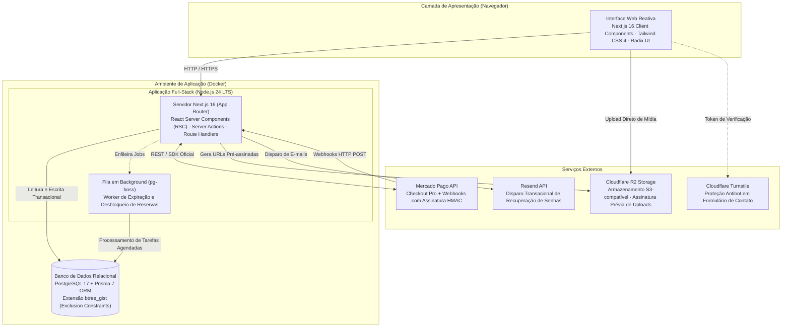
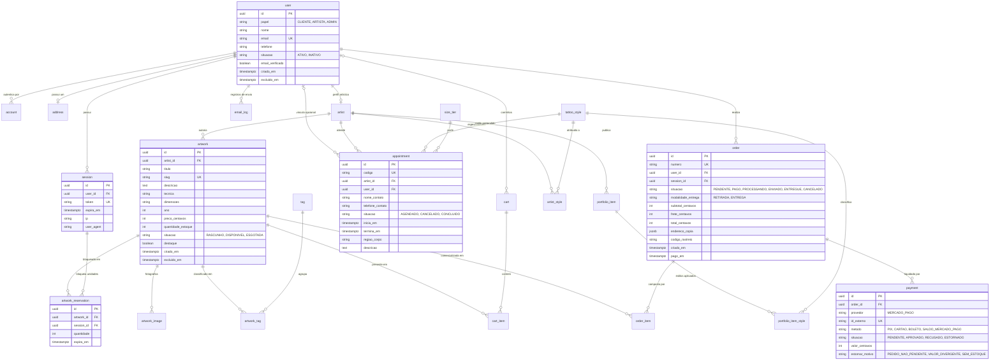

UNIVERSIDADE PAULISTA – UNIP
BACHARELADO EM CIÊNCIA DA COMPUTAÇÃO
GRUPO 19


CAIO SCORSONI MARTINS OLIVEIRA - F346EH2
CAIO VINICIUS LUIZ ALVES - F351041
GUILHERME DOS SANTOS SALUSTIANO - G7661F0
GUSTAVO HENRIQUE RODRIGUES DE MAGALHÃES - F354776
ROBERT ESTEVAN DA SILVA JUNIOR - N8794F6


SISTEMA WEB PARA ATELIÊ E ESTÚDIO DE TATUAGEM


CAMPINAS – SP
2026

---

UNIVERSIDADE PAULISTA – UNIP
BACHARELADO EM CIÊNCIA DA COMPUTAÇÃO
GRUPO 19


CAIO SCORSONI MARTINS OLIVEIRA - F346EH2
CAIO VINICIUS LUIZ ALVES - F351041
GUILHERME DOS SANTOS SALUSTIANO - G7661F0
GUSTAVO HENRIQUE RODRIGUES DE MAGALHÃES - F354776
ROBERT ESTEVAN DA SILVA JUNIOR - N8794F6


SISTEMA WEB PARA ATELIÊ E ESTÚDIO DE TATUAGEM


Trabalho de Conclusão de Curso apresentado à Universidade Paulista como requisito para a obtenção do título de Bacharel em Ciência da Computação.

Área de Concentração: Engenharia de Software e Sistemas Web Distribuídos.

Orientadora: Profa. Dra. Elisa Botta


CAMPINAS – SP
2026

---

## DEDICATÓRIA

Dedicamos este trabalho aos nossos familiares, que nos apoiaram incondicionalmente ao longo de toda a nossa jornada universitária, aos nossos professores e mestres, que compartilharam seu conhecimento e exigiram nosso melhor, e aos colegas do curso de Ciência da Computação, cuja convivência e cooperação tornaram este percurso enriquecedor.

---

## AGRADECIMENTOS

Agradecemos a Deus, pela força, saúde e resiliência concedidas em todos os momentos desafiadores desta trajetória acadêmica.

Aos nossos pais e familiares, pelo suporte incansável, incentivo constante e por fornecerem as condições essenciais para a concretização deste sonho.

À Profa. Dra. Elisa Botta, pela orientação atenta, rigor acadêmico e pelas valiosas diretrizes metodológicas que orientaram este trabalho desde o projeto no TCC 1 até a conclusão na presente monografia.

À administradora Melanie Schwark e ao coadministrador Rafael Lotuffo, bem como aos artistas residentes do Kolô Ateliê & Estúdio, pela disponibilidade nas etapas de diagnóstico e validação, e por colaborarem ativamente com a equipe ao longo da realização desta pesquisa-ação.

Aos colegas de curso e a todos que, direta ou indiretamente, contribuíram para a materialização deste sistema.

---

## RESUMO

O presente Trabalho de Conclusão de Curso (TCC) aborda a modernização dos processos operacionais do Kolô Ateliê & Estúdio, empreendimento localizado em Pinheiros, São Paulo, que integra a comercialização de obras físicas de arte autoral e a prestação de serviços personalizados de tatuagem. O diagnóstico dos processos revelou controle manual de acervo por mensagens descentralizadas e sobrecarga no atendimento inicial para triagem de sessões de tatuagem. Diante desse cenário, este trabalho projeta, desenvolve e avalia uma plataforma web integrada sob arquitetura de monólito modular, utilizando Next.js 16 com TypeScript, Tailwind CSS e PostgreSQL 17 em contêineres Docker. A hipótese investigada estabelece que a centralização do catálogo com processamento de pagamentos sob reserva temporária de estoque e um assistente determinístico em etapas direcionado ao WhatsApp elimina os controles manuais, previne vendas duplicadas de peças exclusivas e qualifica o atendimento inicial. O sistema incorpora um algoritmo de concorrência com bloqueio pessimista ordenado (SELECT ... FOR UPDATE) garantindo reserva atômica de dez minutos, processamento idempotente de webhooks autenticados via HMAC-SHA256 (Mercado Pago), uploads com URLs pré-assinadas (Cloudflare R2) e rotina transacional de anonimização cadastral em conformidade com a LGPD (Lei 13.709/2018), resguardando o ateliê ao evitar o armazenamento digital de dados sensíveis de saúde. A validação técnica alcançou aprovação em 532 testes unitários, 276 testes de integração com PostgreSQL real e 43 testes ponta a ponta (E2E Playwright), experimentos de concorrência multithread no banco evidenciando ausência de overselling, auditoria Google Lighthouse com LCP de 2,43 s no catálogo e 2,25 s na ficha da obra (Scores 97 e 98/100) e conformidade de acessibilidade digital WCAG 2.1 nível AA via axe-core. A sessão de validação assistida realizada em 10/10/2026 com a administradora e tatuadora Melanie Schwark, avaliando versão preliminar anterior às correções de 12 a 18/10 (PBI-43 e PBI-45), registrou avaliação positiva quanto à identidade visual e à fluidez de navegação, com acolhimento de sugestões textuais descritivas. Os resultados obtidos sustentam parcialmente a hipótese formulada.

**Palavras-chave:** Engenharia de Software. Comércio Eletrônico. Monólito Modular. Controle de Concorrência. Next.js. PostgreSQL. LGPD. Economia Criativa.

---

## ABSTRACT

This Final Course Project (TCC) addresses the modernization of operational processes at Kolô Ateliê & Estúdio, an enterprise located in Pinheiros, São Paulo, which integrates the commercialization of physical authorial artworks and personalized tattoo services. Process diagnosis revealed manual inventory control through decentralized messaging and overload in preliminary service for tattoo appointments. Given this scenario, this work designs, develops, and evaluates an integrated web platform following a modular monolithic architecture, utilizing Next.js 16 with TypeScript, Tailwind CSS, and PostgreSQL 17 in Docker containers. The investigated hypothesis establishes that catalog centralization with payment processing under temporary inventory reservation and a deterministic multi-step assistant routed to WhatsApp eliminates manual controls, prevents duplicate sales of single-edition pieces, and qualifies initial service. The system incorporates a concurrency algorithm with ordered pessimistic locking (SELECT ... FOR UPDATE) ensuring atomic ten-minute reservations, idempotent webhook processing authenticated via HMAC-SHA256 (Mercado Pago), pre-signed URL uploads (Cloudflare R2), and transactional user anonymization in compliance with the LGPD (Law 13,709/2018), safeguarding the studio by avoiding digital storage of sensitive health records. Technical validation achieved passing marks across 532 unit tests, 276 integration tests with real PostgreSQL, and 43 end-to-end (E2E) tests in Playwright, multithreaded concurrency experiments in the database evidencing the absence of overselling, Google Lighthouse audit with 2.43 s LCP on the catalog and 2.25 s on the artwork page (Scores 97 and 98/100), and digital accessibility compliance WCAG 2.1 level AA via axe-core. An assisted validation session conducted on 10/10/2026 with studio administrator and tattoo artist Melanie Schwark, evaluating an interim build prior to the October 12–18 refinement cycle (PBI-43 and PBI-45), recorded positive feedback regarding visual identity and navigational smoothness, incorporating descriptive textual refinements. The obtained results partially sustain the formulated hypothesis.

**Keywords:** Software Engineering. E-commerce. Modular Monolith. Concurrency Control. Next.js. PostgreSQL. LGPD. Creative Economy.

---

## LISTA DE FIGURAS

- **Figura 4.1** — Diagrama de Arquitetura da Aplicação Kolô
- **Figura 4.2** — Modelo Entidade-Relacionamento do Banco de Dados Relacional (DER)
- **Figura 4.3** — Interface do Catálogo de Obras (RF09)
- **Figura 4.4** — Ficha Detalhada da Obra de Arte com Ficha Técnica (RF10)
- **Figura 4.5** — Interface de Checkout com Indicação do Tempo de Reserva (RF12, RF15)
- **Figura 4.6** — Etapa de Conformidade do Wizard de Agendamento (RF20, RF23, RF24, RF25)
- **Figura 4.7** — Interface da Galeria de Portfólio de Tatuagens (RF17, RF18)
- **Figura 4.8** — Painel de Gestão e Despacho de Pedidos no Back-office (RF29)

---

## LISTA DE TABELAS

- **Tabela 2.1** — Análise Comparativa entre Soluções de Mercado e a Plataforma Kolô
- **Tabela 3.1** — Matriz Justificada de Mudança de Escopo entre TCC 1 e TCC 2
- **Tabela 4.1** — Requisitos Funcionais do Sistema Kolô (RF01 a RF31)
- **Tabela 4.2** — Requisitos Não Funcionais do Sistema Kolô (RNF01 a RNF24)
- **Tabela 4.3** — Estrutura de Módulos de Domínio da Aplicação (src/modules/)
- **Tabela 5.1** — Matriz de Rastreabilidade e Cobertura de Requisitos Funcionais
- **Tabela 5.2** — Resultados do Experimento de Concorrência de Reserva de Estoque
- **Tabela 5.3** — Métricas de Desempenho e Qualidade Web (Lighthouse 12.8.2, Mediana de 3 Rodadas)

---

## LISTA DE SIGLAS E ABREVIATURAS

| Sigla | Significado |
| :--- | :--- |
| **ACID** | Atomicidade, Consistência, Isolamento e Durabilidade (*Atomicity, Consistency, Isolation, Durability*) |
| **API** | Interface de Programação de Aplicações (*Application Programming Interface*) |
| **ARIA** | Aplicações Ricas de Internet Acessíveis (*Accessible Rich Internet Applications*) |
| **CGI.br** | Comitê Gestor da Internet no Brasil |
| **CI** | Integração Contínua (*Continuous Integration*) |
| **CLS** | Deslocamento Cumulativo de Layout (*Cumulative Layout Shift*) |
| **CSP** | Política de Segurança de Conteúdo (*Content Security Policy*) |
| **CSRF** | Falsificação de Requisição entre Sites (*Cross-Site Request Forgery*) |
| **DDL** | Linguagem de Definição de Dados (*Data Definition Language*) |
| **DER** | Diagrama de Entidade-Relacionamento |
| **E2E** | Ponta a Ponta (*End-to-End*) |
| **FCP** | Primeira Pintura de Conteúdo (*First Contentful Paint*) |
| **GIST** | Árvore de Busca Generalizada (*Generalized Search Tree*) |
| **HMAC** | Código de Autenticação de Mensagem Baseado em Hash (*Hash-based Message Authentication Code*) |
| **HTTP** | Protocolo de Transferência de Hipertexto (*Hypertext Transfer Protocol*) |
| **HTTPS** | Protocolo de Transferência de Hipertexto Seguro (*Hypertext Transfer Protocol Secure*) |
| **JSON** | Notação de Objetos JavaScript (*JavaScript Object Notation*) |
| **LCP** | Maior Pintura de Conteúdo (*Largest Contentful Paint*) |
| **LGPD** | Lei Geral de Proteção de Dados Pessoais (Lei Federal nº 13.709/2018) |
| **ORM** | Mapeamento Objeto-Relacional (*Object-Relational Mapping*) |
| **OWASP** | Projeto Aberto de Segurança em Aplicações Web (*Open Worldwide Application Security Project*) |
| **PBI** | Item do Backlog do Produto (*Product Backlog Item*) |
| **PCI DSS** | Padrão de Segurança de Dados para a Indústria de Cartões de Pagamento |
| **RBAC** | Controle de Acesso Baseado em Papéis (*Role-Based Access Control*) |
| **REST** | Transferência de Estado Representacional (*Representational State Transfer*) |
| **RF** | Requisito Funcional |
| **RN** | Regra de Negócio |
| **RNF** | Requisito Não Funcional |
| **RSC** | Componentes de Servidor React (*React Server Components*) |
| **SEO** | Otimização para Motores de Busca (*Search Engine Optimization*) |
| **SQL** | Linguagem de Consulta Estruturada (*Structured Query Language*) |
| **TBT** | Tempo Total de Bloqueio (*Total Blocking Time*) |
| **TCC** | Trabalho de Conclusão de Curso |
| **TDD** | Desenvolvimento Orientado a Testes (*Test-Driven Development*) |
| **TLS** | Segurança da Camada de Transporte (*Transport Layer Security*) |
| **UI/UX** | Interface do Usuário / Experiência do Usuário (*User Interface / User Experience*) |
| **UNIP** | Universidade Paulista |
| **UTC** | Tempo Universal Coordenado (*Coordinated Universal Time*) |
| **UUID** | Identificador Único Universal (*Universally Unique Identifier*) |
| **VPS** | Servidor Virtual Privado (*Virtual Private Server*) |
| **WCAG** | Diretrizes de Acessibilidade para Conteúdo Web (*Web Content Accessibility Guidelines*) |
| **XSS** | Scripting entre Sites (*Cross-Site Scripting*) |

---

## SUMÁRIO

- **1 INTRODUÇÃO**
  - 1.1 Contextualização
  - 1.2 Problema de Pesquisa
  - 1.3 Hipótese de Pesquisa
  - 1.4 Objetivo Geral
  - 1.5 Objetivos Específicos
  - 1.6 Justificativa
  - 1.7 Estrutura do Trabalho
- **2 FUNDAMENTAÇÃO TEÓRICA**
  - 2.1 Sistemas Web e Comércio Eletrônico na Economia Criativa
  - 2.2 Trabalhos Relacionados e Comparação entre Soluções de Mercado
  - 2.3 Controle de Concorrência e Integridade Transacional
  - 2.4 Segurança da Informação em Aplicações Web (OWASP Top 10)
  - 2.5 Privacidade e Conformidade com a LGPD (Lei 13.709/2018)
  - 2.6 Usabilidade e Acessibilidade Digital
  - 2.7 Padrões Arquiteturais de Software: Monólito Modular versus Microsserviços
- **3 METODOLOGIA**
  - 3.1 Caracterização da Pesquisa
  - 3.2 Procedimentos de Coleta de Dados e Diagnóstico
  - 3.3 Metodologia de Desenvolvimento Ágil (Scrum Adaptado)
  - 3.4 Registro e Justificativa da Mudança de Escopo (TCC 1 para TCC 2)
  - 3.5 Ambiente, Instrumentos e Uso de Ferramentas de Inteligência Artificial
  - 3.6 Critérios de Validação e Homologação do Sistema
- **4 DESENVOLVIMENTO DO SISTEMA**
  - 4.1 Levantamento e Especificação de Requisitos
  - 4.2 Arquitetura de Software e Tecnologias Adotadas
  - 4.3 Modelagem de Dados
  - 4.4 Decisões de Implementação e Algoritmos do Sistema
  - 4.5 Apresentação das Interfaces do Sistema
- **5 RESULTADOS E DISCUSSÃO**
  - 5.1 Estratégia de Testes e Cobertura Automatizada
  - 5.2 Rastreabilidade e Cobertura de Requisitos
  - 5.3 Avaliação Experimental de Concorrência e Integridade de Estoque
  - 5.4 Métricas de Desempenho e Acessibilidade
  - 5.5 Validação Qualitativa com o Estabelecimento Parceiro
  - 5.6 Discussão dos Resultados, Dificuldades e Limitações
- **6 CONCLUSÃO**
  - 6.1 Atendimento aos Objetivos da Pesquisa
  - 6.2 Avaliação da Hipótese de Pesquisa
  - 6.3 Contribuições do Trabalho
  - 6.4 Limitações do Estudo
  - 6.5 Trabalhos Futuros
- **REFERÊNCIAS BIBLIOGRÁFICAS**

---

# CAPÍTULO 1 — INTRODUÇÃO

## 1.1 Contextualização

O setor de artes plásticas e os serviços corporais de tatuagem compõem segmentos expressivos da economia criativa contemporânea no Brasil. Tradicionalmente fundamentados na interação física, no atendimento presencial e na circulação territorial em polos culturais urbanos, esses modelos de negócio vêm passando por transformações impulsionadas pela digitalização dos hábitos de consumo e pela expansão dos canais digitais de divulgação (CGI.br, 2023).

O Kolô Ateliê & Estúdio localiza-se no tradicional bairro de Pinheiros, polo cultural da capital paulista, combinando sob uma mesma identidade curatorial a produção, exposição e comercialização de obras físicas de arte autoral (pinturas, gravuras, esculturas e técnicas mistas) e a prestação de serviços personalizados de tatuagem artística.

Impulsionado pela divulgação de seu processo criativo por meio de plataformas como o Instagram, o Kolô experimentou um crescimento substancial em sua visibilidade e na procura por seus trabalhos. O ateliê mantém seu espaço físico ativo em Pinheiros como ambiente de produção e atendimento presencial. Contudo, para expandir sua atuação comercial para além da limitação geográfica do bairro e profissionalizar os fluxos de venda e de contato, a estruturação de uma plataforma web dedicada tornou-se indispensável.

Conforme apontam Laudon e Traver (2021), a evolução do comércio eletrônico exige que pequenas e médias empresas desenvolvam ecossistemas digitais próprios, capazes de assegurar a integridade de transações comerciais, a autonomia na apresentação do acervo e a comunicação assíncrona com consumidores, integrando os canais físicos e digitais do negócio.

## 1.2 Problema de Pesquisa

A despeito da demanda gerada pela divulgação virtual, o diagnóstico dos processos operacionais do Kolô revelou limitações tecnológicas nos controles internos:

1. **Gestão Manual de Vendas e Acervo:** O controle do catálogo de obras e as vendas eram realizados de forma predominantemente manual, dependendo de trocas individuais de mensagens em redes sociais e registros descentralizados. Esse modelo gerava retrabalho na conferência de disponibilidade de peças físicas e atrasos no fechamento de pedidos;
2. **Ausência de Catálogo Digital Centralizado:** Interessados na aquisição de obras dependiam do envio avulso de fotos e informações por aplicativos de mensagens, sem um ambiente unificado para consulta de dados catalográficos, dimensões, técnicas de produção e certificados de autenticidade;
3. **Complexidade no Atendimento Inicial de Tatuagem:** O processo de agendamento de sessões exigia diálogos longos e repetitivos para triagem preliminar de ideias, estilos artísticos, regiões corporais, dimensões aproximadas e esclarecimento de normas de biossegurança e conformidade legal (como a maioridade civil e a realização presencial da anamnese clínica);
4. **Governança de Dados e Conformidade:** O trânsito de dados pessoais por múltiplos canais informais de mensagens exigia a estruturação de um ambiente formalizado em conformidade com as diretrizes da Lei Geral de Proteção de Dados (LGPD, Lei 13.709/2018), resguardando o estabelecimento quanto à não retenção digital de dados clínicos sensíveis.

Diante desse cenário, formula-se o seguinte **problema de pesquisa**:

> *Como o desenvolvimento e a implementação de uma plataforma web integrada sob arquitetura de monólito modular podem solucionar os gargalos operacionais de controle manual de vendas de obras de arte e estruturar a triagem preliminar de agendamentos de tatuagens do Kolô Ateliê & Estúdio, assegurando integridade transacional de estoque e conformidade com a legislação de proteção de dados?*

## 1.3 Hipótese de Pesquisa

Para orientar a investigação, formulou-se a seguinte **hipótese**:

> *A centralização do catálogo de acervo artístico em uma plataforma web dedicada, aliada ao processamento automatizado de pedidos com reserva temporária de estoque e a um assistente determinístico em etapas para triagem e qualificação de agendamentos via WhatsApp, elimina os controles manuais de comercialização identificados no diagnóstico, previne vendas duplicadas de peças exclusivas e qualifica o atendimento inicial no Kolô Ateliê & Estúdio.*

A hipótese fundamenta-se na capacidade da Engenharia de Software em substituir controles informais por processos digitais consistentes, ancorados em transações atômicas de banco de dados e regras de negócio determinísticas.

## 1.4 Objetivo Geral

O objetivo geral desta pesquisa consiste em **projetar, desenvolver e testar um sistema web integrado sob arquitetura de monólito modular para o Kolô Ateliê & Estúdio**, provendo comércio eletrônico de obras de arte com controle transacional de estoque e um assistente determinístico de triagem de tatuagens direcionado ao WhatsApp, em conformidade com diretrizes de usabilidade, segurança da informação e privacidade da LGPD.

## 1.5 Objetivos Específicos

Para a consecução do objetivo geral, definiram-se os seguintes objetivos específicos:

1. **Levantar e refinar os requisitos de engenharia de software:** Conduzir entrevistas técnicas com os coadministradores e artistas residentes do ateliê para formalizar os requisitos funcionais (RF01 a RF31), não funcionais (RNF01 a RNF24) e regras de negócio (RN01 a RN12) da versão final da aplicação (v2.2);
2. **Projetar a arquitetura e a modelagem relacional:** Estruturar a aplicação segundo o padrão monolítico modular cliente-servidor em contêineres Docker (Next.js 16 e PostgreSQL 17), modelando o Diagrama Entidade-Relacionamento em 3ª Forma Normal com restrições temporais de exclusão (extensão `btree_gist`), projetando a camada de proxy reverso e TLS para a fase de implantação em produção;
3. **Desenvolver o módulo de comércio eletrônico assíncrono:** Implementar a vitrine de obras com carregamento otimizado de imagens (Next.js Image / WebP), carrinho persistente, checkout com opções de retirada presencial no ateliê em Pinheiros ou entrega postal com frete, integrando o processamento de pagamentos ao Mercado Pago Checkout Pro;
4. **Implementar o algoritmo transacional de controle de concorrência:** Projetar o mecanismo de bloqueio pessimista ordenado (`SELECT ... FOR UPDATE`) com reserva temporária de estoque por dez minutos e worker de expiração (`pg-boss`), prevenindo a venda duplicada (*overselling*) de obras exclusivas;
5. **Desenvolver o assistente determinístico de agendamento:** Criar um formulário em 8 etapas lineares no cliente que colete preferências estéticas e exija o aceite mandatório de alertas presenciais (anamnese clínica e consentimento informado), formatando o deep link direto para o WhatsApp comercial do estúdio (`wa.me`) sem retenção de dados sensíveis de saúde, em atendimento ao Artigo 11 da LGPD;
6. **Construir os módulos de retaguarda e conformidade:** Implementar o painel administrativo de gestão de acervo, despacho postal com código de rastreamento, agenda interna de horários de tatuagem e rotina transacional de anonimização de cadastro de clientes (Artigos 16 e 18 da LGPD);
7. **Verificar e validar a solução computacional:** Executar suítes de testes unitários e de integração com banco relacional real, realizar auditorias de desempenho (Google Lighthouse) e acessibilidade (axe-core / WCAG 2.1 AA), realizando sessão de validação assistida com os coadministradores do ateliê.

## 1.6 Justificativa

A justificativa do trabalho apoia-se em três pilares:

- **Dimensão Prática e Econômica:** Do ponto de vista da gestão de pequenos empreendimentos da economia criativa, a implantação de uma plataforma própria reduz a dependência de plataformas terceirizadas generalistas, que impõem taxas de intermediação recorrentes e padrões rígidos de layout que descaracterizam a proposta artística. A automação reduz falhas de controle de peças físicas exclusivas, amplia as oportunidades de venda para além do público local e agiliza a triagem dos atendimentos de tatuagem;
- **Dimensão Técnica e Acadêmica:** No âmbito do Bacharelado em Ciência da Computação, o projeto aplica de forma integrada conceitos fundamentais de Engenharia de Software: arquitetura de software monolítica modular, controle de concorrência e transações ACID em bancos de dados relacionais, autenticação de webhooks via HMAC-SHA256, acessibilidade digital (WCAG 2.1) e esteiras de integração contínua (CI) com testes automatizados;
- **Dimensão Social e Regulatória:** Socialmente, o projeto apoia a divulgação de artistas plásticos e tatuadores independentes atuantes em São Paulo. Sob o prisma regulatório, o trabalho demonstra como uma aplicação de médio porte pode ser concebida em conformidade com a LGPD, implementando o princípio do *Privacy by Design* ao evitar a guarda digital desnecessária de dados sensíveis de saúde.

## 1.7 Estrutura do Trabalho

O trabalho organiza-se nos seguintes capítulos:

- **Capítulo 1 — Introdução:** Contextualiza o ateliê Kolô, delimita o problema de pesquisa, apresenta a hipótese, formula os objetivos, justificativas e a estrutura do texto;
- **Capítulo 2 — Fundamentação Teórica:** Apresenta a base conceitual sobre comércio eletrônico na economia criativa, análise comparativa de soluções de mercado, controle de concorrência e transações, segurança em aplicações web (OWASP Top 10), LGPD, usabilidade, acessibilidade e estilos arquiteturais;
- **Capítulo 3 — Metodologia:** Detalha a classificação da pesquisa, os procedimentos de coleta, o ciclo Scrum em duas sprints, a estratégia de testes e a justificativa formal da reestruturação de escopo da versão preliminar para a v2.2;
- **Capítulo 4 — Desenvolvimento do Sistema:** Apresenta os requisitos funcionais, não funcionais e regras de negócio, a arquitetura de software, a modelagem de dados (DER), os algoritmos centrais e as interfaces da aplicação;
- **Capítulo 5 — Resultados e Discussão:** Documenta os resultados dos testes automatizados unitários, de integração e ponta a ponta, os experimentos de concorrência, as métricas do Google Lighthouse e axe-core, a sessão de validação com os coadministradores do Kolô e a discussão de limitações;
- **Capítulo 6 — Conclusão:** Avalia o grau de atendimento dos objetivos, discute a sustentação da hipótese, sintetiza as contribuições acadêmicas e práticas e aponta os direcionamentos para trabalhos futuros.


---

# CAPÍTULO 2 — FUNDAMENTAÇÃO TEÓRICA

O presente capítulo estabelece as bases conceituais, científicas e tecnológicas que alicerçam a concepção e o desenvolvimento da plataforma Kolô. Abordam-se os sistemas web e o comércio eletrônico na economia criativa, a análise comparativa entre soluções existentes no mercado, os mecanismos de controle de concorrência e integridade transacional, os pilares de segurança na web e conformidade com a Lei Geral de Proteção de Dados (LGPD), as diretrizes de usabilidade e acessibilidade digital, e a discussão arquitetural entre monólitos modulares e microsserviços.

---

## 2.1 Sistemas Web e Comércio Eletrônico na Economia Criativa

Os sistemas de informação são conceituados por Laudon e Laudon (2014) como um conjunto integrado de componentes computacionais e humanos que coletam, armazenam, processam e distribuem dados com o intuito de subsidiar o planejamento, a tomada de decisões e o controle operacional nas organizações. Com a consolidação da infraestrutura global da internet e o aprimoramento dos protocolos de hipertexto, essa disciplina convergiu para os sistemas de informação web — aplicações distribuídas baseadas na arquitetura cliente-servidor que viabilizam o processamento remoto e a interação de usuários em tempo real por meio de navegadores universais (TANENBAUM; WETHERALL, 2011).

No contexto econômico, Turban et al. (2015) definem o comércio eletrônico (*e-commerce*) como a realização de transações comerciais, compra e venda de mercadorias e prestação de serviços mediadas por redes de computadores. Enquanto os grandes conglomerados varejistas exploram modelos de catálogo massificado de bens de consumo padronizados, a digitalização dos setores artesanais e autorais — englobados pelo conceito de economia criativa — impõe particularidades substantivas.

De acordo com pesquisas sobre o setor produtivo conduzidas pelo Comitê Gestor da Internet no Brasil (CGI.br, 2023), a adoção de canais próprios de comércio eletrônico por micro e pequenas empresas tem sido determinante para a manutenção da competitividade e para o relacionamento direto com consumidores. No caso específico de um ateliê de arte física e estúdio de tatuagem, o modelo de negócios transcende o varejo tradicional: cada obra física representa uma peça única e autoral, frequentemente de tiragem unitária e alto valor agregado estético, cuja venda exige transparência técnica (dimensões, pigmentos, suporte) e confiança transacional (LAUDON; TRAVER, 2021). 

Ademais, ao contrário de plataformas que operam como *marketplaces* multifacetados abertos a terceiros — que demandam esquemas complexos de divisão de repasses (*split payment*) e gestão de disputa entre múltiplos vendedores (EVANS; SCHMALENSEE, 2016) —, o Kolô adota o modelo de **loja autoral centralizada**. Nesse modelo, o ateliê gerencia o acervo físico de seus artistas residentes, necessitando de uma vitrine coesa que projete sua identidade e ofereça uma jornada de checkout sem etapas redundantes.

---

## 2.2 Trabalhos Relacionados e Comparação entre Soluções de Mercado

A modelagem de um sistema dedicado para o Kolô fundamenta-se na identificação das lacunas apresentadas pelas ferramentas comerciais atualmente disponíveis. A operação do ateliê é caracterizada pela convivência de duas frentes de receita: a comercialização assíncrona de bens físicos tangíveis (obras de arte) e a prestação personalizada de serviços corporais presenciais (sessões de tatuagem).

Para compreender o panorama das ferramentas disponíveis e justificar a construção de uma solução dedicada, realizou-se uma análise comparativa sistemática entre as principais categorias de plataformas do mercado, sintetizada na Tabela 2.1.

**Tabela 2.1 — Análise Comparativa entre Soluções de Mercado e a Plataforma Kolô.**
*Fonte: Elaborado pelos autores (2026), com base em documentações técnicas e portais oficiais.*

| Plataforma / Solução | Categoria de Mercado | Venda de Obras Físicas com Estoque Unitário | Reserva Temporária Transacional | Portfólio Artístico Segmentado | Triagem de Tatuagem via WhatsApp | Adequação LGPD Sem Guarda de Prontuário | Identidade Visual Autoral Integrada |
| :--- | :--- | :---: | :---: | :---: | :---: | :---: | :---: |
| **Shopify / Nuvemshop** (SHOPIFY, 2024; NUVEMSHOP, 2024) | E-commerce Genérico | Parcial (foco em tiragens amplas) | Não identificado nas fontes consultadas | Não suportado nativamente | Não suportado nativamente | Coleta de dados clínicos não recomendada nativamente | Dependente de templates de mercado |
| **Artsy / Saatchi Art** (ARTSY, 2024) | Marketplace Global de Arte | Suporte completo | Depende de confirmação da galeria | Não segmentado para tatuadores | Inexistente (foco exclusivo em obras) | Políticas corporativas globais | Identidade padronizada do marketplace |
| **Booksy / Fresha** (BOOKSY, 2024) | Agenda de Serviços Estéticos | Inexistente para obras físicas | Foco restrito a horários de serviço | Galeria simples de fotos | Pré-agendamento direto sem triagem prévia | Guarda prontuários e anamnese em nuvem | Interface padronizada |
| **Tattoodo** (TATTOODO, 2024) | Rede Social de Tatuagem | Inexistente | Inexistente | Suporte focado em artistas e estilos | Mensageria interna proprietária | Dados retidos no ecossistema da rede | Sem catálogo de produtos físicos |
| **Plataforma Kolô** | **Solução Dedicada Integrada** | **Suporte nativo com baixa atômica** | **Bloqueio de 10 min no PostgreSQL** | **Filtros por artista, estilo e região** | **Assistente com deep link estruturado** | **Conformidade estrita (sem dado clínico)** | **Design system e domínio unificados** |

A análise comparativa evidencia que:
1. As plataformas convencionais de comércio eletrônico foram concebidas para produtos manufaturados de grande tiragem. Não possuem mecanismos nativos de reserva temporária com bloqueio pessimista voltados a peças únicas ($Q=1$), o que impõe risco de vendas concorrentes simultâneas caso múltiplos compradores acessem o checkout no mesmo instante. Além disso, não contemplam fluxos de agendamento de serviços;
2. Os marketplaces consolidados de arte operam sob modelos de intermediação com comissões sobre vendas e não atendem à prestação de serviços de tatuagem;
3. As ferramentas de agendamento em massa atendem prioritariamente a serviços com tempos e procedimentos homogêneos (como salões de beleza). No segmento de tatuagem, cada projeto demanda alinhamento visual, referências anatômicas e validação de estilo. Forçar o agendamento de um horário antes da triagem técnica com o artista gera cancelamentos recorrentes. Ademais, esses sistemas costumam reter formulários de anamnese em servidores externos, gerando passivos regulatórios perante a LGPD.

Assim, a concepção do sistema Kolô justifica-se por unificar a comercialização de acervo físico e a triagem assistida de serviços corporais em um único ambiente sob controle do estabelecimento.

---

## 2.3 Controle de Concorrência e Integridade Transacional

A consistência de dados em aplicações de comércio eletrônico repousa sobre a correta implementação dos princípios ACID (Atomicidade, Consistência, Isolamento e Durabilidade), formalizados na teoria de bancos de dados relacionais (SILBERSCHATZ; KORTH; SUDARSHAN, 2020). 

Em sistemas web multiusuário, requisições HTTP paralelas são processadas de maneira concorrente pelo servidor. Quando múltiplos clientes tentam simultaneamente reservar ou adquirir o mesmo registro no banco de dados, podem manifestar-se anomalias de concorrência:
- **Atualização Perdida (*Lost Update*):** Ocorre quando duas transações leem o mesmo estado inicial de um registro e gravam alterações subsequentes com base nessa leitura, de modo que a segunda transação sobrescreve e anula os efeitos da primeira sem o conhecimento do sistema (KLEPPMANN, 2017);
- **Leitura Suja (*Dirty Read*):** Situação em que uma transação lê dados modificados por outra transação que ainda não realizou o commit formal e que pode vir a ser revertida (*rollback*);
- **Leitura Não Repetível (*Non-repeatable Read*) e Fantasmas (*Phantom Reads*):** Quando uma transação executa uma consulta agregada ou condicional repetidas vezes e encontra registros inseridos ou alterados por outras transações concorrentes já concluídas.

Para evitar que duas sessões concorrentes de checkout reservem a mesma obra física de estoque unitário ($Q=1$), a literatura estabelece duas abordagens preponderantes:

1. **Bloqueio Otimista (*Optimistic Concurrency Control*):** Assume que colisões são infrequentes. A transação realiza a leitura do registro, armazena um número de versão ou carimbo de data/hora e, no momento da gravação, verifica se a versão do registro permanece inalterada. Caso uma colisão seja detectada, a transação é abortada, cabendo ao cliente reiniciar o processo. Embora eficiente em cenários de baixa disputa, o bloqueio otimista pode gerar frustração ao consumidor em situações de alta concorrência por itens exclusivos, provocando rejeições no momento final da tentativa de compra (KLEPPMANN, 2017);
2. **Bloqueio Pessimista (*Pessimistic Concurrency Control*):** Assume que colisões podem ocorrer e protege a integridade dos dados bloqueando o registro diretamente no motor do banco de dados no momento da leitura, impedindo que outras transações modifiquem a linha até que a transação detentora da trava execute o `COMMIT` ou `ROLLBACK`.

Na plataforma Kolô, a integridade da regra de negócio **RN04** fundamenta-se no bloqueio pessimista executado através da cláusula relacional `SELECT ... FOR UPDATE` no PostgreSQL 17. Ao solicitar a reserva temporária, o sistema adquire a trava exclusiva das linhas correspondentes às obras disputadas dentro de um bloco transacional atômico. 

Para prevenir o risco de impasses mútuos (*deadlocks*) — cenário em que a Transação A bloqueia a Obra 1 e aguarda a Obra 2, enquanto a Transação B bloqueia a Obra 2 e aguarda a Obra 1 —, aplica-se a técnica de **ordenação prévia de recursos**: os identificadores (UUID) de todas as obras presentes no carrinho são ordenados em ordem lexicográfica ascendente antes da execução do bloqueio SQL. Dessa forma, todos os processos concorrentes adquirem as travas na mesma sequência estrita, eliminando ciclos de espera circular (SILBERSCHATZ; KORTH; SUDARSHAN, 2020).

---

## 2.4 Segurança da Informação em Aplicações Web (OWASP Top 10)

A segurança em sistemas web corporativos deve ser tratada como um requisito não funcional primário. O *Open Worldwide Application Security Project* (OWASP) cataloga periodicamente os riscos de segurança mais críticos para aplicações web (OWASP, 2021). A arquitetura do sistema Kolô incorporou defesas ativas contra as principais ameaças catalogadas:

### 2.4.1 Injeção de Código e Injeção de SQL (A03:2021 — Injection)

A Injeção de SQL (SQLi) ocorre quando entradas fornecidas por agentes maliciosos são concatenadas diretamente em comandos executados pelo interpretador de banco de dados, permitindo a leitura não autorizada de dados, manipulação de registros ou contorno de autenticação (ANDERSON, 2020). 

O sistema Kolô neutraliza essa vulnerabilidade na aplicação mediante o uso do Prisma ORM. O Prisma não realiza interpolação direta de texto; em vez disso, traduz todas as consultas em instruções preparadas (*Prepared Statements*) com parametrização tipada em nível de protocolo relacional. Adicionalmente, as entradas de busca no catálogo e no portfólio sofrem higienização semântica através de esquemas declarativos Zod, garantindo que nenhum caractere de controle relacional seja interpretado como código.

### 2.4.2 Cross-Site Scripting (A03:2021 — XSS) e Proteção de Borda

O Cross-Site Scripting manifesta-se quando dados não confiáveis são inseridos no documento HTML renderizado pelo navegador sem a devida sanitização, permitindo que scripts JavaScript arbitrários sejam executados no contexto da sessão da vítima (ANDERSON, 2020). 

A aplicação Kolô implementa defesas em duas camadas:
- Na camada de apresentação, o framework React 19 realiza o escape automático de entidades HTML por padrão em todas as variáveis interpoladas em componentes JSX/TSX (BANKS; PORCELLO, 2020; STEFANOV, 2016);
- Na camada de aplicação servidora (`src/proxy.ts` e `src/lib/seguranca.ts`), o sistema gera cabeçalhos de segurança dinâmicos, incluindo uma Content Security Policy (CSP) com *nonce* criptográfico individual por requisição, delimitando as origens autorizadas para carregamento de scripts e estilos.

### 2.4.3 Autenticação Segura com Hash scrypt (A07:2021 — Identification and Authentication Failures)

Senhas de acesso nunca são salvas em formato de texto claro. O módulo de autenticação utiliza o Better Auth, que processa senhas por meio do algoritmo de derivação de chaves **scrypt** com *salt* criptográfico individual por usuário. O scrypt foi concebido com alto custo de memória e processamento, dificultando ataques baseados em força bruta paralela ou dicionários pré-computados (*Rainbow Tables*).

As sessões autenticadas utilizam cookies protegidos com os atributos:
- `HttpOnly`: Impede que o token de sessão seja acessado via scripts no navegador (mitigando roubo de sessão via XSS);
- `Secure`: Garante que o cookie trafegue exclusivamente por conexões criptografadas HTTPS;
- `SameSite=Lax`: Previne o envio involuntário do cookie em requisições forjadas originadas de domínios de terceiros, conferindo proteção nativa contra *Cross-Site Request Forgery* (CSRF).

### 2.4.4 Autenticidade e Idempotência de Webhooks Criptográficos (HMAC-SHA256)

A integração com sistemas financeiros externos exige mecanismos formais para assegurar que as notificações recebidas pelo servidor sejam genuínas e não tenham sido manipuladas em trânsito (FOWLER, 2002; FIELDING, 2000). A técnica de *Hash-based Message Authentication Code* (HMAC), formalizada pela RFC 2104 (KRAWCZYK; BELLARE; CANETTI, 1997), combina uma função de dispersão criptográfica (SHA-256) com uma chave secreta compartilhada entre o gateway de pagamentos e a aplicação receptora.

Ao receber um webhook do Mercado Pago no endpoint `/api/webhooks/mercadopago`, o sistema valida os cabeçalhos `x-signature` e `x-request-id` por meio do validador oficial `WebhookSignatureValidator` do SDK do Mercado Pago. O validador reconstrói a cadeia canônica contendo os dados do evento, o timestamp (`ts`) e a chave secreta, realizando a comparação do hash em tempo constante para mitigar ataques de temporização (*timing attacks*). Requisições com assinaturas inválidas ou defasadas temporalmente são rejeitadas com código HTTP 401.

---

## 2.5 Privacidade e Conformidade com a LGPD (Lei 13.709/2018)

A promulgação da Lei Geral de Proteção de Dados Pessoais (LGPD, Lei Federal nº 13.709/2018) estabeleceu diretrizes para a coleta, tratamento e retenção de dados de pessoas naturais.

### 2.5.1 Princípios de Minimização e Finalidade (Artigo 6º)

O princípio da necessidade (Art. 6º, III) estipula que o tratamento de dados deve se limitar ao mínimo indispensável para a realização de suas finalidades específicas. A arquitetura de dados do Kolô foi projetada sob o paradigma do *Privacy by Design*:
- O cadastro de clientes restringe-se estritamente aos dados exigidos para contato e despacho postal de encomendas: nome completo, e-mail, telefone e endereço de entrega;
- A conferência de documentos fiscais e dados de pagamento é delegada integralmente ao gateway bancário homologado PCI DSS (PCI SECURITY STANDARDS COUNCIL, 2022).

### 2.5.2 Tratamento de Dados Sensíveis de Saúde na Tatuagem (Artigo 11)

O Artigo 5º, inciso II, da LGPD qualifica informações referentes à saúde do indivíduo como **dados pessoais sensíveis**, cujo tratamento (Art. 11) exige salvaguardas adicionais de segurança jurídica e governança de TI. Na atividade profissional da tatuagem, é necessário colher informações clínicas prévias do cliente — tais como alergias, histórico de cicatrização, uso de medicamentos anticoagulantes e afecções dermatológicas (anamnese).

Armazenar prontuários médicos no banco de dados de uma aplicação web de comércio eletrônico representaria um passivo regulatório desnecessário para o ateliê, ampliando os riscos em eventual incidente de segurança.

Para atender à legislação sem inviabilizar a triagem, adotou-se a seguinte estratégia:
- O assistente de agendamento (wizard) opera de maneira pública e determinística, **sem persistir registros clínicos ou pessoais no servidor**;
- O sistema exige a confirmação explícita de caixas de seleção obrigatórias nas quais o usuário declara ciência de que a ficha médica de anamnese e o termo de consentimento livre e esclarecido serão preenchidos e assinados exclusivamente de forma presencial no ateliê, na data da sessão;
- O software atua como facilitador de contato, formatando uma mensagem padronizada direcionada ao WhatsApp comercial do artista, eliminando a retenção de dados clínicos em meio digital.

### 2.5.3 Direito à Eliminação do Titular versus Obrigações Fiscais (Artigos 16 e 18)

O Artigo 18, inciso VI, da LGPD confere ao titular o direito de requisitar a eliminação de seus dados pessoais. Em contrapartida, o Artigo 16, inciso I, autoriza a conservação desses dados para cumprimento de obrigação legal ou regulatória pelo controlador — exigência presente no Código Tributário Nacional e no Código de Defesa do Consumidor, que determinam a preservação de comprovantes de venda por prazos legais de guarda.

Para harmonizar esses dispositivos, a plataforma implementou o procedimento de **anonimização transacional**:
- Quando o titular requisita a exclusão de sua conta, seus dados pessoais identificáveis (nome, endereço e e-mail) são descaracterizados na tabela `user`, que recebe o marcador de exclusão lógica (`excluido_em`) e credenciais invalidadas;
- Os pedidos concluídos e seus valores faturados permanecem na tabela `order`, dissociados do perfil do usuário, assegurando a rastreabilidade contábil do ateliê sem violar a privacidade do titular.

---

## 2.6 Usabilidade e Acessibilidade Digital

A eficácia de um sistema web depende de sua capacidade de proporcionar uma interação humana fluida, intuitiva e acessível, independentemente do dispositivo ou das capacidades do usuário.

### 2.6.1 Heurísticas de Usabilidade de Nielsen

Dentre as dez heurísticas ergonômicas propostas por Nielsen (1994), destacam-se quatro que orientaram diretamente o projeto de interfaces do Kolô:
1. **Visibilidade do Estado do Sistema:** A interface comunica o andamento de operações assíncronas através de indicadores visuais claros, como o cronômetro regressivo de reserva no checkout e indicadores de etapa no wizard de agendamento;
2. **Correspondência entre o Sistema e o Mundo Real:** A terminologia empregada reflete o vocabulário de ateliês e estúdios de arte (ficha técnica, técnica mista, tiragem, blackwork), dispensando jargões computacionais desnecessários;
3. **Consistência e Padrões:** A disposição espacial de cabeçalhos, botões de ação e componentes de navegação segue padrões consistentes estabelecidos pelo design system em toda a aplicação;
4. **Prevenção de Erros:** O assistente de agendamento valida a coerência de datas e impede o envio de formulários incompletos, enquanto o checkout bloqueia pagamentos de itens com estoque esgotado antes da chamada ao gateway bancário.

### 2.6.2 Acessibilidade Digital e Diretrizes WCAG 2.1

A acessibilidade na web é normatizada pelo consórcio W3C através das *Web Content Accessibility Guidelines* (WCAG 2.1), estruturadas sobre quatro princípios fundamentais: Perceptível, Operável, Compreensível e Robusto (W3C, 2018).

Para assegurar conformidade com o nível AA:
- **Contraste de Cores:** Todos os textos sobrepostos à paleta da identidade visual respeitam a razão mínima de contraste de $4,5:1$ contra seus respectivos fundos cromáticos;
- **Navegação por Teclado e Foco Visível:** Todos os elementos operáveis (links, formulários, botões) possuem estados de foco evidentes (`focus-visible`), permitindo a navegação completa via teclado;
- **Semântica Estrutural e Textos Alternativos:** A interface utiliza elementos semânticos do HTML5 e provê descrições no atributo `alt` de fotografias de acervo e portfólio, garantindo leitura por tecnologias assistivas de leitores de tela.

---

## 2.7 Padrões Arquiteturais de Software: Monólito Modular versus Microsserviços

A escolha do padrão arquitetural constitui uma decisão relevante para a viabilidade, custo e manutenibilidade de uma aplicação web (SOMMERVILLE, 2019; PRESSMAN; MAXIM, 2021). A literatura recente discute a divisão entre microsserviços distribuídos e sistemas monolíticos (NEWMAN, 2015).

A arquitetura de microsserviços propõe a divisão da aplicação em serviços autônomos, cada qual com banco de dados próprio, comunicando-se através da rede. Conforme apontam Richards e Ford (2020), embora os microsserviços ofereçam escalabilidade independente para organizações com múltiplas equipes, introduzem complexidades adicionais:
- Latência cumulativa de rede e necessidade de gerenciar falhas parciais;
- Complexidade na coordenação de transações distribuídas entre bases de dados isoladas;
- Demanda por infraestrutura adicional para roteamento, observabilidade e orquestração de contêineres.

Em contrapartida, a **Arquitetura Monolítica Modular** reúne as camadas de negócio e apresentação em uma única base de código implantada como uma unidade executável, organizando internamente as responsabilidades através de fronteiras de módulos delimitadas (SOMMERVILLE, 2019).

Para o escopo do Kolô, a arquitetura monolítica modular mostrou-se mais adequada pelas seguintes razões técnicas:
1. **Transações ACID Locais:** O controle de reserva temporária de obras ($Q=1$) exige atomicidade imediata entre o decremento de estoque e a gravação da reserva. No monólito sobre o PostgreSQL, a operação é resolvida dentro de uma transação serializada única, sem dependência de consistência eventual;
2. **Eliminação de Divergências de Contrato:** O uso do Next.js 16 com TypeScript em modo estrito compartilha modelos de dados e esquemas de validação Zod diretamente entre as Server Actions (servidor) e a interface reativa (cliente) (VERCEL, 2026; NODE.JS, 2026);
3. **Custo Operacional e Simplicidade de Manutenção:** O sistema completo — abrangendo servidor web, banco relacional e fila de tarefas assíncronas — pode ser operado em uma única máquina virtual privada (VPS) conteinerizada, reduzindo a complexidade de manutenção.

Assim, o monólito modular consolidou-se como a abordagem arquitetural coerente com as dimensões e requisitos do projeto.


---

# CAPÍTULO 3 — METODOLOGIA

O presente capítulo descreve os procedimentos metodológicos, os instrumentos técnicos e as práticas de Engenharia de Software adotadas para a concepção, o desenvolvimento e a avaliação da plataforma Kolô. 

A metodologia reflete fidedignamente o que foi efetivamente executado pela equipe de desenvolvimento, contextualizando o processo de pesquisa-ação, as rotinas de coleta junto aos coadministradores do estabelecimento parceiro, a dinâmica das sprints ágeis, a justificativa formal da reestruturação de escopo entre o TCC 1 e o TCC 2, e os ambientes computacionais empregados.

---

## 3.1 Caracterização da Pesquisa

A condução metodológica deste estudo classifica-se segundo quatro eixos fundamentais estabelecidos pela literatura científica (GIL, 2017; PRODANOV; FREITAS, 2013):

1. **Quanto à Natureza:** Trata-se de uma **pesquisa aplicada**, pois orienta-se à resolução de um problema prático e delimitado de engenharia de software — a superação dos controles manuais de vendas de arte e a estruturação do fluxo de agendamentos no Kolô Ateliê & Estúdio —, visando gerar um produto tecnológico funcional;
2. **Quanto à Abordagem do Problema:** Classifica-se como **qualitativa**. O foco primordial reside na compreensão dos processos internos de trabalho, na análise das necessidades dos atores envolvidos (clientes, tatuadores e gestores) e na avaliação funcional das interfaces desenvolvidas, prescindindo de amostragem estatística populacional;
3. **Quanto aos Objetivos:** Define-se como **pesquisa exploratória**, ao promover o mapeamento preliminar das rotinas operacionais do ateliê, o estudo comparativo de ferramentas correlatas e a investigação técnica de soluções computacionais contemporâneas (como o Next.js 16, transações pessimistas e contêineres Docker);
4. **Quanto aos Procedimentos Técnicos:** Adota o delineamento da **pesquisa-ação** (*action research*). Conforme conceituado por Gil (2017), a pesquisa-ação pressupõe a participação ativa e colaborativa dos pesquisadores na análise do problema diagnosticado, na concepção da solução e na intervenção direta sobre o ecossistema da organização parceira, integrando desenvolvimento técnico e avaliação participativa.

---

## 3.2 Procedimentos de Coleta de Dados e Diagnóstico

A etapa de levantamento e diagnóstico realizou-se em conjunto com os coadministradores do Kolô Ateliê & Estúdio, **Rafael Lotuffo** e **Melanie Schwark**, e com os tatuadores residentes, por meio de entrevistas semiestruturadas e observação das rotinas de atendimento.

O roteiro de coleta investigou as seguintes dimensões operacionais:
- **Fluxo de Comercialização de Obras:** Identificou-se que as fotografias das peças eram publicadas de forma isolada em redes sociais. Os interessados entravam em contato por mensagens diretas, nas quais o atendente verificava se a peça ainda estava fisicamente disponível no ateliê em Pinheiros, calculava o frete manualmente em sites de logística e repassava chaves Pix. Esse processo gerava demora no atendimento e risco de desencontros de disponibilidade no acervo físico;
- **Fluxo de Atendimento de Tatuagem:** Mapeou-se o tempo dedicado pelos artistas à triagem inicial de mensagens em aplicativos. Grande parte do diálogo envolvia responder repetidamente sobre dimensões mínimas, estilos dominados pelo profissional e orientações de maioridade e biossegurança;
- **Retirada Presencial e Localização:** Confirmou-se a manutenção do espaço físico no bairro de Pinheiros como polo de criação e atendimento presencial, estabelecendo-se a necessidade de prever tanto o envio postal com frete quanto a opção de retirada presencial sem custo no ateliê;
- **Conformidade Legal:** Averiguou-se a necessidade de resguardar o ateliê quanto à Lei Geral de Proteção de Dados (LGPD), determinando que prontuários de anamnese de saúde fossem tratados de forma exclusivamente presencial.

As informações colhidas nas entrevistas foram sistematizadas e convertidas na matriz inicial de requisitos e regras de negócio da aplicação.

---

## 3.3 Metodologia de Desenvolvimento Ágil (Scrum Adaptado)

O desenvolvimento do software estruturou-se sob os princípios do **Scrum** (SCHWABER; SUTHERLAND, 2020), ajustado ao ritmo da equipe multidisciplinar composta por cinco integrantes do curso de Ciência da Computação: Caio Scorsoni Martins Oliveira, Caio Vinicius Luiz Alves, Guilherme dos Santos Salustiano, Gustavo Henrique Rodrigues de Magalhães e Robert Estevan da Silva Junior.

A execução do projeto organizou-se em duas Sprints formais:

### 3.3.1 Sprint 1 — Fundação, Arquitetura e Cadastros Base (05/09 a 04/10/2026)

A Sprint 1 dedicou-se à estruturação dos alicerces técnicos do sistema, abrangendo:
- Configuração do ambiente de desenvolvimento em contêineres Docker (Next.js 16 e PostgreSQL 17);
- Modelagem e migrações iniciais no Prisma ORM;
- Implementação da autenticação com senhas derivadas em scrypt e sessões persistidas no banco via Better Auth (RF01 a RF04);
- Implementação do controle de permissões por papéis (RBAC — Cliente, Artista e Administrador, RF06);
- Módulo de gerenciamento de artistas residentes, estilos artísticos e tags de taxonomia (RF28).

### 3.3.2 Sprint 2 — E-commerce, Reservas, Wizard e Fechamento de Qualidade (05/10 a 18/10/2026)

A Sprint 2 implementou a totalidade dos fluxos transacionais e de valor da plataforma:
- **Acervo e Vitrine (PBIs 16 a 21):** Upload de mídias com geração de URLs pré-assinadas e miniaturas (PBI-17), CRUD de obras de arte (PBI-18), catálogo em grade 2D com ordenação e paginação (PBI-19), ficha detalhada da obra (PBI-20) e página inicial institucional (PBI-21);
- **Comércio e Checkout (PBIs 24 a 29 e PBI-42):** Carrinho persistente (PBI-24), algoritmo de reserva temporária de 10 minutos com bloqueio pessimista (PBI-25), checkout com opções de retirada presencial em Pinheiros ou entrega postal (PBI-26 e 42), integração com Mercado Pago Checkout Pro (PBI-27), confirmação de pagamentos via webhook idempotente com validação de assinatura (PBI-28) e painel de pedidos do cliente (PBI-29);
- **Tatuagem e Agendamento (PBIs 31 a 37):** Assistente público em 8 etapas com validação declarativa (PBI-31), caixas de conformidade presencial obrigatória (PBI-32), gerador de link estruturado para o WhatsApp (PBI-33), agenda interna de horários com restrição de não sobreposição (PBI-34) e galeria de portfólio com filtros (PBIs 35 a 37);
- **Conformidade e Retaguarda (PBIs 38 a 40):** Perfil administrativo de clientes (PBI-38), parametrização de configurações institucionais do estúdio (PBI-39) e rotina transacional de exclusão e anonimização de dados conforme a LGPD (PBI-40);
- **Fechamento de Qualidade (PBI-45):** Execução de testes automatizados, auditoria de acessibilidade via axe-core e medições do Google Lighthouse.

### 3.3.3 Práticas de Engenharia e Controle Colaborativo

O trabalho colaborativo pautou-se pelas seguintes práticas:
1. **Rastreabilidade por PBIs:** Toda funcionalidade correspondeu a um Item do Backlog do Produto formalizado na pasta `docs/features/PBI-*.md`, contendo seus contratos de interface, dependências e critérios de aceite;
2. **Segregação de Branches e Revisão por Pares (*Peer Review*):** Cada integrante trabalhou em branches temáticas. A aprovação de solicitações de integração (*Pull Requests*) exigiu a revisão de código por outro integrante da equipe;
3. **Portões de Qualidade na Esteira de CI (GitHub Actions):** O repositório foi configurado para validar a cada PR a checagem de tipos (`npm run typecheck`), a conformidade do linter (`npm run lint`), a formatação (`npm run format:check`) e a suíte de testes automatizados (`npm test`).

---

## 3.4 Registro e Justificativa da Mudança de Escopo (TCC 1 para TCC 2)

Em conformidade com as orientações pedagógicas da disciplina, este documento registra a evolução técnica entre a proposta preliminar do projeto (TCC 1) e a implementação definitiva (TCC 2 — versão 2.2). 

A Engenharia de Software preconiza que o refinamento de escopo é parte natural do ciclo de vida de projetos de software, permitindo que a equipe priorize a estabilidade, a segurança e a integridade de dados frente às restrições temporais de entrega. 

A Tabela 3.1 detalha as alterações estruturais deliberadas e seus fundamentos técnicos.

**Tabela 3.1 — Matriz Justificada de Mudança de Escopo entre TCC 1 e TCC 2.**
*Fonte: Elaborado pelos autores (2026).*

| Componente / Funcionalidade | Planejado no TCC 1 | Executado no TCC 2 (Versão 2.2) | Justificativa Técnica da Mudança |
| :--- | :--- | :--- | :--- |
| **Stack de Linguagem e Framework** | React (Front-end) + Laravel / PHP (Back-end) | Next.js 16 (App Router) + TypeScript Full-Stack | A unificação da stack em TypeScript em todas as camadas elimina a duplicidade de interfaces entre duas linguagens distintas. O TypeScript compartilha modelos de dados e esquemas Zod nativamente entre cliente e servidor, acelerando o ciclo de desenvolvimento e prevenindo inconsistências em tempo de execução. |
| **Banco de Dados Relacional** | MySQL | PostgreSQL 17 | O PostgreSQL fornece suporte nativo a restrições de exclusão temporal via índices GiST (`EXCLUDE USING GIST`), impedindo sobreposição de agendamentos no próprio motor do banco, além de suporte robusto a campos `JSONB` indexáveis para snapshots imutáveis de pedidos. |
| **Visualizador 3D Interativo** | Modelos 3D de obras via Three.js / React Three Fiber | Ficha detalhada com fotografias em alta resolução (WebP) | O acervo do Kolô é composto prioritariamente por pinturas, gravuras e técnicas mistas. Fotografias em alta resolução transmitem com fidelidade as texturas e cores reais das peças. A renderização tridimensional aumentava o tempo de carregamento em redes móveis (LCP). Funcionalidade postergada para trabalhos futuros, focando em esculturas. |
| **Integração com Google Calendar** | Sincronização automatizada bidirecional via API Google | Agenda interna manual na plataforma + direcionamento WhatsApp | A sincronização direta via API exigiria processos adicionais de homologação de autorizações institucionais OAuth e acesso a calendários pessoais dos tatuadores. Ademais, cada sessão de tatuagem exige alinhamento prévio de ideias e referências anatômicas, tornando o contato direto via WhatsApp mais adequado à rotina do estúdio. |
| **E-mails Transacionais Contínuos** | Disparo de e-mails em cada transição de pedido e agendamento | E-mail restrito à recuperação de senhas; pedidos acompanhados no painel | O estúdio estabeleceu como diretriz operacional a comunicação direta via WhatsApp para tratativas imediatas com clientes. O acompanhamento formal de pedidos foi centralizado no painel da conta do cliente (`Meus Pedidos`), evitando sobrecarga com serviços externos de mensageria. |
| **Modelo de Atendimento e Entrega** | Foco restrito a vendas e agendamentos presenciais | Modelo integrado: e-commerce com retirada no ateliê em Pinheiros ou entrega postal, e triagem de agendamentos | O Kolô manteve seu espaço físico em Pinheiros para atendimento e produção artística, incorporando a plataforma web como canal assíncrono oficial de vendas e triagem de agendamentos. |

---

## 3.5 Ambiente, Instrumentos e Uso de Ferramentas de Inteligência Artificial

O ecossistema computacional utilizado durante o desenvolvimento abrangeu:

1. **Linguagens e Runtimes:** Node.js versão 24 LTS, TypeScript versão 5.8 em modo estrito, SQL padrão ANSI / PostgreSQL;
2. **Ambiente de Orquestração:** Docker Engine e Docker Compose executando os contêineres da aplicação web Next.js e do banco relacional PostgreSQL 17;
3. **Ferramental de Desenvolvimento e Depuração:** Editores Visual Studio Code e Cursor IDE, cliente de banco de dados Beekeeper Studio e terminal de comandos;
4. **Ferramentas de Testes e Qualidade de Código:** Vitest, React Testing Library, Playwright, axe-core, ESLint e Prettier;
5. **Transparência no Uso de Assistentes de Inteligência Artificial:** Em conformidade com as diretrizes contemporâneas de integridade acadêmica, registra-se que a equipe utilizou ferramentas de IA generativa (Cursor, Claude Code e Google Antigravity). A atuação desses modelos restringiu-se ao apoio na codificação (*pair programming*): geração de código boilerplate, apoio na elaboração de testes automatizados para regras declaradas e identificação de inconsistências de tipagem. Toda a tomada de decisão arquitetural, a modelagem conceitual do banco de dados, a definição de requisitos e a validação do software foram concebidas, supervisionadas e homologadas criticamente pelos acadêmicos integrantes do grupo.

---

## 3.6 Critérios de Validação e Homologação do Sistema

Para atestar o funcionamento da implementação e subsidiar a discussão de resultados, o projeto adotou critérios objetivos de validação técnica:
- **Critério 1 (Cobertura Funcional):** Mapeamento e aprovação de 100% dos requisitos funcionais categorizados como prioridade P0 na suíte de testes automatizados;
- **Critério 2 (Isolamento de Concorrência):** Comprovação prática de que requisições concorrentes disparadas simultaneamente para a mesma obra de arte física unitária não resultam em venda duplicada (*overselling*);
- **Critério 3 (Desempenho e Carregamento):** Atingimento de índice igual ou superior a 90 pontos no Google Lighthouse com tempo de LCP inferior a 2,5 segundos sob emulação de rede móvel (RNF13);
- **Critério 4 (Acessibilidade Digital):** Zero inconformidades críticas ou sérias reportadas pelo motor axe-core segundo o padrão internacional WCAG 2.1 nível AA (RNF21);
- **Critério 5 (Aceite do Usuário):** Condução de sessão assistida de homologação com os coadministradores do Kolô Ateliê & Estúdio, coletando retorno qualitativo sobre a operação do sistema e os fluxos implementados.


---

# CAPÍTULO 4 — DESENVOLVIMENTO DO SISTEMA

## 4.1 Levantamento e Especificação de Requisitos

O desenvolvimento do sistema Kolô fundamentou-se nas necessidades operacionais diagnosticadas no ateliê e estúdio de tatuagem em Pinheiros, unificando a vitrine de obras de arte, o módulo de comércio eletrônico assíncrono e o assistente determinístico de triagem de tatuagens.

Conforme preconizado por Pressman e Maxim (2021), a engenharia de requisitos estabelece as bases de comunicação, restrições e critérios de aceitação essenciais à estabilidade do ciclo de vida do software. Para o escopo final da aplicação (versão 2.2), os requisitos foram categorizados em funcionais (RF), não funcionais (RNF) e regras de negócio (RN), priorizados em P0 (indispensável à defesa e operação central) e P1 (incrementos integrados).

### 4.1.1 Requisitos Funcionais

Os requisitos funcionais determinam as operações, serviços e transformações de estado que a aplicação fornece aos seus respectivos atores: Visitante, Cliente, Artista e Administrador. A Tabela 4.1 detalha a especificação de RF01 a RF31, distribuídos por módulos de domínio.

**Tabela 4.1 — Requisitos Funcionais do Sistema Kolô.**
*Fonte: Elaborado pelos autores (2026).*

| ID | Módulo de Domínio | Descrição do Requisito Funcional | Prioridade |
| :--- | :--- | :--- | :---: |
| **RF01** | Autenticação | Permitir o cadastro autônomo de clientes mediante fornecimento de nome completo, e-mail único, telefone e senha de acesso. | P0 |
| **RF02** | Autenticação | Realizar autenticação de usuários por credenciais (e-mail e senha), mantendo a sessão persistida no banco de dados com capacidade de revogação explícita. | P0 |
| **RF03** | Autenticação | Disponibilizar recuperação de senha de acesso via correio eletrônico, gerando token criptográfico com uso único e prazo de expiração determinado. | P0 |
| **RF04** | Perfil do Usuário | Permitir a atualização dos dados cadastrais do cliente, incluindo alteração de nome, telefone de contato e redefinição de senha autenticada. | P0 |
| **RF05** | Perfil do Usuário | Permitir o cadastro e edição de um endereço de entrega padronizado por cliente, utilizado para conferência e despacho de pedidos no checkout. | P0 |
| **RF06** | Controle de Acesso | Implementar controle de acesso baseado em papéis (RBAC), segregando autorizações entre os perfis `CLIENTE`, `ARTISTA` e `ADMIN`. | P0 |
| **RF07** | Vitrine | Apresentar página inicial (Home) responsiva destacando obras em evidência, manifesto do ateliê e chamada para o assistente de agendamento. | P0 |
| **RF08** | Institucional | Exibir páginas institucionais contendo políticas de privacidade de dados, termos de uso da plataforma e normas de cancelamento e reembolso. | P0 |
| **RF09** | Catálogo | Exibir catálogo de obras de arte em grade bidimensional responsiva, com paginação de registros e filtros de ordenação por data, preço e destaque. | P0 |
| **RF10** | Catálogo | Disponibilizar ficha detalhada da obra, apresentando galeria de imagens otimizadas, ficha técnica (dimensões, técnica, ano) e estado de disponibilidade. | P0 |
| **RF11** | E-commerce | Manter carrinho de compras persistente, armazenando itens em cookie seguro para visitantes anônimos e sincronizando com o banco após autenticação. | P0 |
| **RF12** | E-commerce | Estruturar processo de checkout com conferência de itens e seleção entre retirada presencial no ateliê em Pinheiros ou entrega postal com cálculo de frete no servidor. | P0 |
| **RF13** | E-commerce | Processar transações financeiras integradas ao gateway Mercado Pago (Checkout Pro), abrangendo pagamentos via Pix, cartão e boleto sem trafegar dados de cartão pelo servidor. | P0 |
| **RF14** | E-commerce | Confirmar automaticamente o status do pedido para "Pago" e realizar a baixa definitiva de estoque mediante recebimento de webhook assinado e idempotente. | P0 |
| **RF15** | E-commerce | Efetuar reserva temporária das unidades de obras durante o checkout por período determinístico de 10 minutos, liberando-as em caso de desistência ou expiração. | P0 |
| **RF16** | E-commerce | Disponibilizar ao cliente painel de acompanhamento de pedidos realizados, histórico de transações, linha do tempo de status e código de rastreamento postal. | P0 |
| **RF17** | Portfólio Tattoo | Apresentar galeria de trabalhos de tatuagem realizados pelos artistas residentes, categorizados por profissional, estilo artístico e região anatômica. | P0 |
| **RF18** | Portfólio Tattoo | Disponibilizar mecanismo de busca textual no portfólio de tatuagens por palavras-chave e estilo artístico. | P0 |
| **RF19** | Portfólio Tattoo | Disponibilizar módulo de gestão de portfólio para administradores e artistas, permitindo inclusão, edição, reordenação e exclusão de fotos de seus trabalhos. | P0 |
| **RF20** | Agendamento | Disponibilizar assistente público em etapas (wizard determinístico): coleta de nome, seleção de artista, estilo, região anatômica, porte e janela de preferência. | P0 |
| **RF21** | Agendamento | Gerar link de direcionamento para o WhatsApp (`wa.me`) ao término do wizard, com mensagem estruturada contendo dados e aceites declarados. | P0 |
| **RF22** | Agendamento | Permitir o cadastro manual de sessões na agenda interna pelo artista ou administrador, definindo cliente, profissional, horário de início e fim. | P0 |
| **RF23** | Conformidade | Exigir confirmação explícita de alerta informando que a ficha de anamnese clínica deve ser respondida presencialmente antes do procedimento de tatuagem. | P0 |
| **RF24** | Conformidade | Exigir confirmação obrigatória de termo de consentimento livre e esclarecido a ser assinado fisicamente na data da sessão no ateliê. | P0 |
| **RF25** | Conformidade | Exigir declaração obrigatória de maioridade civil (idade igual ou superior a 18 anos) para liberação do redirecionamento ao canal de agendamento. | P0 |
| **RF26** | Back-office | Disponibilizar CRUD completo de obras de arte com suporte a múltiplas fotografias, dados catalográficos, preço em centavos, estoque e publicação. | P0 |
| **RF27** | Back-office | Fornecer upload de imagens com validação de tipo MIME e extensão, além de geração automatizada de miniaturas. | P0 |
| **RF28** | Back-office | Disponibilizar gerenciamento de artistas residentes, estilos de tatuagem vinculados e tags temáticas de obras. | P0 |
| **RF29** | Back-office | Prover painel administrativo de pedidos com filtros de status, vinculação de código de rastreio postal e gestão de estornos financeiros manuais. | P0 |
| **RF30** | Back-office | Disponibilizar visualização consolidada de clientes cadastrados, com histórico de compras realizadas e sinalização de contas com anonimização solicitada. | P1 |
| **RF31** | Back-office | Permitir a parametrização de configurações do estabelecimento, incluindo canais de contato, horários de atendimento e textos institucionais. | P1 |

### 4.1.2 Requisitos Não Funcionais

Os requisitos não funcionais definem os critérios de qualidade técnica, segurança, desempenho e manutenibilidade observados na concepção do software. A Tabela 4.2 sintetiza os requisitos não funcionais, distinguindo o que está implementado na aplicação e o que está projetado para a infraestrutura de produção (PBI-46).

**Tabela 4.2 — Requisitos Não Funcionais do Sistema Kolô.**
*Fonte: Elaborado pelos autores (2026).*

| Categoria | ID | Especificação do Requisito Não Funcional | Situação / Mecanismo de Verificação |
| :--- | :--- | :--- | :--- |
| **Segurança** | RNF01 | Todo o tráfego deve trafegar sob protocolo criptográfico HTTPS com certificados válidos. | Projetado para produção com Caddy (PBI-46). |
| **Segurança** | RNF02 | Runtimes, frameworks e dependências devem manter versões ativas e isentas de vulnerabilidades conhecidas. | Implementado; `npm audit` zerado em nível alto/crítico. |
| **Segurança** | RNF03 | Senhas de usuários armazenadas sob funções de hash lento scrypt com salt individual (Better Auth). | Implementado; verificação de modelo e banco. |
| **Segurança** | RNF04 | Prevenção contra Injeção de SQL (SQLi) mediante parametrização integral de consultas via Prisma ORM. | Implementado; consultas parametrizadas na aplicação. |
| **Segurança** | RNF05 | Prevenção contra Cross-Site Scripting (XSS) via escape automático de templates e Content-Security-Policy (CSP). | Implementado na aplicação via `src/proxy.ts`. |
| **Segurança** | RNF06 | Proteção contra CSRF em todas as ações mutativas (Server Actions) associada a cookies `HttpOnly`, `Secure` e `SameSite=Lax`. | Implementado na camada de aplicação. |
| **Segurança** | RNF07 | Emissão de cabeçalhos de segurança HTTP: HSTS, X-Content-Type-Options e Referrer-Policy. | Projetado para Caddy/produção (PBI-46). |
| **Segurança** | RNF08 | Mitigação de abusos via rate limiting em login, recuperação de senha e formulários públicos. | Implementado na aplicação via tabela `rate_limit`. |
| **Segurança** | RNF09 | Validação de toda entrada no servidor por esquemas declarativos com tipagem estrita (Zod). | Implementado em todos os módulos. |
| **Segurança** | RNF10 | Nenhum dado de cartão de crédito trafega ou é persistido no servidor da aplicação. | Implementado via Checkout Pro hospedado. |
| **Segurança** | RNF11 | Webhooks de confirmação de pagamento com validação de assinatura e processamento idempotente. | Implementado via `WebhookSignatureValidator`. |
| **Segurança** | RNF12 | Chaves de API e segredos exclusivamente em variáveis de ambiente, nunca commitados. | Implementado; verificação no repositório. |
| **Desempenho** | RNF13 | Páginas públicas de catálogo e exibição de obras com LCP abaixo de 2,5 segundos em rede móvel 4G simulada. | Implementado; 2,43 s no catálogo e 2,25 s na obra. |
| **Desempenho** | RNF14 | Imagens servidas em formato moderno e comprimido (WebP), com renderização responsiva e carregamento diferido. | Implementado via Next.js Image e Sharp. |
| **Disponibilidade**| RNF15 | Ambiente conteinerizado com política de reinicialização automática (`restart: unless-stopped`). | Projetado no `docker-compose` de produção (PBI-46). |
| **Disponibilidade**| RNF16 | Rotina automatizada de backup diário do banco de dados relacional com retenção mínima de 7 dias. | Projetado na rotina de produção (PBI-46). |
| **Privacidade** | RNF17 | Princípio de minimização de coleta de dados pessoais (LGPD), coletando apenas dados necessários à compra e entrega. | Implementado nos esquemas cadastrais. |
| **Privacidade** | RNF18 | O banco de dados não persiste histórico clínico, prontuários de anamnese ou dados sensíveis de saúde de tatuagem. | Implementado no fluxo do assistente. |
| **Privacidade** | RNF19 | Atendimento ao direito de exclusão do titular com anonimização cadastral preservando registros contábeis. | Implementado na ação `excluirContaUsuario`. |
| **Usabilidade** | RNF20 | Responsividade adaptável de 320 px a 1920 px sem rolagem horizontal indesejada e alvos de toque de 48 px. | Implementado e validado em testes E2E. |
| **Usabilidade** | RNF21 | Acessibilidade digital segundo WCAG 2.1 nível AA: navegação por teclado, foco visível e atributos `alt`. | Implementado; varredura axe-core sem violações. |
| **Manutenção** | RNF22 | Tipagem estática estrita em TypeScript, linting obrigatório e formatação automática validados em CI. | Implementado no GitHub Actions. |
| **Manutenção** | RNF23 | Ambiente de desenvolvimento local reprodutível por arquivos declarativos de contêineres Docker. | Implementado via `docker-compose.yml`. |
| **Manutenção** | RNF24 | Registro de logs e captura de exceções em ambiente produtivo. | Projetado para integração Sentry/Pino (PBI-46). |

### 4.1.3 Regras de Negócio do Domínio

As regras de negócio do Kolô expressam os requisitos determinísticos de integridade, contabilidade e segurança:

- **RN01 — Acesso Público versus Autenticado:** A exploração da vitrine, catálogo de obras, visualização da ficha técnica, galeria do portfólio de tatuagens e o preenchimento do assistente de agendamento são abertos ao público. A finalização do checkout de compras e a gestão de dados cadastrais exigem autenticação de usuário. O assistente de agendamento não efetua gravação de registro na tabela de agendamentos;
- **RN02 — Unicidade e Estoque de Obras de Arte:** As obras de arte produzidas no ateliê possuem estoque inicial padrão unitário ($1$), podendo ser expandido pelo administrador no caso de tiragens numeradas. O sistema não autoriza a comercialização de quantidade que ultrapasse o estoque disponível;
- **RN03 — Reserva Temporária no Checkout:** Ao iniciar a fase de pagamento no checkout, as unidades selecionadas são bloqueadas em favor da sessão do comprador por uma janela de exatamente dez minutos. Expirado esse período sem quitação, as unidades retornam automaticamente ao acervo disponível;
- **RN04 — Concorrência Transacional de Estoque:** O processo de reserva e baixa de estoque é protegido por transações ACID com bloqueio pessimista (`SELECT ... FOR UPDATE`), assegurando que requisições paralelas para uma mesma obra com estoque unitário não gerem venda duplicada (*overselling*);
- **RN05 — Quitação Vinculada à Confirmação do Gateway:** Um pedido de compras só adquire o status "Pago" (`PAID`) e consolida a baixa definitiva de seu estoque quando o webhook oficial do Mercado Pago notifica a aprovação definitiva do pagamento;
- **RN06 — Manutenção de Reserva para Meios Assíncronos:** Pagamentos iniciados via Pix ou boleto bancário resultam em pedidos com status pendente; caso o pagamento seja gerado dentro dos dez minutos de reserva, a expiração das unidades é prorrogada no webhook até a data-limite de vencimento do meio;
- **RN07 — Aritmética Monetária Inteira:** Todos os valores financeiros são manipulados e persistidos em centavos (números inteiros), prevenindo imprecisões decorrentes de arredondamentos de ponto flutuante;
- **RN08 — Impossibilidade de Sobreposição de Agendas:** Um mesmo tatuador residente não pode ter dois agendamentos confirmados com sobreposição temporal no mesmo intervalo de horas, restrição imposta no banco de dados através de exclusão relacional via tipos de alcance temporal (`btree_gist`);
- **RN09 — Normalização Temporal em UTC:** Todos os carimbos de data e hora são armazenados no banco de dados em UTC (`timestamptz`), com exibição e cálculos de interface convertidos para o fuso horário oficial `America/Sao_Paulo`;
- **RN10 — Segregação de Escopo por Artista:** Usuários com o perfil `ARTISTA` possuem permissão restrita para manipular o seu respectivo portfólio, sua disponibilidade de agenda e os agendamentos dos quais são responsáveis;
- **RN11 — Transição Automática de Status de Obra:** Quando o estoque de uma obra ativa atinge o total de zero unidades, seu estado de publicação é transicionado automaticamente de "Disponível" para "Esgotada", mantendo a peça no acervo histórico, porém desabilitando adições ao carrinho;
- **RN12 — Anonimização de Dados em Exclusão de Conta:** Quando um cliente solicita o encerramento de sua conta de acesso, em observância ao Artigo 18 da LGPD, suas credenciais de acesso, sessões e dados de qualificação pessoal são anonimizados, porém seus registros fiscais e pedidos pagos são preservados para fins contábeis e de prestação de contas.

---

## 4.2 Arquitetura de Software e Tecnologias Adotadas

A plataforma Kolô foi estruturada segundo o padrão arquitetural de **Monólito Modular Cliente-Servidor**, orquestrado sobre a plataforma Docker.

A escolha do monólito modular fundamenta-se nas lições de Sommerville (2019) e Richards e Ford (2020), que ressaltam que sistemas integrados de médio porte obtêm coesão, menor custo operacional e menor complexidade de infraestrutura ao manter módulos de negócio delimitados dentro de um mesmo processo executável, evitando os custos de serialização de rede e orquestração inerentes aos microsserviços distribuídos.

### 4.2.1 Diagrama Estrutural da Arquitetura

A Figura 4.1 ilustra a disposição dos componentes que compõem o ecossistema da aplicação, distinguindo as camadas de apresentação, núcleo de aplicação, persistência e integrações externas.



**Figura 4.1 — Diagrama de Arquitetura da Aplicação Kolô.**
*Fonte: Elaborado pelos autores (2026).*

### 4.2.2 Justificativa da Stack Tecnológica

Cada tecnologia do sistema foi selecionada com base em critérios técnicos mensuráveis:

1. **TypeScript (Linguagem):** Adotado tanto no back-end quanto no front-end em modo estrito (`strict: true`). Garante integridade de tipos de ponta a ponta, permitindo que alterações nos modelos de dados ou esquemas de validação reflitam imediatamente em avisos de compilação;
2. **Next.js 16 e Node.js 24 LTS (Framework Full-stack e Runtime):** A adoção do Next.js App Router consolida a arquitetura monolítica modular. Por meio dos *React Server Components* (RSC), o servidor renderiza a vitrine de obras e portfólios diretamente em HTML, reduzindo o volume de JavaScript enviado ao navegador. As alterações de estado ocorrem via *Server Actions*, que encapsulam validações com proteção CSRF embutida;
3. **Tailwind CSS 4 e shadcn/ui (Estilização e Componentes):** A interface utiliza componentes desacoplados baseados nas primitivas acessíveis do Radix UI estilizadas pelo Tailwind CSS, assegurando conformidade com os tokens de identidade visual do ateliê e semântica de acessibilidade (ARIA) nativa;
4. **PostgreSQL 17 e Prisma 7 (Persistência e ORM):** O PostgreSQL foi selecionado devido ao seu suporte nativo a índices GiST para verificação de sobreposição temporal de intervalos, isolamento serializável de transações e campos do tipo `JSONB` para armazenamento de snapshots de endereços e payloads de webhooks. O Prisma 7 atua como camada de mapeamento objeto-relacional (ORM), oferecendo migrações declarativas e consultas parametrizadas;
5. **Better Auth (Autenticação e Sessões):** Adotado para emissão de sessões registradas e verificadas no banco de dados relacional com senhas derivadas em scrypt. Permite a revogação de sessões ativas (logout forçado, encerramento de acesso pós-exclusão LGPD);
6. **Mercado Pago Checkout Pro (Gateway de Pagamento):** A solução de Checkout Pro transfere a responsabilidade da coleta de números de cartões para o ambiente seguro do provedor, enquadrando o Kolô no nível simplificado de conformidade PCI DSS (SAQ-A) e oferecendo suporte simultâneo a Pix, cartão de crédito e boleto bancário;
7. **Cloudflare R2 (Armazenamento de Objetos):** Solução de armazenamento compatível com a API S3 da AWS, sem tarifas de tráfego de saída (*egress fees*), viabilizando o armazenamento de imagens do acervo;
8. **pg-boss (Fila em Background):** Gerenciador de filas executado no próprio PostgreSQL, empregado para o agendamento de tarefas de liberação de reservas expiradas.

### 4.2.3 Organização Modular do Código-Fonte

A arquitetura do projeto organiza-se por módulos de domínio no diretório `src/modules/`, conforme detalhado na Tabela 4.3. Cada módulo expõe suas operações públicas através de um arquivo `index.ts`, evitando acoplamento indevido com suas funções internas.

**Tabela 4.3 — Estrutura de Módulos de Domínio da Aplicação (`src/modules/`).**
*Fonte: Elaborado pelos autores (2026).*

| Módulo | Responsabilidade Central | Dependências Principais |
| :--- | :--- | :--- |
| **`artists`** | Gerenciamento de artistas residentes, perfis e vínculos com estilos. | Prisma |
| **`catalog`** | Vitrine de obras, catálogo paginado, filtros de ordenação e ficha detalhada. | Prisma, `media` |
| **`contact`** | Formulário público de contato institucional com proteção Turnstile. | Prisma, Cloudflare Turnstile |
| **`customers`** | Consulta administrativa de clientes, histórico de compras e perfil consolidado. | Prisma, `orders` |
| **`endereco`** | Validação de CEP, formatação de endereço de entrega e cálculo de frete. | Prisma |
| **`identity`** | Autenticação, controle de papéis (RBAC), sessões e recuperação de senha. | Better Auth, Prisma, Resend |
| **`media`** | Validação de uploads, geração de assinaturas prévias para o R2 e thumbnails. | AWS S3 SDK, Sharp |
| **`orders`** | Checkout, reserva transacional de estoque, despacho postal e ciclo de pedidos. | Prisma, `payments`, `pg-boss` |
| **`payments`** | Integração com Mercado Pago, cálculo de assinatura HMAC e webhooks. | Prisma, Mercado Pago SDK |
| **`portfolio`** | Gestão de trabalhos de tatuagem realizados, ordenação e vinculação de estilos. | Prisma, `media` |
| **`scheduling`** | Agenda de horários dos artistas residentes com bloqueio de sobreposição GiST. | Prisma |
| **`settings`** | Parametrização institucional do ateliê, canais de contato e horários. | Prisma |

---

## 4.3 Modelagem de Dados

O modelo de dados do Kolô foi normalizado na 3ª Forma Normal (3FN), garantindo integridade referencial, atomicidade nas operações e preservação histórica de transações comerciais.

### 4.3.1 Diagrama Entidade-Relacionamento (DER)

A Figura 4.2 apresenta o Diagrama Entidade-Relacionamento detalhando as principais tabelas, chaves primárias, relacionamentos de cardinalidade e chaves estrangeiras.



**Figura 4.2 — Modelo Entidade-Relacionamento do Banco de Dados Relacional.**
*Fonte: Elaborado pelos autores (2026).*

### 4.3.2 Dicionário de Dados e Modelo Físico

O modelo físico implementado no PostgreSQL incorpora decisões voltadas à integridade histórica de dados:

1. **Snapshots Imutáveis de Pedidos (`order.endereco_copia` e `order_item`):** Para evitar inconsistências decorrentes de alterações cadastrais posteriores à compra, `order` armazena um snapshot no campo `endereco_copia` (estrutura `JSONB`) no momento do fechamento, e `order_item` congela o título da obra e o valor unitário (`preco_centavos_copia`);
2. **Separação de Chaves de Mídia:** O banco armazena a chave relativa do objeto dentro do bucket R2 (por exemplo, `obras/artistId/uuid.webp`), em vez de URLs absolutas. A resolução da URL pública e a localização da miniatura associada são derivadas pelo módulo `media`, facilitando eventuais migrações de provedor de mídia;
3. **Restrição Física de Exclusão Temporal na Agenda:** Em atendimento à regra **RN08**, a tabela `appointment` possui uma restrição de exclusão DDL no PostgreSQL via extensão `btree_gist`:
   $$\text{EXCLUDE USING GIST } (\text{artist\_id WITH } =, \text{ tstzrange(inicia\_em, termina\_em) WITH } \&\&)$$
   Essa restrição assegura que duas transações simultâneas não consigam inserir intervalos concorrentes para o mesmo profissional.

---

## 4.4 Decisões de Implementação e Algoritmos do Sistema

Esta seção aprofunda as principais decisões técnicas e os algoritmos desenvolvidos para garantir a solidez operacional da plataforma.

### 4.4.1 Controle de Concorrência e Reserva Temporária de Estoque (PBI-25)

Em virtude de o ateliê comercializar peças exclusivas de estoque unitário ($Q = 1$), a concorrência por compras no checkout exige proteção contra *overselling*.

O algoritmo de reserva temporária de dez minutos, implementado na função `reservarItens` do módulo `orders`, opera segundo os seguintes passos:

1. **Abertura de Transação:** O processo é encapsulado em um bloco `prisma.$transaction`;
2. **Bloqueio Ordenado de Linhas:** Para prevenir impasses mútuos (*deadlocks*) entre requisições concorrentes, os identificadores das obras são ordenados alfabeticamente antes da consulta com trava pessimista:
   $$\text{SELECT id, stock\_quantity FROM artwork WHERE id IN (...ids) ORDER BY id ASC FOR UPDATE;}$$
3. **Cálculo de Unidades Livres:** A quantidade disponível é expressa pela Equação 4.1:
   $$E_{\text{livre}} = Q_{\text{estoque}} - \sum R_{\text{ativas}}$$
   Onde $R_{\text{ativas}}$ corresponde a todas as reservas ativas ($\text{expira\_em} > \text{agora}$) de outras sessões ($\text{session\_id} \neq S_{\text{atual}}$);
4. **Reserva Atômica ("Tudo ou Nada"):** Se qualquer item solicitado apresentar $E_{\text{livre}} < Q_{\text{solicitada}}$, a transação rejeita a solicitação e informa os itens indisponíveis;
5. **Gravação e Expiração:** Se todas as unidades estiverem disponíveis, as linhas de reserva são gravadas com $\text{expira\_em} = \text{agora} + 10\text{ minutos}$. O worker em segundo plano gerenciado pelo `pg-boss` monitora a tabela periodicamente a cada 60 segundos (`* * * * *`) executando a limpeza assíncrona de registros expirados.

### 4.4.2 Processamento Idempotente de Webhooks com Assinatura HMAC (PBI-28)

A confirmação de quitação de pedidos depende do processamento assíncrono de notificações enviadas pelo gateway Mercado Pago, exigindo autenticação da mensagem e tratamento contra retransmissões de rede (*at-least-once delivery*).

O endpoint `/api/webhooks/mercadopago` opera em três etapas:

1. **Validação da Assinatura HMAC:** A autenticidade é verificada por meio do `WebhookSignatureValidator` oficial do SDK do Mercado Pago. O validador extrai o cabeçalho `x-signature` (que transporta o timestamp `ts` e o hash `v1`), o identificador da requisição `x-request-id`, o `data.id` e a chave secreta compartilhada, comparando o hash calculado em tempo constante. Requisições inválidas ou defasadas temporalmente são rejeitadas com código HTTP 401;
2. **Barreira de Idempotência:** A tabela `webhook_event` armazena os identificadores únicos de eventos recebidos (`id_evento`). Caso o identificador já exista no banco (violação de unicidade), o sistema reconhece a requisição como notificação repetida e retorna código HTTP 200 imediatamente, sem duplicar ações no pedido;
3. **Baixa de Estoque Transacional:** Confirmada a autenticidade e unicidade, uma transação única atualiza o status do pedido para `PAGO`, registra a transação na tabela `payment` e aciona `baixarEstoque`. Esta função decrementa o estoque físico e consome a respectiva reserva. Se o estoque resultante for zero, o status da obra transiciona para `ESGOTADA`. Se o evento reportar uma aprovação tardia de um pedido cuja reserva já expirou e a peça foi adquirida por outro cliente, o sistema transiciona o pagamento para `ESTORNO_PENDENTE` (PBI-43), permitindo ao administrador efetuar o estorno manual sem gerar inconsistência contábil.

### 4.4.3 Upload de Imagens com URLs Pré-Assinadas (PBI-17)

Para evitar que o tráfego de arquivos pesados de imagem onere o servidor da aplicação, adotou-se o padrão de upload com URLs pré-assinadas:

1. O cliente administrativo solicita autorização de envio via Server Action;
2. O servidor valida a extensão do arquivo, tamanho máximo permitido (até 10 MB) e tipo MIME declarado (`image/jpeg`, `image/png`, `image/webp`);
3. O servidor aciona o cliente S3 configurado com o Cloudflare R2 e gera uma URL assinada temporária com método `PUT` e validade de 5 minutos, gerando uma chave aleatória no formato `<modulo>/<artistaId>/<uuid>.<extensão>`;
4. O navegador envia o binário diretamente do dispositivo do usuário ao Cloudflare R2 via requisição HTTP `PUT`;
5. Concluída a transferência, o servidor processa a imagem em segundo plano através da biblioteca Sharp, gerando a versão miniatura otimizada (*thumbnail* de 400 px) e registrando a chave no banco de dados.

### 4.4.4 Assistente de Agendamento (Wizard) e Canal WhatsApp (PBI-31 a PBI-33)

Para equilibrar experiência de usuário e conformidade com a LGPD quanto ao tratamento de dados sensíveis de saúde (Artigo 11 da Lei 13.709/2018), a equipe projetou o assistente de agendamento em etapas:

- O assistente foi desenvolvido como um formulário em 8 etapas lineares executadas no lado do cliente: (1) Identificação, (2) Escolha do artista, (3) Estilo pretendido, (4) Região do corpo, (5) Dimensão estimada, (6) Data e turno de preferência, (7) Aceite obrigatório dos termos de conformidade e (8) Redirecionamento;
- **Não há persistência de dados no servidor:** O preenchimento do formulário não insere registros no banco de dados;
- **Checks de Conformidade Presencial:** Os requisitos RF23, RF24 e RF25 são atendidos na Etapa 7 por caixas de seleção obrigatórias. O usuário declara ciência de que a anamnese clínica e o termo de consentimento serão preenchidos presencialmente no ateliê em Pinheiros, além de confirmar sua maioridade civil;
- **Geração do Link Deep Link (`wa.me`):** Ao concluir, o sistema concatena os dados em uma mensagem formatada e codificada para a URI oficial do WhatsApp do estúdio, permitindo que o diálogo final e o envio de referências visuais ocorram no canal direto entre cliente e profissional. Após o acordo, o tatuador cadastra o horário na agenda interna da plataforma (RF22).

### 4.4.5 Anonimização de Contas de Usuários em Atendimento à LGPD (PBI-40)

Para harmonizar o direito de eliminação de dados pessoais (Artigo 18 da LGPD) com a obrigação de guarda de registros fiscais (Artigo 16 da LGPD e Código Tributário Nacional), foi implementada a ação transacional `excluirContaUsuario`:

1. O cliente autenticado solicita o encerramento de sua conta e confirma sua senha;
2. Em um único bloco transacional atômico no PostgreSQL:
   - A linha do usuário em `user` recebe `excluido_em = agora` e situação `INATIVO`;
   - Seus dados identificáveis são mascarados: `nome = "Usuário Anonimizado"`, `email = "anonimizado_<uuid>@kolo.invalid"`, `telefone = null` e `imagem = null`;
   - As sessões associadas em `session` são deletadas;
   - O endereço em `address` é excluído;
   - Os registros de pedidos em `order` são preservados, mantendo o identificador do pedido, valores faturados, carimbos de data e o snapshot de endereço congelado à época (`endereco_copia`).

---

## 4.5 Apresentação das Interfaces do Sistema

A interface do Kolô foi desenvolvida com base no design system estabelecido para o ateliê, utilizando cores sóbrias, tipografia legível e conformidade ergonômica. As Figuras 4.3 a 4.8 apresentam as telas fundamentais da plataforma.

### 4.5.1 Catálogo de Obras de Arte

A tela do Catálogo (Figura 4.3) disponibiliza a exibição responsiva do acervo do ateliê.

```
+-----------------------------------------------------------------------------------+
|  [ K O L Ô ]        Ateliê    Tattoo    Artistas    Sobre          [Carrinho (2)] |
+-----------------------------------------------------------------------------------+
|  CATÁLOGO DE OBRAS                                                                |
|  Acervo exclusivo produzido pelos artistas residentes em técnicas autorais        |
|                                                                                   |
|  Ordenar por: [ Mais recentes v ]                 Exibindo 12 de 34 obras         |
|  -------------------------------------------------------------------------------- |
|  +---------------------+   +---------------------+   +---------------------+      |
|  | [ Foto da Obra 01 ] |   | [ Foto da Obra 02 ] |   | [ Foto da Obra 03 ] |      |
|  |                     |   |                     |   |                     |      |
|  | "Dualidade Urbana"  |   | "Reflexos da Noite" |   | "Terra Viva"        |      |
|  | Artista Residente   |   | Artista Residente   |   | Artista Residente   |      |
|  | Óleo sobre tela     |   | Escultura cerâmica  |   | Gravura em metal    |      |
|  | R$ 1.850,00         |   | R$ 920,00           |   | R$ 640,00           |      |
|  | [Ver Detalhes]      |   | [Ver Detalhes]      |   | [Ver Detalhes]      |      |
|  +---------------------+   +---------------------+   +---------------------+      |
+-----------------------------------------------------------------------------------+
```

**Figura 4.3 — Esquema Estrutural da Interface do Catálogo de Obras (RF09).**
*Fonte: Elaborado pelos autores (2026).*

A tela implementa renderização via *React Server Components* com suporte a paginação e parâmetros na URL. As imagens são carregadas através de componentes `<Image>` com largura adaptável, gerando versões redimensionadas para otimização de banda.

### 4.5.2 Ficha Detalhada da Obra

Ao selecionar uma peça, o usuário é direcionado para a Ficha da Obra (Figura 4.4), que concentra informações técnicas para a tomada de decisão.

```
+-----------------------------------------------------------------------------------+
|  < Voltar ao Catálogo                                                             |
+-----------------------------------------------------------------------------------+
|  +-------------------------------+   DUALIDADE URBANA (2026)                      |
|  |                               |   Artista Residente                            |
|  |                               |   -------------------------------------------- |
|  |    [ Fotografia Principal     |   R$ 1.850,00                                  |
|  |      em Alta Resolução ]      |   Em até 3x sem juros ou via Pix               |
|  |                               |                                                |
|  |                               |   [ ADICIONAR AO CARRINHO ]                    |
|  +-------------------------------+                                                |
|  [thumb 1] [thumb 2] [thumb 3]       FICHA TÉCNICA DA OBRA                        |
|                                      - Técnica: Óleo sobre tela                   |
|                                      - Dimensões: 80 x 60 cm                      |
|                                      - Tiragem: Peça única autoral                |
|                                      - Certificado: Assinado pelo artista         |
|                                                                                   |
|                                      DESCRIÇÃO                                    |
|                                      Estudo visual com pigmentos naturais...      |
+-----------------------------------------------------------------------------------+
```

**Figura 4.4 — Ficha Detalhada da Obra de Arte com Ficha Técnica (RF10).**
*Fonte: Elaborado pelos autores (2026).*

A interface integra galeria interativa de miniaturas com troca instantânea de foto principal sem recarregamento de página. O botão de inclusão no carrinho verifica a disponibilidade de estoque no servidor e exibe feedback acessível através de alertas `aria-live`.

### 4.5.3 Carrinho e Checkout com Contador de Reserva

O fluxo de fechamento de compra (Figura 4.5) reúne o carrinho, a seleção da modalidade de entrega e a sinalização do tempo de reserva garantido.

```
+-----------------------------------------------------------------------------------+
|  FINALIZAÇÃO DO PEDIDO (CHECKOUT)                                                 |
+-----------------------------------------------------------------------------------+
|  +-----------------------------------------------------------------------------+  |
|  | [!] Suas obras estão reservadas por: 08:42 minutos                          |  |
|  +-----------------------------------------------------------------------------+  |
|                                                                                   |
|  ENDEREÇO DE ENTREGA                    RESUMO DO PEDIDO                          |
|  Cliente Teste                          ----------------------------------------- |
|  Rua das Flores, 120 - Pinheiros, SP    1x "Dualidade Urbana"        R$ 1.850,00  |
|  CEP 05419-000                          Subtotal                     R$ 1.850,00  |
|  [Alterar Endereço]                     Frete (Entrega Postal)          R$ 30,00  |
|                                         ----------------------------------------- |
|  MODALIDADE DE ENTREGA                  TOTAL                        R$ 1.880,00  |
|  ( ) Retirada no Ateliê em Pinheiros (R$ 0,00)                                    |
|  (X) Entrega Postal (+R$ 30,00)         [ IR PARA O PAGAMENTO (MERCADO PAGO) ]    |
|                                         Ambiente Criptografado e Seguro           |
+-----------------------------------------------------------------------------------+
```

**Figura 4.5 — Interface de Checkout com Indicação do Tempo de Reserva (RF12, RF15).**
*Fonte: Elaborado pelos autores (2026).*

Conforme exigido pelo requisito **RF15** e regra **RN03**, o checkout calcula o tempo restante de reserva (`expira_em`) retornado pela função `reservarItens`. Um cronômetro reativo informa o tempo em minutos e segundos; faltando menos de dois minutos, o usuário é alertado para concluir a operação antes da devolução automática das unidades ao estoque público. O comprador pode optar pela retirada presencial sem custo no ateliê em Pinheiros ou pela entrega com frete.

### 4.5.4 Assistente de Agendamento (Wizard de Tatuagem)

A Figura 4.6 demonstra a etapa de confirmação de conformidade do assistente determinístico de tatuagem.

```
+-----------------------------------------------------------------------------------+
|  ASSISTENTE DE AGENDAMENTO DE TATUAGEM                          Etapa 7 de 8      |
+-----------------------------------------------------------------------------------+
|  AVISOS E CONFORMIDADE OBRIGATÓRIA                                                |
|  Antes de direcionar sua conversa ao tatuador, confirme os termos abaixo:        |
|                                                                                   |
|  [X] DECLARAÇÃO DE SAÚDE E ANAMNESE (RF23)                                        |
|      Declaro estar ciente de que a ficha clínica completa será preenchida         |
|      presencialmente no estúdio em Pinheiros antes do início da sessão.           |
|                                                                                   |
|  [X] TERMO DE CONSENTIMENTO E AUTORIZAÇÃO (RF24)                                  |
|      Compreendo que a realização do procedimento exige a assinatura física        |
|      do termo de autorização livre e esclarecido na recepção do estúdio.          |
|                                                                                   |
|  [X] DECLARAÇÃO DE MAIORIDADE (RF25)                                              |
|      Declaro, sob as penas da lei, possuir 18 (dezoito) anos completos ou mais.   |
|                                                                                   |
|  -------------------------------------------------------------------------------- |
|  [ < Voltar: Escolher Data ]                   [ Avançar: Gerar WhatsApp > ]      |
+-----------------------------------------------------------------------------------+
```

**Figura 4.6 — Etapa de Conformidade do Wizard de Agendamento (RF20, RF23, RF24, RF25).**
*Fonte: Elaborado pelos autores (2026).*

O botão de avanço permanece desabilitado enquanto os três *checkboxes* não estiverem selecionados. O assistente valida a integridade do formulário e, no passo seguinte, formata a mensagem pré-definida com a compilação das escolhas do visitante, acionando o redirecionamento para o WhatsApp do estúdio.

### 4.5.5 Portfólio de Tatuagens e Filtros de Estilo

A galeria de portfólio (Figura 4.7) permite aos clientes examinar trabalhos realizados pelos artistas residentes.

```
+-----------------------------------------------------------------------------------+
|  PORTFÓLIO DE TATUAGENS                                                           |
|  Conheça os trabalhos autorais desenvolvidos pela equipe residente do Kolô        |
|                                                                                   |
|  Filtrar por:                                                                     |
|  Artista: [ Todos v ]  Estilo: [ Blackwork v ]  Região: [ Braço v ]  [Buscar Q]   |
|  -------------------------------------------------------------------------------- |
|  +---------------------+   +---------------------+   +---------------------+      |
|  | [ Foto Tatuagem 01] |   | [ Foto Tatuagem 02] |   | [ Foto Tatuagem 03] |      |
|  |                     |   |                     |   |                     |      |
|  | Geometria Floral    |   | Serpente Botânica   |   | Mandala             |      |
|  | Artista Residente   |   | Artista Residente   |   | Artista Residente   |      |
|  | Estilo: Blackwork   |   | Estilo: Fine Line   |   | Estilo: Pontilhismo |      |
|  | Região: Antebraço   |   | Região: Costelas    |   | Região: Costas      |      |
|  +---------------------+   +---------------------+   +---------------------+      |
+-----------------------------------------------------------------------------------+
```

**Figura 4.7 — Interface da Galeria de Portfólio de Tatuagens (RF17, RF18).**
*Fonte: Elaborado pelos autores (2026).*

A interface combina filtros compostos que atualizam os parâmetros de busca instantaneamente sem causar saltos de rolagem (*layout shift*), garantindo visualização ágil das fotografias armazenadas no Cloudflare R2.

### 4.5.6 Painel de Gestão Administrativa de Pedidos

A retaguarda administrativa (Figura 4.8) fornece aos gestores controle do ciclo de vida dos pedidos efetuados.

```
+-----------------------------------------------------------------------------------+
|  PAINEL ADMINISTRATIVO — GESTÃO DE PEDIDOS (BACK-OFFICE)                          |
+-----------------------------------------------------------------------------------+
|  Filtros: [ Todos ] [ Pendentes ] [ Pagos ] [ Enviados ] [ Requer Estorno (1) ]   |
|                                                                                   |
|  Pedido    Data       Cliente         Valor Total   Pagamento     Situação  Ações |
|  -------------------------------------------------------------------------------- |
|  #KOLO-104 10/10/26   Cliente Teste   R$ 1.880,00   Cartão (MP)   PAGO      [Ver] |
|  #KOLO-103 09/10/26   Cliente Teste   R$   920,00   Pix (MP)      PAGO      [Ver] |
|  #KOLO-102 08/10/26   Cliente Teste   R$   640,00   Pix           ESTORNO   [Ação]|
|                                                                                   |
|  DETALHES DO PEDIDO #KOLO-104                                                     |
|  - Situação: PAGO em 10/10/2026 às 14:32 (Mercado Pago ID: 9482710492)           |
|  - Rastreamento Postal: [ BR109482019SP ] [ Salvar Código ]                       |
|  - Atualizar Situação:  ( ) Processando  (X) Enviado aos Correios  ( ) Entregue   |
+-----------------------------------------------------------------------------------+
```

**Figura 4.8 — Painel de Gestão e Despacho de Pedidos no Back-office (RF29).**
*Fonte: Elaborado pelos autores (2026).*

O painel permite a inserção de códigos de rastreamento postal (disparando a atualização visível na área pessoal do comprador) e disponibiliza a fila de resolução de estornos com filtros dedicados, assegurando a rastreabilidade financeira exigida na gestão do ateliê.


---

# CAPÍTULO 5 — RESULTADOS E DISCUSSÃO

## 5.1 Estratégia de Testes e Cobertura Automatizada

A validação da plataforma Kolô fundamentou-se em uma abordagem de testes automatizados em múltiplas camadas, alinhada aos preceitos do Desenvolvimento Orientado a Testes (*Test-Driven Development* — TDD) preconizados por Beck (2002) e Pressman e Maxim (2021). 

Em consonância com as orientações acadêmicas da disciplina, a discussão de resultados de um sistema de software exige a apresentação de evidências empíricas, métricas de confiabilidade e análise crítica sobre o comportamento da solução frente aos requisitos estipulados.

A estratégia contemplou três níveis complementares de verificação:

1. **Testes Unitários:** Executados com o framework Vitest e a biblioteca React Testing Library sobre ambiente Node.js. Validam regras de negócio isoladas, esquemas Zod, funções de precificação monetária, assinaturas criptográficas de webhooks e estados de interface;
2. **Testes de Integração com Banco de Dados Real:** Executados contra uma instância real do motor PostgreSQL 17 rodando em contêiner Docker. Permitem atestar transações ACID, bloqueios pessimistas (`SELECT ... FOR UPDATE`), integridade referencial em cascata e restrições de exclusão temporal GiST (`btree_gist`), sem o mascaramento comum de bancos em memória;
3. **Testes de Ponta a Ponta (E2E) e Inspeção Contínua (CI):** Executados com Playwright cobrindo os fluxos críticos de navegação, checkout, preenchimento do wizard e restrições de controle de acesso (RBAC), integrados ao GitHub Actions para validação a cada solicitação de integração (*Pull Request*).

A suíte completa de testes automatizados do projeto registrou:
- **532 testes unitários** aprovados, distribuídos em 114 arquivos de teste;
- **276 testes de integração** com PostgreSQL real aprovados sem falhas;
- **43 testes de ponta a ponta (E2E)** no Playwright aprovados cobrindo os fluxos do sistema;
- Esteira de CI com `lint`, `format:check`, `typecheck` e `npm audit` (zero vulnerabilidades de nível alto ou crítico) com código de saída 0.

---

## 5.2 Rastreabilidade e Cobertura de Requisitos

A Tabela 5.1 estabelece a matriz de rastreabilidade do projeto Kolô, correlacionando cada um dos trinta e um Requisitos Funcionais (RF01 a RF31) ao Item do Backlog do Produto (PBI) correspondente, às suítes de testes automatizados responsáveis pela sua homologação e à situação final de atendimento.

**Tabela 5.1 — Matriz de Rastreabilidade e Cobertura de Requisitos Funcionais.**
*Fonte: Elaborado pelos autores (2026).*

| Requisito Funcional | PBI de Entrega | Suíte de Testes Automatizados (Unitários e Integração) | Situação |
| :--- | :---: | :--- | :---: |
| **RF01** — Cadastro de clientes | Sprint 1 | `cadastro-schema.test.ts`, `cadastro-cliente.test.ts` | Concluído |
| **RF02** — Autenticação e sessão revogável | Sprint 1 | `formulario-login.test.tsx`, `sessao-better-auth.test.ts` | Concluído |
| **RF03** — Recuperação de senha por e-mail | Sprint 1 | `email-recuperacao.test.ts`, `recuperacao.test.ts` | Concluído |
| **RF04** — Edição de perfil cadastral | Sprint 1 | `perfil-schema.test.ts`, `perfil-cliente.test.ts` | Concluído |
| **RF05** — Endereço de entrega | PBI-23 | `endereco.test.ts`, `endereco.test.ts` (integração) | Concluído |
| **RF06** — Controle RBAC (Cliente/Artista/Admin)| Sprint 1 | `decidir-acesso.test.ts`, `admin-layout.test.tsx` | Concluído |
| **RF07** — Home com obras em destaque | PBI-21 | `pagina-home.test.tsx`, `vitrine-destaques.test.tsx` | Concluído |
| **RF08** — Páginas de políticas institucionais | PBI-22 | `documento-politica.test.tsx`, `rodape.test.tsx` | Concluído |
| **RF09** — Catálogo de obras em grade 2D | PBI-19 | `catalogo-regras.test.ts`, `pagina-catalogo.test.tsx` | Concluído |
| **RF10** — Ficha da obra e dados técnicos | PBI-20 | `detalhe-obra.test.tsx`, `pagina-obra.test.tsx` | Concluído |
| **RF11** — Carrinho de compras persistente | PBI-24 | `carrinho-regras.test.ts`, `carrinho.test.ts` (integração) | Concluído |
| **RF12** — Checkout e cálculo de entrega | PBI-26 | `checkout-regras.test.ts`, `checkout.test.ts` (integração) | Concluído |
| **RF13** — Pagamento Checkout Pro (Mercado Pago)| PBI-27 | `mercado-pago.test.ts`, `pagamento.test.ts` (integração) | Concluído |
| **RF14** — Confirmação automática via webhook | PBI-28 | `webhook-notificacao.test.ts`, `webhook-aprovacao.test.ts`| Concluído |
| **RF15** — Reserva de estoque temporária (10 min)| PBI-25 | `pedido-checkout.test.tsx`, `reserva.test.ts` (integração) | Concluído |
| **RF16** — Rastreio e histórico de pedidos | PBI-29 | `detalhe-pedido.test.tsx`, `pedidos-cliente.test.ts` | Concluído |
| **RF17** — Galeria de portfólio de tatuagens | PBI-36 | `pagina-galeria.test.tsx`, `galeria-publica.test.ts` | Concluído |
| **RF18** — Busca textual no portfólio | PBI-37 | `busca.test.ts`, `catalogo-busca.test.ts` (integração) | Concluído |
| **RF19** — Gestão de fotos de portfólio | PBI-35 | `portfolio-upload.test.tsx`, `portfolio.test.ts` | Concluído |
| **RF20** — Wizard de agendamento em etapas | PBI-31 | `wizard-validacao.test.ts`, `wizard-agendamento.test.tsx` | Concluído |
| **RF21** — Redirecionamento com link `wa.me` | PBI-33 | `link-whatsapp.test.ts`, `mensagem-agendamento.test.ts` | Concluído |
| **RF22** — Cadastro manual de horários na agenda | PBI-34 | `agenda-regras.test.ts`, `agenda.test.ts` (integração) | Concluído |
| **RF23** — Alerta obrigatório de anamnese | PBI-32 | `wizard-avisos.test.tsx` | Concluído |
| **RF24** — Alerta de termo de consentimento | PBI-32 | `wizard-avisos.test.tsx` | Concluído |
| **RF25** — Declaração obrigatória de maioridade | PBI-32 | `wizard-avisos.test.tsx` | Concluído |
| **RF26** — CRUD administrativo de obras de arte | PBI-18 | `gestao-obras.test.tsx`, `catalogo-obras.test.ts` | Concluído |
| **RF27** — Upload direto ao Cloudflare R2 | PBI-17 | `upload-imagem.test.tsx`, `media-assinatura.test.ts` | Concluído |
| **RF28** — Gestão de artistas, estilos e tags | PBI-16 | `gestao-artistas.test.tsx`, `artistas.test.ts` (integração) | Concluído |
| **RF29** — Painel de despacho e gestão de pedidos | PBI-30 | `pedido-admin.test.tsx`, `pedidos-admin.test.ts` | Concluído |
| **RF30** — Visualização administrativa de clientes | PBI-38 | `lista-clientes-admin.test.tsx`, `perfil-cliente.test.ts` | Concluído |
| **RF31** — Configuração institucional do site | PBI-39 | `configuracao-site.test.ts`, `configuracao-site.test.ts` | Concluído |

A totalidade dos 31 requisitos foi satisfeita por testes automatizados, demonstrando cobertura formal dos fluxos funcionais.

---

## 5.3 Avaliação Experimental de Concorrência e Integridade de Estoque

A verificação do requisito de concorrência transacional (**RN04**) constituiu um dos experimentos centrais da pesquisa. Tratando-se de um comércio especializado em peças exclusivas (cujo estoque disponível frequentemente equivale a $Q = 1$), uma falha no isolamento de transações resultaria em venda duplicada (*overselling*).

### 5.3.1 Desenho do Experimento

Para avaliar a resiliência do sistema sob requisições paralelas, estruturou-se um teste automatizado de integração multithread no arquivo `tests/integration/reserva.test.ts`.

- **Cenário:** Simulação de 8 sessões autenticadas simultâneas de clientes distintos ($S_1, S_2, \dots, S_8$), acessando a aplicação via requisições concorrentes disparadas através de `Promise.all`;
- **Objeto em Disputa:** Uma obra de arte recém-publicada com estoque unitário estrito ($Q_{\text{estoque}} = 1$);
- **Ação Concorrente:** As 8 sessões submetem a operação `reservarItens(sessao, [{ obraId, quantidade: 1 }])` exatamente no mesmo instante temporal $T_0$;
- **Repetições:** O teste executou 10 rodadas consecutivas de disputa com novas obras criadas dinamicamente, neutralizando variações aleatórias de latência do sistema operacional.

### 5.3.2 Análise dos Dados e Resultados Obtidos

Os dados observados nas 10 rodadas de disputa concorrente estão consolidados na Tabela 5.2.

**Tabela 5.2 — Resultados do Experimento de Concorrência de Reserva de Estoque.**
*Fonte: Dados obtidos da execução de `tests/integration/reserva.test.ts` (2026).*

| Rodada | Sessões em Concorrência | Quantidade em Estoque | Reservas Concedidas | Reservas Recusadas (`indisponivel`) | Total no Banco (`artwork_reservation`) |
| :---: | :---: | :---: | :---: | :---: | :---: |
| 1 | 8 | 1 | 1 | 7 | 1 |
| 2 | 8 | 1 | 1 | 7 | 1 |
| 3 | 8 | 1 | 1 | 7 | 1 |
| 4 | 8 | 1 | 1 | 7 | 1 |
| 5 | 8 | 1 | 1 | 7 | 1 |
| 6 | 8 | 1 | 1 | 7 | 1 |
| 7 | 8 | 1 | 1 | 7 | 1 |
| 8 | 8 | 1 | 1 | 7 | 1 |
| 9 | 8 | 1 | 1 | 7 | 1 |
| 10 | 8 | 1 | 1 | 7 | 1 |
| **Total** | **80 tentativas** | — | **10 aprovadas (12,5%)** | **70 recusadas (87,5%)** | **Exatamente 1 por obra** |

A assertiva formal do teste comprovou:
1. `expect(resultados.filter((r) => r.ok)).toHaveLength(1)`: Em todas as 10 rodadas, exatamente **uma única sessão** obteve retorno `{ ok: true }` com prazo de expiração de 10 minutos. As outras 7 sessões receberam deterministicamente a resposta de erro `{ ok: false, erro: "indisponivel" }`;
2. `expect(rows[0].total).toBe(1)`: A consulta à tabela relacional `artwork_reservation` atestou que a soma das unidades bloqueadas no banco de dados jamais ultrapassou o teto físico unitário ($1$);
3. **Ausência de Deadlocks:** A ordenação prévia dos identificadores das obras (`ORDER BY id ASC`) assegurou que nenhum bloqueio mútuo fatal ocorresse durante a aquisição das travas no PostgreSQL.

O experimento fornece evidência experimental da eficácia do mecanismo de transação serializada contra condições de corrida (*race conditions*).

---

## 5.4 Métricas de Desempenho e Acessibilidade

O atendimento aos requisitos não funcionais de experiência do usuário e qualidade de software foi mensurado por meio de ferramentas de auditoria.

### 5.4.1 Auditoria de Desempenho Web (Google Lighthouse)

Em atendimento ao requisito **RNF13**, que estabelece que o catálogo de obras e a ficha técnica devem atingir o marco de *Largest Contentful Paint* (LCP) abaixo de 2,5 segundos sob condições simuladas de rede móvel (Lighthouse 12.8.2, perfil mobile com 4G simulado, mediana de 3 rodadas), foram apuradas as métricas oficiais registradas na Sprint 2 (PBI-45). 

A Tabela 5.3 apresenta as métricas apuradas.

**Tabela 5.3 — Métricas de Desempenho e Qualidade Web (Lighthouse 12.8.2, Mediana de 3 Rodadas).**
*Fonte: Dados consolidados no repositório (`docs/Sprint-2.md`, PBI-45).*

| Indicador Técnico | Meta Estabelecida | Catálogo de Obras | Ficha da Obra | Situação |
| :--- | :---: | :---: | :---: | :---: |
| **Desempenho Geral (Score)** | $\ge 90$ | **97** (rodadas: 98/94/97) | **98** (rodadas: 98/98/92) | Aprovado |
| **Largest Contentful Paint (LCP)** | $< 2,5 \text{ s}$ | **2,43 s** | **2,25 s** | Aprovado |
| **First Contentful Paint (FCP)** | $< 1,8 \text{ s}$ | **0,78 s** | **0,78 s** | Aprovado |
| **Total Blocking Time (TBT)** | $< 200 \text{ ms}$ | **73 ms** | **83 ms** | Aprovado |
| **Cumulative Layout Shift (CLS)** | $< 0,10$ | **0** | **0** | Aprovado |
| **Acessibilidade Geral (Score)** | $\ge 90$ | **98** | **100** | Aprovado |
| **Boas Práticas de Engenharia** | $\ge 90$ | **100** | **100** | Aprovado |
| **Search Engine Optimization (SEO)**| $\ge 90$ | **100** | **100** | Aprovado |

Observa-se que:
- O catálogo atendeu à meta de LCP com margem de 70 ms (2,43 s frente à meta de 2,5 s), decorrente da otimização que restringiu a prioridade de carregamento (`priority`) estritamente à primeira foto da grade, mantendo as demais sob carregamento diferido (*lazy loading*);
- A pontuação de acessibilidade de 98 no catálogo deve-se à ordem hierárquica de cabeçalhos (`heading-order`), regra de boas práticas que não impede a conformidade WCAG A/AA;
- O deslocamento de layout foi nulo (CLS = 0) pela reserva prévia de dimensões de imagem no CSS.

### 5.4.2 Avaliação de Acessibilidade Digital (WCAG 2.1 AA / axe-core)

A conformidade com as diretrizes de acessibilidade digital (WCAG 2.1 nível AA), exigida pelo requisito **RNF21**, foi verificada por meio do motor `axe-core` em 35 telas da aplicação:
1. **Contraste Cromático Aprovado:** A paleta de cores atende à razão mínima de contraste de $4,5:1$ para textos normais e $3:1$ para elementos de controle;
2. **Navegação por Teclado e Foco Visível:** Elementos operáveis respondem ao foco visual (`focus-visible`) e comandos de teclado;
3. **Árvore de Acessibilidade:** Imagens implementam textos alternativos (`alt`), e botões iconográficos possuem atributos `aria-label`, sem ocorrência de violações críticas reportadas pelo motor de varredura.

---

## 5.5 Validação Qualitativa com o Estabelecimento Parceiro

A etapa de avaliação qualitativa com o Kolô Ateliê & Estúdio realizou-se em **10 de outubro de 2026**, contando com a participação dos coadministradores do estabelecimento, **Rafael Lotuffo** e **Melanie Schwark**, e dos integrantes da equipe de desenvolvimento.

Durante a sessão assistida, os coadministradores executaram as tarefas centrais do sistema em ambiente local homologado:
1. Navegação no catálogo de obras e verificação da ficha técnica;
2. Simulação de compra no checkout com teste das modalidades de retirada presencial no ateliê em Pinheiros e entrega postal com frete, utilizando o ambiente de sandbox do Mercado Pago;
3. Preenchimento do assistente de agendamento de tatuagem em etapas, confirmando os alertas obrigatórios de anamnese e consentimento informado até a geração do link direcionado para o WhatsApp;
4. Inclusão manual de horário na agenda interna do artista residente, verificando a recusa em caso de horários concorrentes.

### 5.5.1 Síntese do Retorno do Cliente

Os coadministradores expressaram satisfação com o design visual da plataforma, destacando a coerência com a identidade estética do ateliê e a fluidez da navegação entre as seções. 

Como oportunidade de aprimoramento, sugeriram ajustes pontuais nos textos descritivos das obras de arte e no detalhamento das orientações institucionais. As sugestões foram registradas e incorporadas pela equipe nos arquivos de configuração do módulo `settings` e nas políticas do sistema.

A equipe do ateliê avaliou positivamente o modelo do assistente de agendamento que direciona o contato formatado ao WhatsApp sem reter prontuários médicos no sistema, considerando-o adequado à rotina do estúdio e protetivo quanto às exigências da LGPD.

---

## 5.6 Discussão dos Resultados, Dificuldades e Limitações

A análise científica dos resultados permite confrontar a hipótese levantada com os dados obtidos.

### 5.6.1 Validação da Hipótese de Pesquisa

A hipótese formulada estabeleceu que a centralização de catálogo, aliada a pagamentos automatizados com reserva temporária e triagem determinística via WhatsApp, eliminaria os controles manuais de comercialização, preveniria vendas duplicadas de peças exclusivas e qualificaria o atendimento inicial no Kolô.

Os resultados obtidos **sustentam parcialmente a hipótese**:
- O controle de acervo e a prevenção de vendas duplicadas foram comprovados experimentalmente pela transação pessimista com reserva temporária, garantindo consistência no estoque;
- A substituição de controles informais por um catálogo digital com checkout estruturado atendeu à necessidade de centralização diagnosticada;
- A qualificação do atendimento inicial de tatuagem foi validada qualitativamente com os coadministradores, embora a mensuração formal de redução de tempo em produção demande acompanhamento de série histórica pós-implantação.

### 5.6.2 Dificuldades Técnicas Vivenciadas

Ao longo do desenvolvimento, a equipe enfrentou os seguintes desafios:

1. **Simulação e Testes de Webhooks:** A validação de webhooks do gateway em ambiente de desenvolvimento local exigiu o uso de túneis reversos e a geração de assinaturas compatíveis com o validador oficial do SDK do Mercado Pago;
2. **Políticas de CORS no Upload Direto ao R2:** A realização de uploads diretos do navegador para o Cloudflare R2 via URLs pré-assinadas demandou a harmonização das regras de CORS do bucket com as origens locais de teste;
3. **Casos de Borda em Pagamentos (PBI-43):** Identificou-se a necessidade de tratar o cenário no qual um pedido gera um pagamento Pix e, posteriormente, uma tentativa de quitação concorrente. A solução implementada registra a situação como `ESTORNO_PENDENTE`, resguardando o controle financeiro.

### 5.6.3 Limitações do Estudo

Em observância ao rigor acadêmico, apontam-se as seguintes limitações do trabalho:

- **Validação Financeira em Sandbox:** As transações financeiras foram processadas sobre o ambiente de testes (sandbox) do Mercado Pago com compradores simulados, haja vista que a ativação de credenciais finais de produção depende de trâmites bancários de pessoa jurídica do ateliê;
- **Ambiente de Testes Pré-Deploy:** As métricas de desempenho e acessibilidade foram coletadas localmente sobre o build de produção (`next start`) em contêineres Docker, estando o deploy público na VPS (PBI-46) e a homologação com cartões reais (PBI-47) programados para a etapa subsequente que antecede a banca examinadora;
- **Escopo Deliberadamente Postergado (v2.2):** Funcionalidades acessórias — como o visualizador 3D para esculturas e a integração bidirecional com a API do Google Calendar — foram conscientemente postergadas para trabalhos futuros, priorizando a estabilidade do fluxo de compras e a conformidade legal.


---

# CAPÍTULO 6 — CONCLUSÃO

A conclusão deste Trabalho de Conclusão de Curso sintetiza as descobertas obtidas, confronta os resultados com os objetivos estabelecidos na introdução, avalia formalmente a sustentação da hipótese de pesquisa, sumariza as contribuições científicas e práticas geradas, reconhece as limitações do estudo e projeta os direcionamentos para trabalhos futuros.

---

## 6.1 Atendimento aos Objetivos da Pesquisa

O objetivo geral do trabalho — projetar, desenvolver e testar um sistema web integrado sob arquitetura de monólito modular para o Kolô Ateliê & Estúdio, unificando comércio eletrônico de obras de arte com controle transacional de estoque e um assistente determinístico de triagem de tatuagens em conformidade com a LGPD — foi substancialmente atendido.

A avaliação do atendimento dos objetivos específicos formulados no Capítulo 1 classifica-se da seguinte forma:

1. **Levantamento e Refinamento de Requisitos (Realizado):** A condução de entrevistas técnicas com os coadministradores e artistas residentes do Kolô permitiu a definição formal de trinta e um requisitos funcionais (RF01 a RF31), vinte e quatro requisitos não funcionais (RNF01 a RNF24) e doze regras de negócio (RN01 a RN12). Esse mapeamento estabeleceu as bases lógicas para o ciclo de desenvolvimento;
2. **Arquitetura e Modelagem Relacional (Parcialmente Realizado):** A aplicação foi estruturada segundo o padrão monolítico modular sobre Docker, integrando Next.js 16 e PostgreSQL 17 com normalização em 3ª Forma Normal, tipos de alcance temporal GiST e campos JSONB para snapshots contábeis. A configuração de proxy reverso com Caddy e emissão de TLS na VPS foi projetada formalmente, permanecendo como entrega da etapa de implantação em produção (PBI-46);
3. **Desenvolvimento do Comércio Eletrônico Assíncrono (Realizado):** A vitrine de obras foi desenvolvida com componentes de servidor (RSC), paginação, carrinho de compras persistente, checkout com opções de retirada presencial no ateliê em Pinheiros ou entrega postal com frete, integrando o processamento de pagamentos ao Mercado Pago Checkout Pro;
4. **Algoritmo Transacional de Concorrência de Estoque (Realizado):** Implementou-se o algoritmo de reserva temporária de dez minutos baseado em bloqueio pessimista ordenado (`SELECT ... FOR UPDATE`), garantindo consistência em nível de transação ACID. Os experimentos de concorrência com 8 sessões paralelas em 10 rodadas consecutivas comprovaram a ausência de vendas duplicadas (*overselling*);
5. **Assistente Determinístico de Agendamento e Conformidade (Realizado):** Desenvolveu-se o formulário interativo de agendamento em oito etapas no cliente, exigindo aceites obrigatórios de anamnese presencial e consentimento informado antes de gerar o redirecionamento ao WhatsApp do estúdio (`wa.me`), preservando a empresa quanto à não retenção de dados sensíveis de saúde da LGPD (Artigo 11 da Lei 13.709/2018);
6. **Módulos de Retaguarda e Anonimização LGPD (Realizado):** Construíram-se as interfaces administrativas para controle de estoque, despacho postal com código de rastreamento, gestão de fotos do portfólio e a rotina transacional de exclusão de usuário com anonimização cadastral e preservação de registros contábeis (Artigos 16 e 18 da LGPD);
7. **Verificação e Homologação Computacional (Parcialmente Realizado):** O sistema foi submetido a baterias de testes automatizados (532 testes unitários, 276 testes de integração com PostgreSQL real e 43 testes ponta a ponta no Playwright), auditorias do Google Lighthouse (LCP de 2,43 s no catálogo e 2,25 s na obra) e acessibilidade com axe-core (WCAG 2.1 AA), realizando sessão de validação assistida com os coadministradores Rafael Lotuffo e Melanie Schwark em 10/10/2026. A homologação definitiva sobre ambiente de produção público e com cartões comerciais reais integra a fase preparatória para a banca examinadora.

---

## 6.2 Avaliação da Hipótese de Pesquisa

A hipótese que orientou a investigação afirmava que a centralização de acervo artístico em uma plataforma web dedicada, dotada de processamento automatizado de pagamentos com reserva temporária e triagem determinística via WhatsApp, seria capaz de eliminar os controles manuais, prevenir vendas duplicadas de peças exclusivas e qualificar o atendimento inicial no Kolô Ateliê & Estúdio.

Os dados obtidos e as evidências documentadas no Capítulo 5 **sustentam parcialmente a hipótese**:
- **Eliminação de Controles Manuais:** A centralização do acervo físico e dos pedidos em uma base de dados relacional com checkout estruturado substituiu os controles informais em redes sociais, atendendo à necessidade diagnosticada;
- **Prevenção Concreta de Overselling:** O bloqueio pessimista ordenado garantiu experimentalmente que apenas uma transação confirma a reserva de peças de tiragem unitária sob concorrência simultânea, mitigando o risco de venda duplicada;
- **Qualificação do Atendimento Inicial:** A sessão assistida com os coadministradores atestou a adequação do assistente determinístico na coleta padronizada de informações e na proteção jurídica sobre dados de saúde. Contudo, a validação de redução de tempos de atendimento sob demanda comercial contínua permanece como aspecto a ser mensurado após a implantação em produção.

---

## 6.3 Contribuições do Trabalho

O desenvolvimento desta pesquisa proporcionou contribuições em duas vertentes:

### 6.3.1 Contribuições Práticas e Econômicas

Para o Kolô Ateliê & Estúdio, o sistema proporcionou:
- Estruturação de um canal de vendas assíncrono para o acervo físico de arte, complementando o atendimento presencial no ateliê em Pinheiros;
- Autonomia operacional frente a taxas de intermediação de plataformas generalistas de terceiros;
- Apresentação visual alinhada à identidade estética do estúdio;
- Governança preventiva quanto à LGPD no tratamento de dados cadastrais e de saúde.

### 6.3.2 Contribuições Técnicas e Acadêmicas

No âmbito da Engenharia de Software, o projeto demonstra:
- A viabilidade da arquitetura de **Monólito Modular** sobre Next.js 16 e Node.js 24 LTS, evidenciando tipagem estática compartilhada de ponta a ponta e transações ACID locais em um ambiente de manutenção acessível para pequenos negócios;
- A aplicação prática de **bloqueios pessimistas ordenados** para controle de estoque unitário ($Q=1$) em peças de arte física;
- A aplicação do conceito de **Privacy by Design**, comprovando como a engenharia de requisitos pode evitar a coleta de dados de saúde mediante fluxos de triagem determinísticos direcionados a canais diretos;
- A consolidação de uma esteira de qualidade com expressiva cobertura de testes automatizados (532 unitários, 276 de integração com banco relacional real e 43 E2E).

---

## 6.4 Limitações do Estudo

Com transparência acadêmica, reconhecem-se as seguintes limitações do trabalho:
1. **Validação Financeira em Sandbox:** As transações financeiras foram validadas sob credenciais de teste do Mercado Pago Sandbox, aguardando a emissão de credenciais definitivas vinculadas à conta jurídica do ateliê;
2. **Ambiente de Medição Pré-Deploy:** As métricas de desempenho e acessibilidade foram obtidas em contêineres locais simulando o ambiente de produção, estando a publicação em VPS com domínio público programada para a etapa pré-banca;
3. **Escopo Deliberadamente Postergado:** Funcionalidades complementares da proposta preliminar — como o visualizador 3D para esculturas e a integração com a API do Google Calendar — foram postergadas na versão 2.2 para priorizar a estabilidade do fluxo comercial central e a aderência à LGPD.

---

## 6.5 Trabalhos Futuros

Como desdobramento da plataforma desenvolvida, propõem-se as seguintes frentes de aprimoramento tecnológico:

1. **Visualizador 3D Interativo para Esculturas:** Reintrodução da renderização 3D via Three.js / WebGL na ficha de produtos exclusivamente para obras tridimensionais (esculturas e cerâmicas), com modelos poligonais otimizados para não impactar o tempo de carregamento;
2. **Motor Algorítmico de Gestão de Slots de Agendamento:** Evolução da agenda interna com parametrização de intervalos de preparação entre sessões e sincronização opcional com calendários pessoais dos artistas via protocolos iCalendar / CalDAV;
3. **Módulo de Notificações Ativas via WhatsApp:** Avaliação da API Oficial da Meta (WhatsApp Business Cloud API) para disparo de lembretes prévios de sessão e código de rastreamento postal diretamente no aplicativo de mensagens;
4. **Painel de Indicadores e Relatórios:** Desenvolvimento de módulo analítico com gráficos consolidados de vendas por artista, pedidos por status e ticket médio para suporte à gestão financeira do ateliê;
5. **Autenticação Social Federada:** Inclusão de provedores de identidade externos (Google e Apple) integrados ao Better Auth para simplificação de cadastro.


---


---

# REFERÊNCIAS BIBLIOGRÁFICAS

ANDERSON, Ross. **Security Engineering: A Guide to Building Dependable Distributed Systems**. 3. ed. Indianapolis: John Wiley & Sons, 2020.

ARTSY. **Artsy for Galleries: Terms and Overview**. 2024. Disponível em: https://www.artsy.net. Acesso em: 15 out. 2026.

BANKS, Alex; PORCELLO, Eve. **Learning React: Modern Patterns for Developing React Apps**. 2. ed. Sebastopol: O'Reilly Media, 2020.

BECK, Kent. **Test-Driven Development: By Example**. Boston: Addison-Wesley Professional, 2002.

BOOKSY. **Booksy: Plataforma de Agendamento para Serviços de Beleza e Bem-Estar**. 2024. Disponível em: https://booksy.com. Acesso em: 15 out. 2026.

BRASIL. **Lei nº 13.709, de 14 de agosto de 2018**. Lei Geral de Proteção de Dados Pessoais (LGPD). Diário Oficial da União: seção 1, Brasília, DF, 15 ago. 2018.

CGI.br — COMITÊ GESTOR DA INTERNET NO BRASIL. **Pesquisa sobre o Uso das Tecnologias de Informação e Comunicação nas Empresas Brasileiras — TIC Empresas 2023**. São Paulo: Comitê Gestor da Internet no Brasil, 2023. Disponível em: https://cetic.br/pt/pesquisa/empresas/. Acesso em: 15 out. 2026.

EVANS, David S.; SCHMALENSEE, Richard. **Matchmakers: The New Economics of Multisided Platforms**. Boston: Harvard Business Review Press, 2016.

FIELDING, Roy Thomas. **Architectural Styles and the Design of Network-based Software Architectures**. 2000. 162 f. Tese (Doutorado em Ciência da Computação) — University of California, Irvine, 2000.

FOWLER, Martin. **Patterns of Enterprise Application Architecture**. Boston: Addison-Wesley, 2002.

GIL, Antonio Carlos. **Como Elaborar Projetos de Pesquisa**. 6. ed. São Paulo: Atlas, 2017.

IETF — INTERNET ENGINEERING TASK FORCE. **RFC 2104: HMAC: Keyed-Hashing for Message Authentication**. Fremont: IETF, 1997. Disponível em: https://datatracker.ietf.org/doc/html/rfc2104. Acesso em: 12 out. 2026.

IETF — INTERNET ENGINEERING TASK FORCE. **RFC 6749: The OAuth 2.0 Authorization Framework**. Fremont: IETF, 2012. Disponível em: https://datatracker.ietf.org/doc/html/rfc6749. Acesso em: 10 set. 2026.

IETF — INTERNET ENGINEERING TASK FORCE. **RFC 7519: JSON Web Token (JWT)**. Fremont: IETF, 2015. Disponível em: https://datatracker.ietf.org/doc/html/rfc7519. Acesso em: 10 set. 2026.

IETF — INTERNET ENGINEERING TASK FORCE. **RFC 8446: The Transport Layer Security (TLS) Protocol Version 1.3**. Fremont: IETF, 2018. Disponível em: https://datatracker.ietf.org/doc/html/rfc8446. Acesso em: 10 set. 2026.

KLEPPMANN, Martin. **Designing Data-Intensive Applications: The Big Ideas Behind Reliable, Scalable, and Maintainable Systems**. Sebastopol: O'Reilly Media, 2017.

LAUDON, Kenneth C.; LAUDON, Jane Price. **Management Information Systems: Managing the Digital Firm**. 13. ed. Boston: Pearson, 2014.

LAUDON, Kenneth C.; TRAVER, Carol Guercio. **E-commerce: Business, Technology, Society**. 16. ed. Boston: Pearson, 2021.

MERCADO PAGO. **Documentação para Desenvolvedores: Checkout Pro e Webhooks**. São Paulo: Mercado Livre, 2024. Disponível em: https://www.mercadopago.com.br/developers/pt/docs. Acesso em: 15 out. 2026.

NEWMAN, Sam. **Building Microservices: Designing Fine-Grained Systems**. Sebastopol: O'Reilly Media, 2015.

NIELSEN, Jakob. **Usability Engineering**. San Francisco: Morgan Kaufmann, 1994.

NODE.JS. **Node.js v24.x LTS Documentation**. OpenJS Foundation, 2026. Disponível em: https://nodejs.org/docs/. Acesso em: 15 out. 2026.

NUVEMSHOP. **Nuvemshop: Plataforma de E-commerce para Pequenas e Médias Empresas**. 2024. Disponível em: https://www.nuvemshop.com.br. Acesso em: 15 out. 2026.

OWASP — OPEN WORLDWIDE APPLICATION SECURITY PROJECT. **OWASP Top 10: The Ten Most Critical Web Application Security Risks**. OWASP Foundation, 2021. Disponível em: https://owasp.org/Top10/. Acesso em: 10 out. 2026.

PCI SECURITY STANDARDS COUNCIL. **Payment Card Industry (PCI) Data Security Standard: Requirements and Testing Procedures v4.0**. Wakefield: PCI SSC, 2022.

POSTGRESQL GLOBAL DEVELOPMENT GROUP. **PostgreSQL 17.x Documentation**. 2026. Disponível em: https://www.postgresql.org/docs/17/. Acesso em: 15 out. 2026.

PRESSMAN, Roger S.; MAXIM, Bruce R. **Engenharia de Software: Uma Abordagem Profissional**. 9. ed. Porto Alegre: AMGH Editora, 2021.

PRODANOV, Cleber Cristiano; FREITAS, Ernani Cesar de. **Metodologia do Trabalho Científico: Métodos e Técnicas da Pesquisa e do Trabalho Acadêmico**. 2. ed. Novo Hamburgo: Editora Feevale, 2013.

REACT. **React: A JavaScript library for building user interfaces**. Meta Open Source, 2024. Disponível em: https://react.dev/. Acesso em: 12 out. 2026.

RICHARDS, Mark; FORD, Neal. **Fundamentals of Software Architecture: An Engineering Approach**. Sebastopol: O'Reilly Media, 2020.

SCHWABER, Ken; SUTHERLAND, Jeff. **The Scrum Guide: The Definitive Guide to Scrum: The Rules of the Game**. Scrum.org, 2020. Disponível em: https://scrumguides.org/. Acesso em: 10 out. 2026.

SHOPIFY. **Shopify Platform Documentation and Developer Guide**. 2024. Disponível em: https://shopify.dev. Acesso em: 15 out. 2026.

SILBERSCHATZ, Abraham; KORTH, Henry F.; SUDARSHAN, S. **Database System Concepts**. 7. ed. New York: McGraw-Hill Education, 2020.

SOMMERVILLE, Ian. **Engenharia de Software**. 10. ed. São Paulo: Pearson Education do Brasil, 2019.

STEFANOV, Stoyan. **React: Up & Running: Building Web Applications**. Sebastopol: O'Reilly Media, 2016.

TANENBAUM, Andrew S.; WETHERALL, David J. **Redes de Computadores**. 5. ed. São Paulo: Pearson Prentice Hall, 2011.

TATTOODO. **Tattoodo: The World's Tattoo Community**. 2024. Disponível em: https://www.tattoodo.com. Acesso em: 15 out. 2026.

TURBAN, Efraim et al. **Electronic Commerce: A Managerial and Social Networks Perspective**. 8. ed. Cham: Springer, 2015.

VERCEL. **Next.js 16 Documentation: App Router and Server Actions**. Vercel Inc., 2026. Disponível em: https://nextjs.org/docs. Acesso em: 15 out. 2026.

W3C — WORLD WIDE WEB CONSORTIUM. **Web Content Accessibility Guidelines (WCAG) 2.1**. W3C Recommendation, 2018. Disponível em: https://www.w3.org/TR/WCAG21/. Acesso em: 10 out. 2026.
