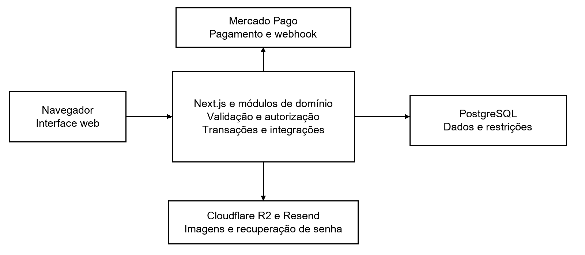

UNIVERSIDADE PAULISTA

BACHARELADO EM CIÊNCIA DA COMPUTAÇÃO

CAIO SCORSONI MARTINS OLIVEIRA

CAIO VINICIUS LUIZ ALVES

GUILHERME DOS SANTOS SALUSTIANO

GUSTAVO HENRIQUE RODRIGUES DE MAGALHÃES

ROBERT ESTEVAN DA SILVA JUNIOR

**AVALIAÇÃO E MELHORIA DA QUALIDADE DE SOFTWARE NA PLATAFORMA KOLÔ**

Atividades Práticas Supervisionadas

7º e 8º semestres

CAMPINAS

2026

```{=openxml}
<w:p><w:r><w:br w:type="page"/></w:r></w:p>
```

CAIO SCORSONI MARTINS OLIVEIRA -- F346EH2 -- CC8Q12

CAIO VINICIUS LUIZ ALVES -- F351041 -- CC8P12

GUILHERME DOS SANTOS SALUSTIANO -- G7661F0 -- CC8P12

GUSTAVO HENRIQUE RODRIGUES DE MAGALHÃES -- F354776 -- CC8P12

ROBERT ESTEVAN DA SILVA JUNIOR -- N8794F6 -- CC8P12

**AVALIAÇÃO E MELHORIA DA QUALIDADE DE SOFTWARE NA PLATAFORMA KOLÔ**

> Trabalho apresentado às Atividades Práticas Supervisionadas do curso de Ciência da Computação da Universidade Paulista, referente ao segundo semestre de 2026, com aplicação ao projeto Kolô Ateliê & Estúdio.
>
> Orientadora do projeto de TCC: Prof.ª Dr.ª Elisa Botta.

CAMPINAS

2026

```{=openxml}
<w:p><w:r><w:br w:type="page"/></w:r></w:p>
```

**RESUMO**

Este trabalho avalia a qualidade da plataforma web Kolô Ateliê & Estúdio, desenvolvida para exposição e comercialização de obras de arte e apoio ao agendamento de tatuagens. O objetivo é relacionar requisitos, processos e evidências técnicas para identificar riscos e propor melhorias verificáveis. Adota-se um estudo aplicado baseado na análise documental da monografia, da especificação do projeto, do código-fonte e dos registros de desenvolvimento. A avaliação considera testes unitários, testes de integração com PostgreSQL, testes de ponta a ponta, auditorias de desempenho e verificações automatizadas de acessibilidade. Os registros do projeto indicam controle transacional de reservas de estoque, tratamento idempotente de notificações de pagamento e melhorias de interface e carregamento de imagens. A mediana documentada do Lighthouse passou de 88 para 97 pontos no catálogo, com redução do LCP de 3,92 para 2,43 segundos. Permanecem limitações relativas à navegação por teclado, à validação no ambiente publicado, à restauração de backups e à consolidação das evidências na mesma revisão do sistema. Os dados apresentados são resultados históricos das fontes consultadas e não representam uma nova execução das suítes. Conclui-se que o projeto reúne mecanismos relevantes de qualidade em ambiente de desenvolvimento e testes, mas a comprovação operacional depende da implantação e de uma rodada final de validação. Propõe-se um plano de melhoria com prioridades, métricas e critérios de aceite.

Palavras-chave: Qualidade de software; Testes de software; Comércio eletrônico; Confiabilidade; Kolô.

**Delimitação desta versão**

Documento elaborado a partir dos arquivos disponíveis na pasta TCC em 26 de outubro de 2026. As atividades e conclusões seguem o tema da APS; os resultados são atribuídos às respectivas fontes. Campos individuais de RA, carga horária e assinatura permanecem sem preenchimento por dependerem de comprovação dos integrantes.

```{=openxml}
<w:p><w:r><w:br w:type="page"/></w:r></w:p>
```

**SUMÁRIO**

```{=openxml}
<w:p><w:r><w:fldChar w:fldCharType="begin" w:dirty="true"/></w:r><w:r><w:instrText xml:space="preserve">TOC \o "1-3" \h \z \u</w:instrText></w:r><w:r><w:fldChar w:fldCharType="separate"/></w:r><w:r><w:t>Clique com o botão direito e escolha Atualizar campo para gerar o sumário.</w:t></w:r><w:r><w:fldChar w:fldCharType="end"/></w:r></w:p>
```

```{=openxml}
<w:p><w:r><w:br w:type="page"/></w:r></w:p>
```

# 1 INTRODUÇÃO

## 1.1 Contexto e escolha do sistema
O Kolô Ateliê & Estúdio reúne comercialização de arte e atendimento para tatuagem em um mesmo empreendimento. A especificação registra um contexto de controle manual de vendas e negociações de agendamento por mensagens. A plataforma web foi escolhida como objeto de avaliação porque concentra regras cujo descumprimento afeta diretamente a operação: venda de peças com estoque reduzido, confirmação de pagamentos, autorização por perfil e conflitos na agenda (Equipe Kolô, 2026a).

O sistema oferece catálogo de obras em duas dimensões, carrinho, checkout integrado ao Mercado Pago, portfólio de tatuagens e um assistente em etapas que prepara uma mensagem para o WhatsApp. O contato pelo assistente não cria uma solicitação persistida nem reserva um horário. O horário é cadastrado posteriormente pelo artista ou administrador. A avaliação respeita esses limites para evitar tratar uma decisão de escopo como defeito.

## 1.2 Problema de avaliação
A presença de funcionalidades e testes não demonstra, por si só, que os requisitos de qualidade foram atendidos na versão entregue. É necessário relacionar cada requisito a um procedimento de verificação, a uma evidência e ao ambiente no qual o resultado foi obtido. A questão que orienta este estudo é: em que medida os mecanismos e resultados documentados do Kolô sustentam sua confiabilidade, eficiência, manutenibilidade e usabilidade, e quais verificações ainda são necessárias?

## 1.3 Justificativa
Uma venda acima do estoque pode exigir estorno e comprometer a confiança do cliente. Uma notificação de pagamento processada duas vezes pode afetar saldos e estoque. Uma barreira de interface pode impedir a conclusão de uma compra. Esses riscos tornam o projeto adequado à aplicação prática do tema da APS e permitem avaliar qualidade por comportamentos observáveis.

## 1.4 Objetivos e escopo
### 1.4.1 Objetivo geral

Avaliar a qualidade da plataforma Kolô a partir de requisitos e evidências do projeto e propor melhorias que possam ser verificadas por métricas, testes e registros de execução.

### 1.4.2 Objetivos específicos

-   Caracterizar o sistema e justificar sua seleção para análise.

-   Relacionar requisitos de qualidade a riscos e procedimentos de avaliação.

-   Definir um plano de qualidade com métricas, ferramentas e critérios de aceite.

-   Analisar os registros de testes funcionais e não funcionais disponíveis.

-   Identificar melhorias já aplicadas e limitações ainda presentes.

-   Propor ações de melhoria priorizadas e critérios para uma nova rodada de avaliação.

-   Documentar o processo e sua contribuição à formação acadêmica.

### 1.4.3 Delimitação do estudo

A análise abrange o repositório tcc-2 e os documentos locais, incluindo a monografia existente. Não foram executados novos testes da aplicação para produzir este relatório. As versões de bibliotecas mencionadas descrevem a configuração local do projeto. O escopo não inclui visualizador 3D, motor automático de horários, API oficial do WhatsApp ou coleta de dados clínicos.

O relatório é um trabalho de APS sobre o sistema desenvolvido no TCC. Por isso, mantém a estrutura exigida no enunciado, mas concentra a discussão em qualidade e melhoria. A monografia é utilizada como fonte de evidências e contexto, sem presumir que todos os resultados históricos descrevam a revisão atual.

# 2 REVISÃO TEÓRICA

## 2.1 Qualidade como requisito verificável
Neste estudo, qualidade é tratada como o atendimento de critérios explícitos sob condições conhecidas. A especificação do Kolô transforma objetivos amplos em requisitos, como evitar estoque negativo, validar entradas no servidor, limitar o LCP das páginas e restringir operações por perfil. A análise utiliza esses contratos como referência de aceite, em vez de formular uma nota geral sem método (Equipe Kolô, 2026a).

A confiabilidade é observada na preservação de invariantes do domínio e no tratamento de falhas e repetições. A eficiência é examinada por tempo de carregamento e pontuação de desempenho. A manutenibilidade é observada pela separação de módulos, tipagem, validações e controles de integração. A usabilidade exige fluxos compreensíveis e verificações de acessibilidade que vão além da inspeção visual.

## 2.2 Verificação e validação no projeto
A verificação compara a implementação com contratos: um cliente não pode administrar obras, e reservas concorrentes não devem ultrapassar o estoque. A validação examina se os fluxos resolvem as necessidades do ateliê. A monografia registra uma sessão com a administradora, realizada com uma versão anterior às correções finais (Oliveira et al., 2026).

Um teste demonstra uma propriedade nas condições do ensaio; o retorno de uma participante descreve sua experiência. Essas evidências se complementam, mas não comprovam, isoladamente, disponibilidade contínua ou melhoria operacional após a publicação.

## 2.3 Níveis de teste
A estratégia combina testes unitários, integração com PostgreSQL e testes de ponta a ponta. Reservas e agenda exigem banco real para avaliar concorrência. Os serviços simulados nos testes de interface limitam o alcance dos resultados.

## 2.4 Concorrência e idempotência

A reserva de estoque é modelada como operação atômica. O código ordena identificadores e bloqueia os registros envolvidos antes de calcular a disponibilidade. O estoque livre considera a quantidade existente e as reservas ativas de outras sessões. O objetivo é evitar que duas compras se apoiem na mesma unidade disponível (Equipe Kolô, 2026d).

No recebimento de pagamentos, idempotência significa que repetir uma notificação não deve repetir o efeito de negócio. A implementação associa a verificação de assinatura à consulta do pagamento no gateway e ao registro de eventos. O resultado do navegador não é usado como prova de quitação. A análise considera a baixa única de estoque e a manutenção de transições válidas como propriedades verificáveis.

## 2.5 Desempenho e acessibilidade

O requisito RNF13 estabelece Lighthouse de pelo menos 90 pontos e LCP inferior a 2,5 segundos no catálogo e na ficha da obra. O LCP representa, para esta avaliação, o instante em que o maior elemento de conteúdo é apresentado. A comparação só é interpretável quando as condições do ensaio são registradas; o projeto informa mediana de três rodadas em simulação móvel de rede 4G (Equipe Kolô, 2026b).

A varredura com axe-core cobre verificações automatizáveis e os testes de largura identificam transbordamento horizontal. O próprio código filtra impactos críticos e sérios e deixa resultados inconclusivos fora desse gate. Por isso, ausência de falhas nesse conjunto não equivale à conformidade integral de acessibilidade. Teclado, foco e avaliação com pessoas permanecem necessários.

## 2.6 Rastreabilidade e melhoria contínua

Rastreabilidade liga requisito, teste, execução e evidência. A contagem da suíte não mede cobertura de código. O ciclo de melhoria adotado consiste em identificar o risco, definir um critério, aplicar a mudança e repetir a medição nas mesmas condições.

# 3 METODOLOGIA

## 3.1 Procedimento e materiais
Foi realizada análise documental aplicada ao projeto. O enunciado da APS define a estrutura e os objetivos acadêmicos; o escopo versão 2.2 fornece os requisitos; o DER e o esquema Prisma descrevem os dados; o código e os testes indicam os mecanismos implementados; os registros da Sprint 2 e a monografia fornecem os resultados históricos. A Sprint 3 contextualiza pendências posteriores à entrega da monografia.

O procedimento consistiu em identificar os fluxos de maior risco, localizar requisitos associados, conferir a presença de implementação e testes, transcrever resultados com atribuição à fonte e propor ações quando faltavam evidências. Divergências entre documentos foram preservadas como limitações de rastreabilidade. A análise da configuração não equivale à execução da ferramenta configurada.

::: {custom-style="Legenda"}
Quadro 1 Fontes e função na avaliação
:::

| **Fonte local**        | **Uso**                                                   |
|------------------------|-----------------------------------------------------------|
| 2026_2\_CC_SI_8.md     | Estrutura e tema da APS                                   |
| docs/ESCOPO-E-STACK.md | RF01 a RF32, RNF01 a RNF24 e regras RN01 a RN12           |
| docs/tcc-2.docx        | Contexto, autoria e resultados consolidados na monografia |
| docs/Sprint-2.md       | Resultados de testes, correções e pendências por entrega  |
| src/ e tests/          | Inspeção de mecanismos e casos de teste presentes         |
| docs/SPRINT-3.md       | Pendências de reprodução dos dados de demonstração        |

::: {custom-style="Legenda"}
Fonte Elaborado a partir dos arquivos locais do projeto em 26 out. 2026.
:::

## 3.2 Critérios de classificação
As evidências são classificadas como resultado histórico documentado, mecanismo inspecionado ou verificação pendente. Uma proposta é explicitamente apresentada como ação futura. Não se atribuem datas de execução, métricas de cobertura, aprovação do cliente ou resultados de produção ausentes nas fontes.

## 3.3 Plano de qualidade e métricas
::: {custom-style="Legenda"}
Quadro 2 Plano de avaliação por atributo
:::

| **Atributo e requisito**   | **Métrica ou condição de aceite**                                 | **Procedimento**                               |
|----------------------------|-------------------------------------------------------------------|------------------------------------------------|
| Confiabilidade RN02 a RN04 | Soma reservada não ultrapassa o estoque em todas as disputas      | Integração PostgreSQL com sessões concorrentes |
| Pagamento RN05 e RNF11     | Aviso inválido recusado; repetição sem nova baixa                 | Webhook assinado e reenvios concorrentes       |
| Autorização RF06 e RN10    | Operação de outro perfil ou proprietário recusada                 | Testes de integração e restrições E2E          |
| Eficiência RNF13           | Lighthouse ≥ 90 e LCP \< 2,5 s em ambas as páginas                | Mediana de três rodadas nas mesmas condições   |
| Responsividade RNF20       | Sem rolagem horizontal em 320, 768, 1440 e 1920 px                | Playwright com registro da rota e captura      |
| Acessibilidade RNF21       | Sem violações críticas/sérias no gate; teclado e foco verificados | axe-core e roteiro manual por tarefa           |
| Manutenibilidade RNF22     | Lint, tipos e testes sem falhas na revisão avaliada               | CI com identificação da revisão e artefatos    |
| Operação RNF15 e RNF16     | Reinício verificado e restauração documentada                     | Ensaio no ambiente publicado e cópia isolada   |

::: {custom-style="Legenda"}
Fonte Requisitos de Equipe Kolô (2026a). Critérios operacionais organizados para esta avaliação.
:::

Para uma nova rodada, cada execução deve registrar revisão do código, data, ambiente, comando, resultado e localização do artefato. As metas de LCP e Lighthouse vêm do projeto. A exigência de registro unificado é uma proposta deste estudo para permitir comparação entre rodadas e evitar a combinação de números de versões diferentes.

## 3.4 Roteiro de testes funcionais e não funcionais
::: {custom-style="Legenda"}
Quadro 3 Casos prioritários para reexecução
:::

| **Caso**       | **Entrada ou ação**                                               | **Resultado esperado**                                         |
|----------------|-------------------------------------------------------------------|----------------------------------------------------------------|
| T01 Reserva    | Duas ou mais sessões disputam uma peça de estoque 1               | Só a quantidade disponível é reservada; sem estoque negativo   |
| T02 Webhook    | Assinatura inválida e depois dois avisos válidos iguais           | Inválido recusado; efeito de negócio aplicado uma vez          |
| T03 Perfil     | Cliente tenta ação administrativa; artista altera outro portfólio | Operações recusadas no servidor                                |
| T04 Agenda     | Duas inserções simultâneas sobrepostas do mesmo artista           | Só um horário é aceito                                         |
| T05 Assistente | Avançar sem aceite e depois completar todos os passos             | Conclusão bloqueada até aceites; link correto sem persistência |
| T06 Conta      | Excluir conta que tem pedido pago                                 | Dados pessoais tratados conforme contrato; pedido preservado   |
| T07 Interface  | Percorrer compra e assistente por teclado em tela estreita        | Foco visível, sequência coerente e ações alcançáveis           |
| T08 Relatório  | Período que cruza meia-noite em São Paulo e pedido estornado      | Totais coerentes com período e situação do pedido              |

::: {custom-style="Legenda"}
Fonte Elaborado a partir de RF06, RF12 a RF25, RF32 e RN01 a RN12.
:::

## 3.5 Repetibilidade
Os scripts disponíveis incluem npm test, npm run test:integration e npm run test:e2e, além de lint, typecheck e build. As suítes com banco utilizam ambientes de teste. A reprodução exige dependências, migrações e dados apropriados; a Sprint 3 registra que o povoamento dos dados de demonstração ainda precisa ser consolidado. Nenhum segredo ou arquivo de ambiente foi incorporado a este documento.

# 4 DESENVOLVIMENTO

## 4.1 Sistema e arquitetura observados
A implementação segue um monólito modular com Next.js, React e TypeScript. PostgreSQL e Prisma sustentam persistência e migrações. Os módulos de domínio incluem identidade, catálogo, mídia, pedidos, pagamentos, agenda, portfólio, clientes e relatórios. A separação permite localizar regras e testar contratos por domínio. Essa estrutura é observável no repositório; a infraestrutura pública descrita no escopo deve ser tratada como planejada enquanto não houver comprovação de implantação.

::: {custom-style="Legenda"}
Figura 1 Relações principais da arquitetura avaliada
:::

{width="6.299212598425197in" height="2.7559055118110236in"}

::: {custom-style="Legenda"}
Fonte Elaborado a partir do código e do escopo. O diagrama não comprova implantação pública.
:::

## 4.2 Modelo de dados e invariantes
No comércio, artwork se relaciona a artwork_reservation, cart_item e order_item; order reúne itens e pagamentos. Na agenda, appointment vincula artista, intervalo e contato. As contas e sessões sustentam a identificação e o controle de acesso. O modelo utiliza valores monetários inteiros em centavos e datas armazenadas em UTC. O DER completo e o esquema estão identificados no Apêndice A.

## 4.3 Resultados de confiabilidade e testes
A monografia registra um experimento com dez rodadas de oito sessões concorrentes, cada rodada disputando uma obra de estoque unitário. Em cada rodada, uma reserva foi concedida e sete foram recusadas. O total foi de 80 tentativas, com dez reservas concedidas para dez disputas independentes. O resultado sustenta a propriedade de não exceder o estoque nesse cenário, mas não mede latência e não exercita carrinhos com várias obras (Oliveira et al., 2026).

::: {custom-style="Legenda"}
Tabela 1 Síntese do experimento de concorrência registrado
:::

| **Condição**                   | **Resultado documentado**       |
|--------------------------------|---------------------------------|
| Rodadas e sessões              | 10 rodadas × 8 sessões          |
| Estoque em cada disputa        | 1 unidade                       |
| Reservas concedidas por rodada | 1                               |
| Reservas recusadas por rodada  | 7                               |
| Total de tentativas            | 80                              |
| Violação do limite de estoque  | Nenhuma no experimento descrito |

::: {custom-style="Legenda"}
Fonte Oliveira et al. (2026), seção 5.3. Experimento histórico, sem nova execução nesta análise.
:::

Os testes presentes incluem reserva concorrente, agenda sobreposta e processamento simultâneo de avisos de pagamento. A inspeção confirma a existência desses casos e dos mecanismos correspondentes; a aprovação atual depende da execução na revisão avaliada. A monografia informa 562 testes unitários, 276 de integração e 43 de ponta a ponta. Também observa que as contagens de integração e E2E antecedem o relatório de vendas.

A Sprint 2, no fechamento da qualidade integrada, registra 532 testes unitários, 276 de integração e 43 E2E. A diferença entre 532 e 562 não foi tratada como erro aritmético nem somada entre documentos: as contagens pertencem a registros de momentos distintos. A ação recomendada é produzir um relatório unificado da revisão final, com contagem, aprovação e artefatos de cada suíte.

## 4.4 Desempenho e melhorias já registradas
O catálogo não atingia inicialmente o requisito de desempenho: o registro informa 88 pontos e LCP de 3,92 s. A equipe identificou disputa de banda entre imagens da primeira linha carregadas antecipadamente. A correção manteve prioridade elevada somente na primeira imagem. Depois da alteração, a mediana de três rodadas foi de 97 pontos e LCP de 2,43 s (Equipe Kolô, 2026b).

::: {custom-style="Legenda"}
Tabela 2 Comparação de desempenho documentada
:::

| **Indicador**         | **Catálogo antes** | **Catálogo depois** | **Ficha da obra** |
|-----------------------|--------------------|---------------------|-------------------|
| Lighthouse desempenho | 88                 | 97                  | 98                |
| LCP                   | 3,92 s             | 2,43 s              | 2,25 s            |
| FCP                   | 0,77 s             | 0,78 s              | 0,78 s            |
| TBT                   | 116 ms             | 73 ms               | 83 ms             |
| CLS                   | 0                  | 0                   | 0                 |

::: {custom-style="Legenda"}
Fonte Equipe Kolô (2026b), PBI 45. Medianas de três rodadas, móvel e 4G simulado.
:::

A redução calculada de LCP no catálogo é de aproximadamente 38,0%, obtida pela diferença entre 3,92 e 2,43 dividida por 3,92. O aumento foi de nove pontos na pontuação de desempenho. Esse cálculo descreve a comparação registrada e não uma nova medição.

A margem até o limite de 2,5 s é de apenas 0,07 s no catálogo. Assim, o atendimento local do requisito não garante o mesmo resultado na VPS ou sob outra rede. Recomenda-se repetir as rodadas após a publicação e conservar os relatórios originais. A pontuação da ficha da obra demonstra uma segunda página avaliada, mas não fornece uma comparação antes e depois para ela.

### 4.4.1 Interface observada
O catálogo é um dos pontos de entrada do fluxo de compra e uma das páginas avaliadas pelo requisito RNF13. A imagem documenta a organização visual da interface disponível nos arquivos do projeto. Sua presença não representa uma execução de teste.

::: {custom-style="Legenda"}
Figura 2 Catálogo de obras do projeto
:::

{width="6.299212598425197in" height="4.921259842519685in"}

::: {custom-style="Legenda"}
Fonte Captura já disponível em docs/telas/atelie. Imagem ilustrativa da interface, sem nova auditoria.
:::

## 4.5 Acessibilidade e segurança
A Sprint 2 registra varredura de 35 telas nas larguras de 320, 768, 1440 e 1920 px. O axe-core é executado em 320 e 1440 px. A documentação descreve correções em nomes acessíveis de botões de ordenação no portfólio e quebra de texto em ações do pedido administrativo. O fechamento informa lista de exceções vazia no conjunto verificado. A revisão também identificou alvo de toque de 44 px, corrigido para pelo menos 48 px e acompanhado de teste.

O resultado é parcial em relação ao RNF21: teclado e foco permaneceram pendentes. A varredura verifica regras automáticas e os impactos selecionados, sem garantir a experiência de usuários com deficiência. A inspeção do teste confirma que resultados inconclusivos não entram no gate. Esse limite deve acompanhar qualquer afirmação sobre acessibilidade.

::: {custom-style="Legenda"}
Quadro 4 Evidências históricas de segurança e seus limites
:::

| **Controle**          | **Evidência registrada**                               | **Limite**                                           |
|-----------------------|--------------------------------------------------------|------------------------------------------------------|
| Assinatura de webhook | Aviso sem assinatura recebe HTTP 401                   | Revalidar com o gateway pelo endereço publicado      |
| Permissões            | Ação administrativa repetida por cliente foi recusada  | Não substitui revisão de todas as operações          |
| CSRF e entradas       | Origem externa recusada; entrada inválida rejeitada    | Roteiro aplicado ao ambiente local de testes         |
| Dependências          | Audit com zero vulnerabilidades no fechamento de 18/10 | Resultado histórico; requer nova consulta na entrega |
| Cabeçalhos e CSP      | Nonce por requisição e cabeçalhos inspecionados        | Nota pública e HTTPS dependem da implantação         |

::: {custom-style="Legenda"}
Fonte Equipe Kolô (2026b), PBI 45. Nenhuma nova varredura de segurança foi executada neste relatório.
:::

A ausência de anamnese no esquema é coerente com o escopo de minimização de dados do projeto. Isso não é apresentado como certificação de conformidade jurídica. A análise limita-se aos contratos e à estrutura de dados inspecionados.

## 4.6 Análise crítica e plano de melhoria
As melhorias já registradas atacam falhas concretas de desempenho, nomes acessíveis, transbordamento e tamanho de botões. O próximo ciclo deve concentrar-se em lacunas de evidência e operação, antes de ampliar funcionalidades. A priorização abaixo é uma proposta desta avaliação; não representa trabalho já executado nem atribuição individual acordada.

::: {custom-style="Legenda"}
Quadro 5 Melhorias propostas e critérios de encerramento
:::

| **Prioridade e ação**                 | **Justificativa**                                 | **Critério de aceite**                                                                      |
|---------------------------------------|---------------------------------------------------|---------------------------------------------------------------------------------------------|
| Alta Consolidar execução final        | Contagens e resultados são de momentos diferentes | Mesma revisão com lint, tipos, build e três suítes; artefatos e falhas registrados          |
| Alta Teclado e foco                   | RNF21 permanece parcialmente verificado           | Compra, login, assistente e admin percorridos sem mouse; foco e ordem documentados          |
| Alta Homologar integrações publicadas | Dublês E2E não substituem Mercado Pago e R2 reais | Compra sandbox pela URL pública e upload real com miniatura e exibição                      |
| Alta Restaurar backup                 | Plano de operação ainda carece de comprovação     | Dump restaurado em ambiente isolado; integridade e tempo registrados                        |
| Média Ampliar concorrência            | Experimento usa apenas uma obra por disputa       | Carrinhos multiobra, repetição concorrente e fronteiras de expiração sem violar invariantes |
| Média Repetir desempenho na VPS       | Catálogo tem margem local de apenas 70 ms         | Três rodadas comparáveis por página; LCP \< 2,5 s e nota ≥ 90                               |
| Média Reproduzir dados de demo        | Sprint 3 registra povoamento incompleto           | Clone limpo executa migração e seed e apresenta catálogo e portfólio com imagens            |

::: {custom-style="Legenda"}
Fonte Propostas elaboradas com base nas pendências das Sprints 2 e 3 e na monografia.
:::

## 4.7 Registro e acompanhamento das melhorias
Cada ação deve gerar um registro com problema observado, requisito afetado, alteração, teste que demonstra o defeito, teste após a correção e evidência final. A versão da aplicação precisa ser identificada para que a comparação tenha significado. Em caso de falha, preserva-se o resultado e abre-se nova tarefa; a tentativa posterior não deve apagar o histórico.

::: {custom-style="Legenda"}
Quadro 6 Modelo de registro para o próximo ciclo
:::

| **Campo**        | **Conteúdo a registrar**                                |
|------------------|---------------------------------------------------------|
| Identificação    | Requisito, caso de teste, revisão e ambiente            |
| Situação inicial | Comportamento observado e evidência da falha            |
| Ação             | Mudança realizada e responsável efetivo                 |
| Verificação      | Comando ou roteiro, data, amostra e resultado           |
| Comparação       | Métrica anterior e posterior sob condições equivalentes |
| Encerramento     | Artefato, revisão por outro integrante e pendências     |

::: {custom-style="Legenda"}
Fonte Modelo proposto nesta avaliação. Não preenchido com execuções fictícias.
:::

## 4.8 Manutenibilidade e código completo
A tipagem estrita, as validações por esquema, os módulos com APIs públicas e a integração contínua compõem o processo de manutenção definido no repositório. A presença desses controles facilita detectar regressões, mas não fornece, por si só, uma métrica de esforço de manutenção. Não foram inventados índices de complexidade, cobertura de código ou tempo médio de correção.

A codificação completa permanece no repositório do projeto, identificado no Apêndice A por endereço e revisão. Este documento apresenta a arquitetura, o modelo de avaliação e um trecho integral representativo do controle de assinatura. A consulta ou entrega do código completo deve usar o repositório identificado; este arquivo Word não contém a transcrição de todos os arquivos do sistema.

A monografia e a Sprint 2 registram avanços de qualidade em desenvolvimento e testes. A inspeção desta versão também encontra relatórios administrativos já implementados, embora o briefing mais antigo os listasse como adiados. Para essa funcionalidade, prevalecem a atualização do RF32 no escopo, o PBI 48 e o módulo reports presente no código.

# 5 CONCLUSÕES E RECOMENDAÇÕES

A avaliação indica que a plataforma Kolô possui mecanismos de qualidade alinhados aos riscos do domínio e evidências históricas relevantes de testes. O controle de reserva busca impedir a venda além do estoque; o processamento de pagamento verifica autenticidade e repetição; as verificações de interface e desempenho levaram a correções documentadas. O catálogo atingiu as metas registradas após a priorização do carregamento de imagens.

O objetivo deste trabalho foi atendido por meio da seleção e caracterização do sistema, organização dos requisitos de qualidade, definição de métricas, análise de resultados disponíveis e proposição de melhorias com critérios verificáveis. O alcance dessa conclusão é documental e restrito aos ambientes descritos nas fontes. Não houve reexecução das suítes nem comprovação de qualidade em produção nesta análise.

As limitações centrais são a ausência de uma rodada consolidada da revisão final, a verificação pendente de teclado e foco e a necessidade de comprovar integrações, disponibilidade e restauração no ambiente publicado. O retorno qualitativo da administradora registrado na monografia é relevante, mas não permite generalizar usabilidade nem calcular redução de tempo de atendimento.

Recomenda-se executar primeiro as ações de prioridade alta do plano de melhoria e manter os resultados vinculados à mesma revisão. A ampliação dos testes de concorrência, o povoamento reproduzível da demonstração e a medição pública de desempenho devem acompanhar o fechamento. Novas funcionalidades podem ser reavaliadas após a consolidação dessas evidências.

Na formação acadêmica, o caso permite relacionar engenharia de requisitos, banco de dados, testes, segurança e experiência de uso a problemas concretos. O aprendizado central é que qualidade exige critérios observáveis e comunicação precisa dos limites: um resultado local aprovado constitui evidência útil, mas sua validade deve permanecer ligada ao cenário em que foi obtido.

# REFERÊNCIAS

BIBLIOTECA DA UNIVERSIDADE PAULISTA. Guia de normalização para apresentação de trabalhos acadêmicos da Universidade Paulista: ABNT. São Paulo: UNIP, 2025. Disponível em: https://www.unip.br/servicos/biblioteca/assets/download/manual_de_normalizacao_abnt.pdf. Acesso em: 26 out. 2026.

EQUIPE KOLÔ. Escopo e Stack do projeto Kolô. Versão 2.2, atualização de 18 out. 2026. 2026a. Documento técnico local: tcc-2/docs/ESCOPO-E-STACK.md.

EQUIPE KOLÔ. Sprint 2. 2026b. Registro técnico local: tcc-2/docs/Sprint-2.md. Seções dos PBIs 45 a 48.

EQUIPE KOLÔ. Sprint 3 Pós entrega da monografia. 2026c. Registro técnico local: tcc-2/docs/SPRINT-3.md.

EQUIPE KOLÔ. Código-fonte da plataforma Kolô. 2026d. Revisão a94ad02bc90bf4945ded28b7c1b70960abc71b90. Disponível no repositório: https://github.com/caioalves19/tcc-2/tree/a94ad02bc90bf4945ded28b7c1b70960abc71b90. Cópia local consultada em: 26 out. 2026.

EQUIPE KOLÔ. Diagrama Entidade Relacionamento. 2026e. Documento técnico local: tcc-2/docs/DER.md.

OLIVEIRA, Caio Scorsoni Martins et al. Sistema web para ateliê e estúdio de tatuagem. Campinas: Universidade Paulista, 2026. Trabalho de Conclusão de Curso. Documento local: tcc-2/docs/tcc-2.docx.

UNIVERSIDADE PAULISTA. Avaliação E Melhoria Da Qualidade Em Sistemas De Software. APS Atividades Práticas Supervisionadas, 7º e 8º semestre, 2026/2. Campinas, 2026. Enunciado local convertido em 2026_2\_CC_SI_8.md.

# APÊNDICE A IDENTIFICAÇÃO DO CÓDIGO E DAS EVIDÊNCIAS

Repositório de origem: https://github.com/caioalves19/tcc-2. Revisão local inspecionada: a94ad02bc90bf4945ded28b7c1b70960abc71b90. O estado de trabalho estava sem alterações locais no momento da identificação. O endereço é derivado da configuração local; não foi verificada a disponibilidade externa do repositório.

Consulta da codificação completa na revisão: https://github.com/caioalves19/tcc-2/tree/a94ad02bc90bf4945ded28b7c1b70960abc71b90

::: {custom-style="Legenda"}
Quadro 7 Localização dos materiais para conferência
:::

| **Material**           | **Caminho relativo a tcc-2**              |
|------------------------|-------------------------------------------|
| Implementação          | src/                                      |
| Esquema e migrações    | prisma/schema.prisma e prisma/migrations/ |
| Testes unitários       | tests/unit/                               |
| Testes de integração   | tests/integration/                        |
| Fluxos E2E e varredura | tests/e2e/                                |
| Pipeline de integração | .github/workflows/ci.yml                  |
| Regras e arquitetura   | docs/ESCOPO-E-STACK.md e docs/DER.md      |
| Resultados históricos  | docs/Sprint-2.md e docs/tcc-2.docx        |
| Pendências posteriores | docs/SPRINT-3.md                          |

::: {custom-style="Legenda"}
Fonte Inventário dos caminhos presentes na cópia local consultada.
:::

Para entrega acadêmica, o código completo deve acompanhar o documento por acesso ao repositório ou por exportação da mesma revisão, conforme o procedimento adotado pela disciplina. Arquivos com credenciais, dependências instaladas e bancos de desenvolvimento não integram esse material. As fichas a seguir registram apenas identificação: carga horária e participação individual precisam ser preenchidas e conferidas pelos responsáveis.

# APÊNDICE B CONTROLE DE ASSINATURA DO WEBHOOK

Listagem integral do arquivo src/modules/payments/assinatura.ts na revisão identificada. O trecho mostra o uso do validador do SDK e o tratamento de recusa. A idempotência e as alterações transacionais pertencem a outros arquivos do módulo e devem ser consultadas no código completo.

import { InvalidWebhookSignatureError, WebhookSignatureValidator } from \"mercadopago\";

export type DadosAssinatura = {

assinatura: string \| null;

idRequisicao: string \| null;

idDado: string \| null;

segredo: string;

};

// RNF11: só processa a notificação que o Mercado Pago assinou (HMAC-SHA256 de id, request-id e

// ts com o segredo do webhook). O validador oficial do SDK compara em tempo constante.

export function assinaturaValida(dados: DadosAssinatura): boolean {

try {

WebhookSignatureValidator.validate({

xSignature: dados.assinatura,

xRequestId: dados.idRequisicao,

dataId: dados.idDado,

secret: dados.segredo,

});

return true;

} catch (erro) {

// O motivo e o x-request-id localizam o aviso no painel do Mercado Pago; nunca o segredo.

console.warn(

\"Assinatura do webhook recusada\",

erro instanceof InvalidWebhookSignatureError ? erro.reason : \"erro desconhecido\",

dados.idRequisicao,

);

return false;

}

}

::: {custom-style="Legenda"}
Fonte Equipe Kolô (2026d). Código transcrito da cópia local, sem alteração de comportamento.
:::

# ANEXO A FICHA INDIVIDUAL DE ATIVIDADES

FICHA DAS ATIVIDADES PRÁTICAS SUPERVISIONADAS

Nome: Caio Scorsoni Martins Oliveira

Curso: Ciência da Computação Campus: \_\_\_\_\_\_\_\_\_\_\_\_\_\_\_\_\_\_

RA: \_\_\_\_\_\_\_\_\_\_\_\_\_\_\_\_\_\_ Turma: \_\_\_\_\_\_\_\_\_\_\_\_\_\_\_\_\_\_

Semestre: \_\_\_\_\_\_\_\_\_\_ Turno: \_\_\_\_\_\_\_\_\_\_ Ano grade: \_\_\_\_\_\_\_\_\_\_

Código da atividade: \_\_\_\_\_\_\_\_\_\_\_\_\_\_\_\_\_\_

Trabalho: Avaliação e melhoria da qualidade de software na plataforma Kolô

Registro de atividades efetivamente realizadas

| **Data** | **Descrição da atividade** | **Total de horas** | **Assinatura do aluno** | **Horas atribuídas** | **Assinatura do professor** |
|----------|----------------------------|--------------------|-------------------------|----------------------|-----------------------------|
|          |                            |                    |                         |                      |                             |
|          |                            |                    |                         |                      |                             |
|          |                            |                    |                         |                      |                             |
|          |                            |                    |                         |                      |                             |
|          |                            |                    |                         |                      |                             |
|          |                            |                    |                         |                      |                             |
|          |                            |                    |                         |                      |                             |
|          |                            |                    |                         |                      |                             |

Horas atribuídas de acordo com o regulamento das Atividades Práticas Supervisionadas do curso.

Total de horas atribuídas: \_\_\_\_\_\_\_\_\_\_\_\_\_\_\_\_\_\_

Avaliação: \_\_\_\_\_\_\_\_\_\_\_\_\_\_\_\_\_\_ Aprovado ou reprovado: \_\_\_\_\_\_\_\_\_\_\_\_\_\_\_\_\_\_

Nota: \_\_\_\_\_\_\_\_\_\_ Data: \_\_\_\_ / \_\_\_\_ / \_\_\_\_\_\_\_\_

Carimbo e assinatura do coordenador do curso:

\_\_\_\_\_\_\_\_\_\_\_\_\_\_\_\_\_\_\_\_\_\_\_\_\_\_\_\_\_\_\_\_\_\_\_\_\_\_\_\_\_\_\_\_\_\_\_\_\_\_\_\_\_\_\_\_\_\_\_\_

Ficha adaptada do modelo fornecido no enunciado. Preenchimento e validação pelos responsáveis.

# ANEXO B FICHA INDIVIDUAL DE ATIVIDADES

FICHA DAS ATIVIDADES PRÁTICAS SUPERVISIONADAS

Nome: Caio Vinicius Luiz Alves

Curso: Ciência da Computação Campus: \_\_\_\_\_\_\_\_\_\_\_\_\_\_\_\_\_\_

RA: \_\_\_\_\_\_\_\_\_\_\_\_\_\_\_\_\_\_ Turma: \_\_\_\_\_\_\_\_\_\_\_\_\_\_\_\_\_\_

Semestre: \_\_\_\_\_\_\_\_\_\_ Turno: \_\_\_\_\_\_\_\_\_\_ Ano grade: \_\_\_\_\_\_\_\_\_\_

Código da atividade: \_\_\_\_\_\_\_\_\_\_\_\_\_\_\_\_\_\_

Trabalho: Avaliação e melhoria da qualidade de software na plataforma Kolô

Registro de atividades efetivamente realizadas

| **Data** | **Descrição da atividade** | **Total de horas** | **Assinatura do aluno** | **Horas atribuídas** | **Assinatura do professor** |
|----------|----------------------------|--------------------|-------------------------|----------------------|-----------------------------|
|          |                            |                    |                         |                      |                             |
|          |                            |                    |                         |                      |                             |
|          |                            |                    |                         |                      |                             |
|          |                            |                    |                         |                      |                             |
|          |                            |                    |                         |                      |                             |
|          |                            |                    |                         |                      |                             |
|          |                            |                    |                         |                      |                             |
|          |                            |                    |                         |                      |                             |

Horas atribuídas de acordo com o regulamento das Atividades Práticas Supervisionadas do curso.

Total de horas atribuídas: \_\_\_\_\_\_\_\_\_\_\_\_\_\_\_\_\_\_

Avaliação: \_\_\_\_\_\_\_\_\_\_\_\_\_\_\_\_\_\_ Aprovado ou reprovado: \_\_\_\_\_\_\_\_\_\_\_\_\_\_\_\_\_\_

Nota: \_\_\_\_\_\_\_\_\_\_ Data: \_\_\_\_ / \_\_\_\_ / \_\_\_\_\_\_\_\_

Carimbo e assinatura do coordenador do curso:

\_\_\_\_\_\_\_\_\_\_\_\_\_\_\_\_\_\_\_\_\_\_\_\_\_\_\_\_\_\_\_\_\_\_\_\_\_\_\_\_\_\_\_\_\_\_\_\_\_\_\_\_\_\_\_\_\_\_\_\_

Ficha adaptada do modelo fornecido no enunciado. Preenchimento e validação pelos responsáveis.

# ANEXO C FICHA INDIVIDUAL DE ATIVIDADES

FICHA DAS ATIVIDADES PRÁTICAS SUPERVISIONADAS

Nome: Guilherme dos Santos Salustiano

Curso: Ciência da Computação Campus: \_\_\_\_\_\_\_\_\_\_\_\_\_\_\_\_\_\_

RA: \_\_\_\_\_\_\_\_\_\_\_\_\_\_\_\_\_\_ Turma: \_\_\_\_\_\_\_\_\_\_\_\_\_\_\_\_\_\_

Semestre: \_\_\_\_\_\_\_\_\_\_ Turno: \_\_\_\_\_\_\_\_\_\_ Ano grade: \_\_\_\_\_\_\_\_\_\_

Código da atividade: \_\_\_\_\_\_\_\_\_\_\_\_\_\_\_\_\_\_

Trabalho: Avaliação e melhoria da qualidade de software na plataforma Kolô

Registro de atividades efetivamente realizadas

| **Data** | **Descrição da atividade** | **Total de horas** | **Assinatura do aluno** | **Horas atribuídas** | **Assinatura do professor** |
|----------|----------------------------|--------------------|-------------------------|----------------------|-----------------------------|
|          |                            |                    |                         |                      |                             |
|          |                            |                    |                         |                      |                             |
|          |                            |                    |                         |                      |                             |
|          |                            |                    |                         |                      |                             |
|          |                            |                    |                         |                      |                             |
|          |                            |                    |                         |                      |                             |
|          |                            |                    |                         |                      |                             |
|          |                            |                    |                         |                      |                             |

Horas atribuídas de acordo com o regulamento das Atividades Práticas Supervisionadas do curso.

Total de horas atribuídas: \_\_\_\_\_\_\_\_\_\_\_\_\_\_\_\_\_\_

Avaliação: \_\_\_\_\_\_\_\_\_\_\_\_\_\_\_\_\_\_ Aprovado ou reprovado: \_\_\_\_\_\_\_\_\_\_\_\_\_\_\_\_\_\_

Nota: \_\_\_\_\_\_\_\_\_\_ Data: \_\_\_\_ / \_\_\_\_ / \_\_\_\_\_\_\_\_

Carimbo e assinatura do coordenador do curso:

\_\_\_\_\_\_\_\_\_\_\_\_\_\_\_\_\_\_\_\_\_\_\_\_\_\_\_\_\_\_\_\_\_\_\_\_\_\_\_\_\_\_\_\_\_\_\_\_\_\_\_\_\_\_\_\_\_\_\_\_

Ficha adaptada do modelo fornecido no enunciado. Preenchimento e validação pelos responsáveis.

# ANEXO D FICHA INDIVIDUAL DE ATIVIDADES

FICHA DAS ATIVIDADES PRÁTICAS SUPERVISIONADAS

Nome: Gustavo Henrique Rodrigues de Magalhães

Curso: Ciência da Computação Campus: \_\_\_\_\_\_\_\_\_\_\_\_\_\_\_\_\_\_

RA: \_\_\_\_\_\_\_\_\_\_\_\_\_\_\_\_\_\_ Turma: \_\_\_\_\_\_\_\_\_\_\_\_\_\_\_\_\_\_

Semestre: \_\_\_\_\_\_\_\_\_\_ Turno: \_\_\_\_\_\_\_\_\_\_ Ano grade: \_\_\_\_\_\_\_\_\_\_

Código da atividade: \_\_\_\_\_\_\_\_\_\_\_\_\_\_\_\_\_\_

Trabalho: Avaliação e melhoria da qualidade de software na plataforma Kolô

Registro de atividades efetivamente realizadas

| **Data** | **Descrição da atividade** | **Total de horas** | **Assinatura do aluno** | **Horas atribuídas** | **Assinatura do professor** |
|----------|----------------------------|--------------------|-------------------------|----------------------|-----------------------------|
|          |                            |                    |                         |                      |                             |
|          |                            |                    |                         |                      |                             |
|          |                            |                    |                         |                      |                             |
|          |                            |                    |                         |                      |                             |
|          |                            |                    |                         |                      |                             |
|          |                            |                    |                         |                      |                             |
|          |                            |                    |                         |                      |                             |
|          |                            |                    |                         |                      |                             |

Horas atribuídas de acordo com o regulamento das Atividades Práticas Supervisionadas do curso.

Total de horas atribuídas: \_\_\_\_\_\_\_\_\_\_\_\_\_\_\_\_\_\_

Avaliação: \_\_\_\_\_\_\_\_\_\_\_\_\_\_\_\_\_\_ Aprovado ou reprovado: \_\_\_\_\_\_\_\_\_\_\_\_\_\_\_\_\_\_

Nota: \_\_\_\_\_\_\_\_\_\_ Data: \_\_\_\_ / \_\_\_\_ / \_\_\_\_\_\_\_\_

Carimbo e assinatura do coordenador do curso:

\_\_\_\_\_\_\_\_\_\_\_\_\_\_\_\_\_\_\_\_\_\_\_\_\_\_\_\_\_\_\_\_\_\_\_\_\_\_\_\_\_\_\_\_\_\_\_\_\_\_\_\_\_\_\_\_\_\_\_\_

Ficha adaptada do modelo fornecido no enunciado. Preenchimento e validação pelos responsáveis.

# ANEXO E FICHA INDIVIDUAL DE ATIVIDADES

FICHA DAS ATIVIDADES PRÁTICAS SUPERVISIONADAS

Nome: Robert Estevan da Silva Junior

Curso: Ciência da Computação Campus: \_\_\_\_\_\_\_\_\_\_\_\_\_\_\_\_\_\_

RA: \_\_\_\_\_\_\_\_\_\_\_\_\_\_\_\_\_\_ Turma: \_\_\_\_\_\_\_\_\_\_\_\_\_\_\_\_\_\_

Semestre: \_\_\_\_\_\_\_\_\_\_ Turno: \_\_\_\_\_\_\_\_\_\_ Ano grade: \_\_\_\_\_\_\_\_\_\_

Código da atividade: \_\_\_\_\_\_\_\_\_\_\_\_\_\_\_\_\_\_

Trabalho: Avaliação e melhoria da qualidade de software na plataforma Kolô

Registro de atividades efetivamente realizadas

| **Data** | **Descrição da atividade** | **Total de horas** | **Assinatura do aluno** | **Horas atribuídas** | **Assinatura do professor** |
|----------|----------------------------|--------------------|-------------------------|----------------------|-----------------------------|
|          |                            |                    |                         |                      |                             |
|          |                            |                    |                         |                      |                             |
|          |                            |                    |                         |                      |                             |
|          |                            |                    |                         |                      |                             |
|          |                            |                    |                         |                      |                             |
|          |                            |                    |                         |                      |                             |
|          |                            |                    |                         |                      |                             |
|          |                            |                    |                         |                      |                             |

Horas atribuídas de acordo com o regulamento das Atividades Práticas Supervisionadas do curso.

Total de horas atribuídas: \_\_\_\_\_\_\_\_\_\_\_\_\_\_\_\_\_\_

Avaliação: \_\_\_\_\_\_\_\_\_\_\_\_\_\_\_\_\_\_ Aprovado ou reprovado: \_\_\_\_\_\_\_\_\_\_\_\_\_\_\_\_\_\_

Nota: \_\_\_\_\_\_\_\_\_\_ Data: \_\_\_\_ / \_\_\_\_ / \_\_\_\_\_\_\_\_

Carimbo e assinatura do coordenador do curso:

\_\_\_\_\_\_\_\_\_\_\_\_\_\_\_\_\_\_\_\_\_\_\_\_\_\_\_\_\_\_\_\_\_\_\_\_\_\_\_\_\_\_\_\_\_\_\_\_\_\_\_\_\_\_\_\_\_\_\_\_

Ficha adaptada do modelo fornecido no enunciado. Preenchimento e validação pelos responsáveis.
